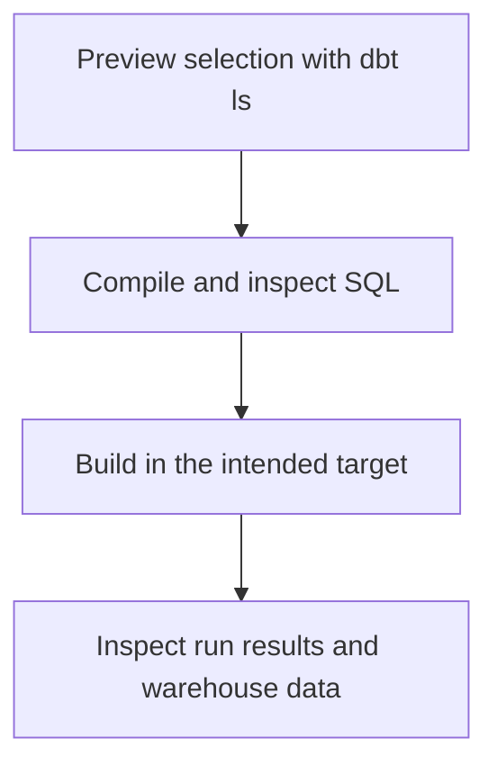

# dbt command and syntax cheatsheet

For the DuckDB lab, append `--profiles-dir .` to commands that need its project-local profile.

| Task | Command |
| --- | --- |
| Check the active dbt binary | `dbt --version` |
| Check profile and connection | `dbt debug` |
| Install project packages | `dbt deps` |
| Parse resources and build the manifest | `dbt parse` |
| List a selection before building | `dbt ls --select +fct_orders` |
| Render model SQL | `dbt compile --select fct_orders` |
| Preview query output | `dbt show --select fct_orders` |
| Build selected resources and run their tests in DAG order | `dbt build --select +fct_orders` |
| Run only models | `dbt run --select fct_orders` |
| Load a lookup CSV | `dbt seed --select order_statuses` |
| Record changes to mutable data | `dbt snapshot --select order_history` |
| Run unit tests for staging | `dbt test --select stg_orders,test_type:unit` |
| Check an upstream timestamp | `dbt source freshness --select source:shop.incoming_orders` |
| Generate project documentation artifacts | `dbt docs generate` |
| Compare code changes and include downstream dependents | `dbt ls --select state:modified+ --state baseline` |
| Build a changed subset and defer eligible parents | `dbt build --select state:modified+ --state baseline --defer` |

## Files and graph syntax

| Syntax or file | Use |
| --- | --- |
| `{{ ref('stg_orders') }}` | Resolve an upstream dbt model, seed or snapshot and declare a dependency. |
| `{{ source('shop', 'incoming_orders') }}` | Reference an externally managed relation declared in source YAML. |
| `{{ this }}` | Refer to the relation for the current resource. |
| `{{ ref('orders_domain', 'fct_orders', version=1) }}` | Pin a published version in supported cross-project setups. |
| `+model` and `model+` | Include ancestors and descendants, respectively. |
| `tag:daily resource_type:seed` | Union of daily-tagged resources and seeds. |
| `tag:daily,resource_type:model` | Intersection of daily-tagged resources and models. |
| `dbt_project.yml` | Project paths and resource defaults. |
| `profiles.yml` | Local data platform connection and targets. |
| `dbt_cloud.yml` | Optional local platform CLI or editor credentials and context. |
| `packages.yml` and `package-lock.yml` | Code dependencies and their resolved versions. |
| `dependencies.yml` | Project dependencies in a supported Mesh setup. |
| `selectors.yml` | Named graph selections. |
| `target/manifest.json` and `target/run_results.json` | Project graph and invocation results. |

| Previous | Catalog | Next |
| --- | --- | --- |
| [Curriculum](../lessons/index.md) | [Home](../index.md) | [Debugging](../debugging/index.md) |
