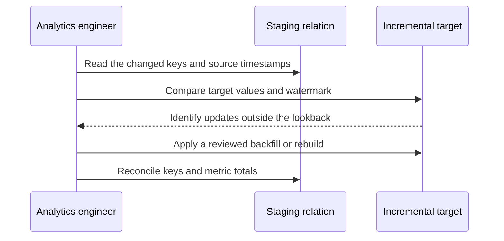

# Recover stale incremental data

Use this playbook when source records have changed but the incremental target still shows old values.

1. Confirm the staging model sees the correction. Compare by the business key between staging and the incremental table.
2. Inspect the compiled filter, the target watermark, and the affected timestamps. Check for nulls, time zone conversions, ties, and records older than the lookback.
3. Use a bounded, idempotent backfill when the adapter and model support it. If a full rebuild is needed, verify size, resource use, grants, and downstream dependencies first. Try the operation in the sandbox.
4. Verify the affected rows, key uniqueness, aggregate totals, and a second run against the same input. Refresh any downstream materializations that depend on the changed keys.
5. Record the affected period and owner. Add a reconciliation or wider lookback where the change frequency warrants it.

Reproduce the failure in [lesson 0040](../lessons/0040-capstone-incident-drill-and-portfolio-review.md). Review the [incremental model design](../lessons/0010-incremental-models-late-data-and-backfills.md) before changing the production policy.

| Previous | Catalog | Next |
| --- | --- | --- |
| [Debugging overview](index.md) | [Home](../index.md) | [Interview practice](../interview/index.md) |
