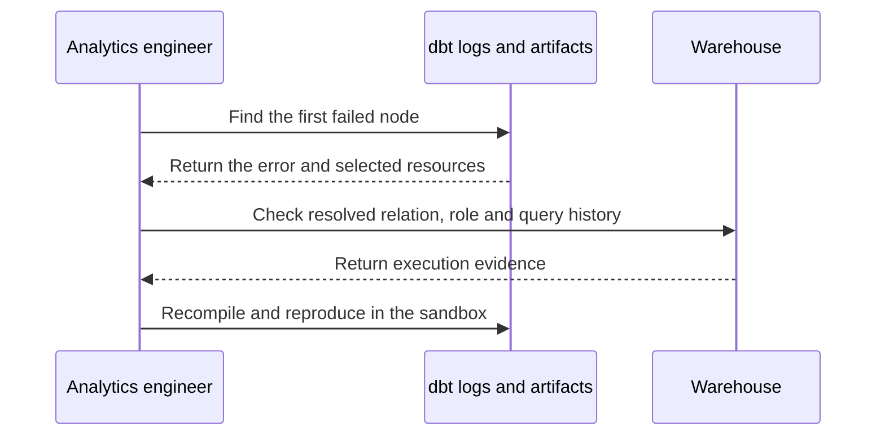

# dbt debugging playbooks

Capture the command, dbt distribution and adapter, Git SHA, target, and invocation or job ID. Find the first failure before investigating downstream skips. Save the relevant artifacts before starting a new invocation.

| Symptom | Diagnosis and recovery |
| --- | --- |
| Connection or credential failure | Run `dbt debug`. Inspect profile, adapter, active target, warehouse role and network path. Compare the local connection with the managed environment. |
| Empty selection or missing ref | Run `dbt ls` with the same selector. Check YAML spelling, enabled state, model versions, dependencies and any required production manifest. |
| Jinja error or invalid compiled SQL | Check the earliest compilation message. Inspect compiled SQL, dispatch choices, and database calls from macros. Check dialect-specific constructs and v2 analysis mode. |
| Missing or unauthorized relation | Inspect where the ref resolves. For deferred runs, confirm which manifest and relation were selected and whether the runner can read the relation. |
| Stale source | Compare the configured load timestamp and real ingestion completion. Inspect the freshness artifact and distinguish an ingestion outage from a timestamp issue. |
| Uniqueness or relationship failure | Look at returned violations, grain and join cardinality. Check nullability and whether the test queried multiple environments. |
| Slow production build | Separate job queue and prep time from SQL execution time. Inspect query history, scans, partition pruning, concurrency, and materialization settings. |
| Dashboard revenue is wrong | Compare the fact to the metric filters, time dimension, aggregation and BI query. Trace the exposure to its owner. |
| Late update missed by a model | Follow the [incremental recovery playbook](incremental-recovery.md). |

| Previous | Catalog | Next |
| --- | --- | --- |
| [Cheatsheet](../cheatsheet/index.md) | [Home](../index.md) | [Incremental recovery](incremental-recovery.md) |
