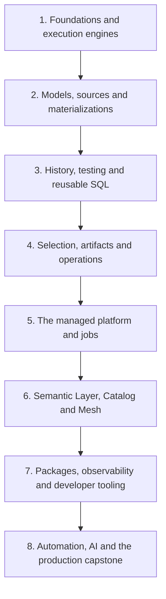

# Learn the dbt ecosystem

Build a shop analytics project from your first SQL model through a production release. Use DuckDB for the local labs, then learn how teams deploy, govern, and monitor the same kinds of models on the dbt platform.

[Start the curriculum](lessons/index.md){ .md-button .md-button--primary }
[Set up the DuckDB lab](lessons/0004-adapters-profiles-and-the-local-shop-lab.md){ .md-button }

-   **[Learning mission](mission.md)**

    See the project milestones and capstone outcomes.

-   **[Command cheatsheet](cheatsheet/index.md)**

    Look up selectors, commands, and project files.

-   **[Debugging playbooks](debugging/index.md)**

    Diagnose connection, graph, data, and production failures.

-   **[Interview practice](interview/index.md)**

    Work through technical and system design questions.

-   **[References and glossary](references/index.md)**

    Find official documentation and current product names.

## Learning roadmap

