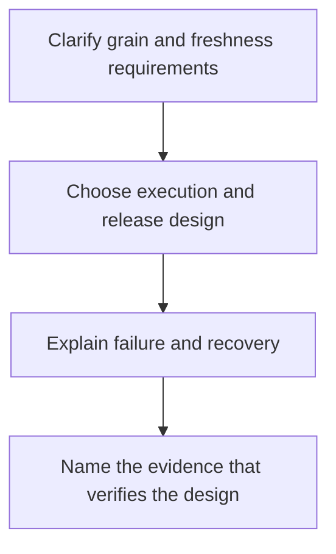

# Senior dbt interview practice

Answer out loud, name a failure mode, and explain how you would verify your answer. Use the prompts under each question to assess your reasoning.

## Execution and data modeling

1. What happens between `dbt build` and a completed table? Discuss parse, DAG selection, render, static analysis where supported, adapter execution and result artifacts.
2. When should a model be a view, table, ephemeral CTE, or incremental table? Compare freshness, repeated computation, adapter constraints and debugging.
3. An order fact doubles after joining a status seed. Where do you look first? State the intended grain and compare match cardinality before changing the SQL.
4. Design a pipeline that can handle two days of late events and occasional month-old corrections. Discuss watermarks, idempotency, deduplication and backfills.
5. How should a team capture changes to a mutable customer table? Explain snapshot cadence, key selection, timestamp versus check strategies and hard deletes.

## Software delivery and operations

6. How would you shorten a large dbt CI run? Describe state selection, deferral, test coverage, temporary schemas, and how to bootstrap a baseline.
7. Compare deploy, CI and merge jobs. Which steps should run after ingestion, on a pull request and after a merge?
8. A source freshness check failed but all data tests passed. What might have happened and which artifacts would you examine?
9. A job takes three times longer after a package update. Compare queue, parse, model SQL, test and warehouse durations. Describe a safe rollback.

## Governance and architecture

10. Two dashboards report different conversion rates. Define an entity, numerator, denominator, time window and dimension policy for a central metric.
11. Split a monolithic project into Orders and Finance domains. Explain public models, ownership, contracts, versions, grants and the sequence of deployments.
12. A model field changed from cents to dollars while its database type stayed the same. How would you catch and coordinate the breaking change?
13. Explain what column lineage can tell you during impact analysis. Where would you seek more evidence when lineage is incomplete?
14. Which project checks belong in pre-commit, CI, scheduled builds, and observability tooling? Give a representative tool and failure mode for each.

[Practice on the capstone project](../lessons/0039-capstone-build-and-release-plan.md)
