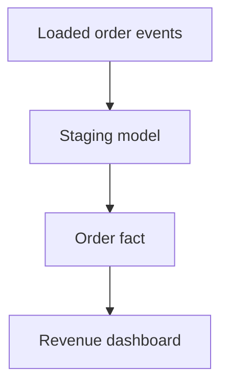

# From loaded data to a dbt DAG

dbt is the transformation part of ELT. The ingestion system lands source tables. dbt reads project files, builds a directed acyclic graph (DAG), and runs transformations in the data platform. It also records dependencies, tests, and run outcomes. Each edge should explain how a downstream resource uses an upstream one.

A SQL model is normally a select statement in a file. Keep warehouse-specific storage choices in materialization config and business logic in the select. A relationship between warehouse tables alone does not add a dbt graph edge. A declared `ref()` or `source()` does.

## Practice

Sketch the orders pipeline before creating any SQL. Label which system owns ingestion, which dbt node owns grain, and which dashboard owner would be affected by removing an order status.

## Recall

What happens to lineage when a model queries a hard-coded table that another dbt model owns?

[dbt project overview](https://docs.getdbt.com/docs/get-started-dbt)

| Previous | Curriculum | Next |
| --- | --- | --- |
| — | [All lessons](index.md) | [Next lesson →](0002-dbt-core-v1-and-the-parse-to-run-lifecycle.md) |
