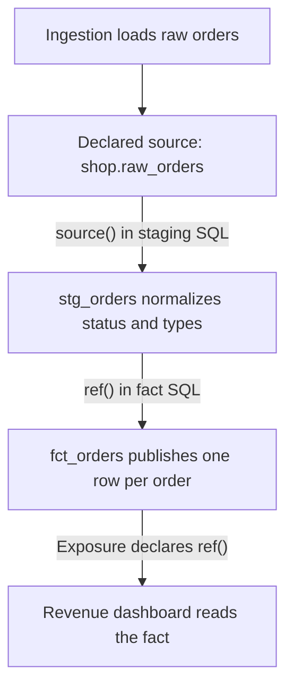

# From loaded data to a dbt DAG

In ELT, an ingestion system extracts data and loads it into a data platform. dbt takes over at transformation. It reads your SQL and YAML, works out which resources depend on one another, and sends SQL to the platform to build and test your models. The data platform executes the SQL.

A directed acyclic graph (DAG) represents those dependencies. In the diagram, each arrow goes from an upstream dependency to a downstream consumer. A cycle would leave dbt with no valid order for building the resources in that cycle.



A SQL model is usually a `select` in a project file. Its materialization config tells dbt how to persist the result, for example as a view or table. Write down the **grain** before writing the query. If `fct_orders` promises one row per `order_id`, joining it to order items can multiply rows and overstate revenue unless you aggregate the items first.

- Use `source('shop', 'raw_orders')` for a table loaded outside dbt after declaring that source in YAML. Use `ref('stg_orders')` for a resource managed by dbt. Both resolve relation names and record graph edges.
- A literal relation such as `analytics.stg_orders` can still return rows, but dbt won't infer its dependency on `stg_orders` from that SQL. A declared exposure can similarly record a dashboard's upstream dependencies for impact analysis.

!!! note "The course fixture"
    In [the DuckDB lab](0004-adapters-profiles-and-the-local-shop-lab.md), `raw_orders` is a CSV seed managed by dbt. The staging model therefore uses `ref('raw_orders')` and can build the seed as an upstream dependency.

## Practice

Sketch the lab graph from the `raw_orders` seed through `stg_orders`, a proposed `fct_orders`, and a revenue dashboard. Label the grain of the fact and explain what breaks if staging drops `status` while the dashboard reports paid revenue. The sketch should show the seed as upstream of staging and identify the dashboard as a downstream consumer of the change.

With the starter lab, check the staging edge empirically. From `shop_lab`, predict the difference, then run:

```bash
dbt ls --profiles-dir . --select stg_orders
dbt ls --profiles-dir . --select +stg_orders
```

In the starter, the first selection lists `stg_orders`. The leading `+` includes its ancestors, so the second lists both `raw_orders` and `stg_orders`. Listing only inspects the graph.

## Recall

1. Why might the SQL still run after you replace a `ref()` with a literal relation name? What would graph selection lose?
2. An ingestion team starts loading `raw_orders` instead. What should change in staging's dependency declaration?

??? note "Answer guidance"
    1. The named relation might already exist, so the database can query it. With the edge gone, a selection such as `+stg_orders` can no longer follow that dependency.
    2. Declare the externally loaded table in source YAML and use `source()` in staging. The ingestion team owns loading the table and dbt records it as an upstream source.

[dbt quickstarts](https://docs.getdbt.com/docs/get-started-dbt) · [ref](https://docs.getdbt.com/reference/dbt-jinja-functions/ref) · [source](https://docs.getdbt.com/reference/dbt-jinja-functions/source) · [Graph operators](https://docs.getdbt.com/reference/node-selection/graph-operators)

| Previous | Curriculum | Next |
| --- | --- | --- |
| | [All lessons](index.md) | [Next lesson](0002-dbt-core-v1-and-the-parse-to-run-lifecycle.md) |
