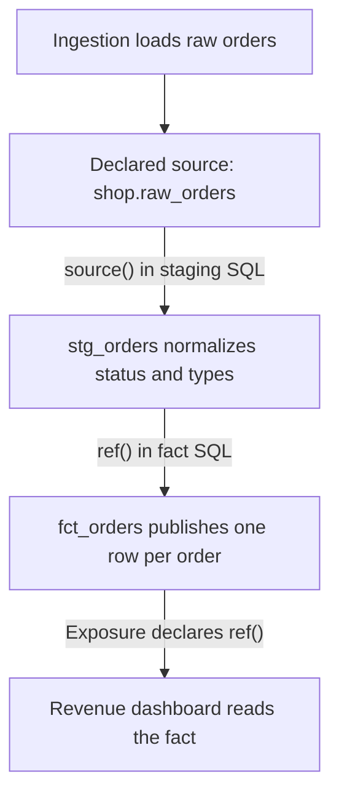

# From loaded data to a dbt DAG

Analytics pipelines commonly follow ELT (Extract, Load, Transform) instead of ETL. An ingestion tool extracts records from operational systems and loads them raw into a data platform. dbt owns the **T** step: it transforms raw tables into tested, documented analytics models inside that warehouse using SQL and version control.

dbt reads your SQL and YAML files, works out which resources depend on one another, and sends SQL to the data platform to build and test each resource in order. The data platform executes the queries and stores the results.

## How dbt orders work

A directed acyclic graph (DAG) represents those dependencies. Each arrow flows from an upstream dependency to a downstream consumer. A cycle (for example, `stg_orders` referencing `fct_orders` while `fct_orders` references `stg_orders`) leaves dbt with no valid build order, so dbt halts with a dependency cycle error during parsing.



A dbt project organizes those nodes across resource types:

| Resource | Role in the DAG |
| --- | --- |
| Source | An external table loaded by ingestion and declared in YAML. |
| Seed | A small CSV file in Git loaded as a lookup or fixture table. |
| Model | A SQL `select` statement (or Python function on supported platforms) built as a view, table, or incremental table. |
| Snapshot | A history table that records row changes over time. |
| Test | A data or unit assertion attached to resources to catch errors before downstream builds run. |
| Exposure | Metadata recording a downstream consumer such as a dashboard or ML pipeline. |

## Grain and graph edges

Write down a model's **grain** (what a single row represents) before writing its SQL. If `fct_orders` promises one row per `order_id`, joining it directly to an `order_items` table with three items per order produces three rows per order and triples the order total. Aggregate child tables to the target grain first.

- Use `source('shop', 'raw_orders')` for a table loaded outside dbt after declaring that source in YAML. Use `ref('stg_orders')` for a resource managed by dbt. Both resolve target-specific relation names and record graph edges.
- A literal table name such as `analytics.stg_orders` can still return rows if that table exists, but dbt omits the edge from its graph. Graph selection and impact analysis miss that dependency.

!!! note "The course fixture"
    In [the DuckDB lab](0004-adapters-profiles-and-the-local-shop-lab.md), `raw_orders` is a CSV seed managed by dbt so you need no external loader. Staging therefore calls `ref('raw_orders')` and can load the seed as an upstream dependency.

## Practice

### What you need

Complete the four-file setup in [lesson 0004](0004-adapters-profiles-and-the-local-shop-lab.md) first if you do not have `shop_lab` ready yet, or read the concept steps below and run the command check right after lesson 0004.

### Steps

1. Sketch the lab graph from the `raw_orders` seed through `stg_orders`, a proposed `fct_orders`, and a revenue dashboard.
2. Label the grain of `fct_orders` and write down what breaks if `stg_orders` drops the `status` column while the dashboard filters for paid revenue.
3. From `shop_lab`, predict the difference between these two commands, then run them:

```bash
dbt ls --profiles-dir . --select stg_orders
dbt ls --profiles-dir . --select +stg_orders
```

**Expected result.** Your sketch places `raw_orders` upstream of `stg_orders` and traces `status` downstream to the dashboard. The first `dbt ls` command lists `stg_orders` alone. The leading `+` includes ancestors, so the second lists both `raw_orders` and `stg_orders` without writing to DuckDB.

## Recall

1. Why might a model query still succeed after you replace `ref('stg_orders')` with a literal table name, and what does dbt lose?
2. An ingestion team takes over loading `raw_orders` outside dbt. What should change in staging's dependency declaration?
3. `fct_orders` joins `stg_orders` to `stg_order_items` (averaging three items per order) without aggregating items first. Which metric breaks, and how do you fix it?

??? note "Answer guidance"
    1. The physical table may already exist in the database, so the SQL runs. With the `ref()` edge gone, dbt cannot infer build order, target switching, or impact analysis via `+stg_orders`.
    2. Declare the externally loaded table in source YAML and change staging to call `source()`. The ingestion team owns loading the table, and dbt tracks it as an upstream source.
    3. Order counts and `sum(total_cents)` inflate roughly threefold because each order repeats per item. Aggregate `stg_order_items` to one row per `order_id` in an intermediate model before joining to `fct_orders`.

[dbt quickstarts](https://docs.getdbt.com/docs/get-started-dbt) · [ref](https://docs.getdbt.com/reference/dbt-jinja-functions/ref) · [source](https://docs.getdbt.com/reference/dbt-jinja-functions/source) · [Graph operators](https://docs.getdbt.com/reference/node-selection/graph-operators)

| Previous | Curriculum | Next |
| --- | --- | --- |
| | [All lessons](index.md) | [Next lesson](0002-dbt-core-v1-and-the-parse-to-run-lifecycle.md) |
