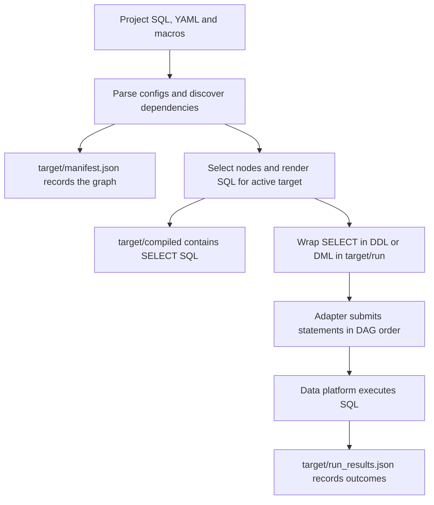

# dbt Core v1 and the parse-to-run lifecycle

When you invoke `dbt build`, dbt does not send your raw model file straight to the warehouse. It moves through three distinct phases: parse, compile, and execute. Knowing what happens in each phase tells you why an invocation failed and which artifact holds the evidence.

**dbt Core v1** is the Python-based open-source engine. A local v1 setup pairs `dbt-core` with a Python adapter package such as `dbt-duckdb`. Pin both in a dedicated virtual environment. Run `command -v dbt` to see which binary your shell invokes and `dbt --version` to verify the engine and installed adapter plugins.

## The three lifecycle phases



| Phase | What happens | What to inspect and common failures |
| --- | --- | --- |
| **Parse** | dbt reads project YAML, SQL, and macros, validates configuration syntax, and extracts edges from `ref()` and `source()`. It does not run your model queries. | Inspect `target/manifest.json` (written by `dbt parse` in Core v1.5+ and dbt v2). Invalid YAML, missing `ref()` targets, and dependency cycles fail here. |
| **Compile** | dbt evaluates Jinja for the chosen target, resolves `ref()` and `source()` to target relation names, and produces executable `SELECT` queries. Macros using `run_query()` can query metadata during this phase. | Inspect `target/compiled/` for the rendered `SELECT` query. Undefined Jinja variables or macro syntax errors fail here. In Core v1, a misspelled column name can still compile cleanly. |
| **Execute** | The adapter wraps compiled SQL into platform-specific DDL or DML (such as `CREATE VIEW` or `CREATE TABLE`) in `target/run/` and runs selected nodes in DAG order. | Inspect `target/run_results.json` for per-node statuses and timings, and `target/run/` for the exact statements executed. Warehouse permissions, missing columns, and failed data tests fail here. |

## Partial parsing and build vs run

- **Partial parsing (`target/partial_parse.msgpack`).** Parsing large projects from scratch on every command is slow. dbt caches parsed state and only reparses modified files on the next run. Pass `--no-partial-parse` if an invocation ignores an external change such as a modified environment variable.
- **`dbt run` vs `dbt build`.** `dbt run` executes models only. `dbt build` runs seeds, snapshots, models, and tests together in DAG order. In `dbt build`, each resource's tests execute immediately after the resource builds, so a failing upstream test skips downstream models before bad data propagates. Each command runs any earlier parse and compile step it needs, so you can invoke `dbt build` directly.

## Practice

### What you need

Use a fresh copy of the four starter files from [the DuckDB lab](0004-adapters-profiles-and-the-local-shop-lab.md) in an isolated directory. If you are reading lessons in order and have not created `shop_lab` yet, read through the steps now and run them right after setting up the lab in lesson 0004.

### Steps

Run the three lifecycle commands one at a time from your lab directory. These commands work with Core v1 plus `dbt-duckdb` or with full dbt v2.

```bash
dbt parse --profiles-dir .
dbt compile --profiles-dir . --select stg_orders
dbt build --profiles-dir . --select +stg_orders
```

Pause after each command and verify its evidence:

1. **After parse.** Open `target/manifest.json`, locate `model.shop_lab.stg_orders`, and confirm `depends_on.nodes` includes `seed.shop_lab.raw_orders`.
2. **After compile.** Open `target/compiled/shop_lab/models/stg_orders.sql` and confirm the `from` clause names the DuckDB relation for `raw_orders`. Notice `target/compiled/` contains only the `select` statement.
3. **After build.** Open `target/run_results.json` and confirm `seed.shop_lab.raw_orders` succeeded before `model.shop_lab.stg_orders`. Check `target/run/shop_lab/models/stg_orders.sql` to see the `create view` statement sent to DuckDB.

Verify when DuckDB actually receives the relation by running this query right after `compile` and again after `build`:

```bash
dbt show --profiles-dir . --inline "select table_type from information_schema.tables where table_schema = 'main' and table_name = 'stg_orders'"
```

**Expected result.** The catalog query returns zero rows after `dbt compile` (no warehouse DDL ran) and one `VIEW` row after `dbt build`.

## Recall

1. Why can `dbt compile` succeed in Core v1 when a model selects a nonexistent column?
2. What is the difference between the SQL in `target/compiled/` and `target/run/`?
3. Which artifact records the seed dependency edge, and why does `dbt build` prevent a bad staging row from reaching a downstream fact?

??? note "Answer guidance"
    1. Core v1 compilation renders Jinja text and resolves relation references without validating column names against the warehouse SQL dialect. The database reports the missing column only when SQL executes.
    2. `target/compiled/` stores the rendered `select` query for inspection. `target/run/` stores the full DDL or DML statement (such as `create view` or `create table`) executed against the data platform.
    3. `target/manifest.json` records `depends_on` graph edges. `dbt build` runs tests immediately after each resource builds and skips downstream dependents if an upstream test fails.

[dbt command reference](https://docs.getdbt.com/reference/dbt-commands) · [dbt artifacts reference](https://docs.getdbt.com/reference/artifacts/dbt-artifacts)

| Previous | Curriculum | Next |
| --- | --- | --- |
| [Previous lesson](0001-from-loaded-data-to-a-dbt-dag.md) | [All lessons](index.md) | [Next lesson](0003-fusion-dbt-v2-and-dbt-oss.md) |
