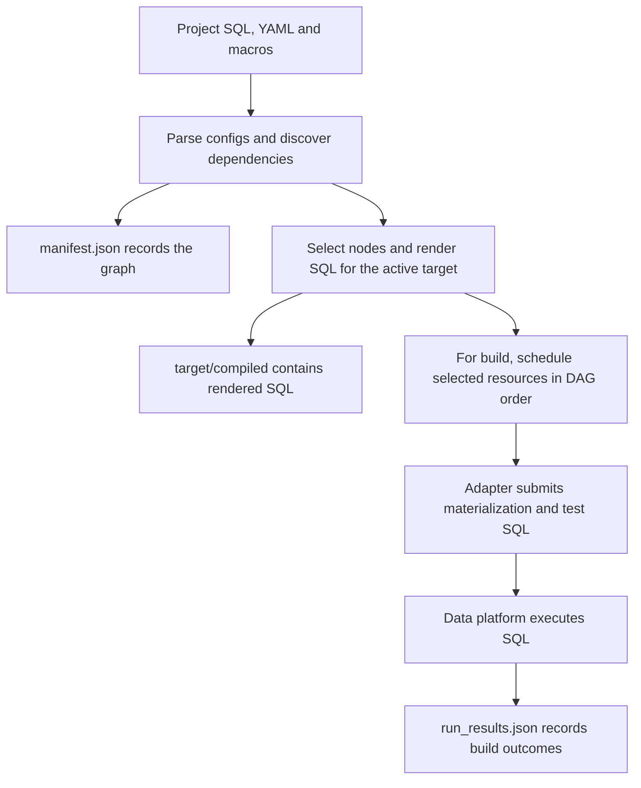

# dbt Core v1 and the parse-to-run lifecycle

dbt Core v1 is the Python-based open-source engine. A local v1 installation pairs it with a compatible Python adapter, such as `dbt-duckdb`. Pin both versions in a dedicated environment. `command -v dbt` shows which executable the shell will use and `dbt --version` reports the engine and, on v1, its installed adapter plugins.



| Phase | What happens in Core v1 | What to inspect |
| --- | --- | --- |
| Parse | dbt loads project files, validates project syntax and records dependencies from calls such as `ref()`. `dbt parse` does this without querying the database. | `target/manifest.json` describes the project graph. Core v1.5 and later write it for `dbt parse`. |
| Compile | dbt renders Jinja and resolves each reference for the chosen target. The same project can render different relation names in development and production. Macros may query metadata during compilation. | `target/compiled/` holds model SQL. Core v1 rendering can succeed on a misspelled column if nothing in the render checks it. |
| Execute | The adapter executes platform-specific statements for the selected materializations. `dbt run` runs models. `dbt build` also handles selected resources such as seeds, snapshots and tests. An upstream failure can skip dependent nodes. | `target/run_results.json` reports statuses for the invocation. Read the build's copy before another invocation overwrites it. |

These commands each do the preparation they need. You can run `dbt build` directly.

## Practice

Use a fresh copy of the four starter files from [the DuckDB lab](0004-adapters-profiles-and-the-local-shop-lab.md) in an isolated directory. Run from that directory. The commands work with a compatible Core v1 and DuckDB adapter or with the course's full dbt v2 CLI. With v2, compilation can include SQL analysis, so use the evidence below to compare the phases.

```bash
dbt parse --profiles-dir .
dbt compile --profiles-dir . --select stg_orders
dbt build --profiles-dir . --select +stg_orders
```

Pause after each command and record one piece of evidence:

1. After parse, find `model.shop_lab.stg_orders` in `target/manifest.json` and confirm its `depends_on.nodes` lists `seed.shop_lab.raw_orders`.
2. After compile, open `target/compiled/shop_lab/models/stg_orders.sql`. The `from` clause names the DuckDB relation for the seed.
3. After build, check that `raw_orders` succeeded before `stg_orders` and that both show success in `target/run_results.json`. The leading `+` selects the seed for loading.

After reading each phase's artifacts, run this query after compile and again after build. It returns zero rows after compile and one `VIEW` row after build.

```bash
dbt show --profiles-dir . --inline "select table_type from information_schema.tables where table_schema = 'main' and table_name = 'stg_orders'"
```

## Recall

1. Why can parsing succeed when a model selects a nonexistent column?
2. Which artifact identifies the seed dependency, and which shows whether the seed loaded in this build?

??? note "Answer guidance"
    1. Parsing validates project structure and discovers dependencies. The column is inside model SQL, so a later SQL analysis or database execution step can be the first to diagnose it.
    2. The manifest records the edge. The build's run results record the seed execution status.

[dbt command reference](https://docs.getdbt.com/reference/dbt-commands) · [dbt artifacts reference](https://docs.getdbt.com/reference/artifacts/dbt-artifacts)

| Previous | Curriculum | Next |
| --- | --- | --- |
| [Previous lesson](0001-from-loaded-data-to-a-dbt-dag.md) | [All lessons](index.md) | [Next lesson](0003-fusion-dbt-v2-and-dbt-oss.md) |
