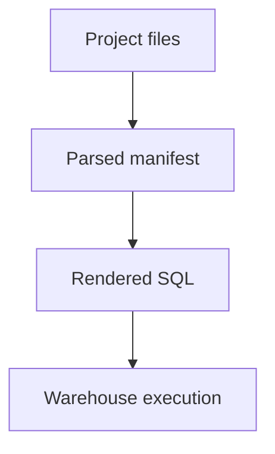

# dbt Core v1 and the parse-to-run lifecycle

dbt Core v1.x is the Python-based open-source engine. Parsing reads resource configs and discovers dependencies without building relations. Compilation renders Jinja and resolves relations for the target. Compilation can still contact the database when macros introspect it. A build schedules selected resources in graph order and records outcomes. The same model can compile to different relation names in development and production.

A dbt Core v1 local install normally pairs the engine with a Python adapter such as `dbt-postgres`. Pin a compatible pair in a dedicated Python environment. Run `dbt --version` to identify which executable and adapter are on your PATH.

## Practice

After setting up the shop lab in lesson 0004, compare `dbt parse`, `dbt compile --select stg_orders` and `dbt build --select stg_orders`. Inspect `target/manifest.json`, `target/compiled/` and `target/run_results.json`. Record which step changes the database.

## Recall

Why can `dbt parse` succeed even if a select references a nonexistent column?

[dbt command reference](https://docs.getdbt.com/reference/dbt-commands)

| Previous | Curriculum | Next |
| --- | --- | --- |
| [← Previous lesson](0001-from-loaded-data-to-a-dbt-dag.md) | [All lessons](index.md) | [Next lesson →](0003-fusion-dbt-v2-and-dbt-oss.md) |
