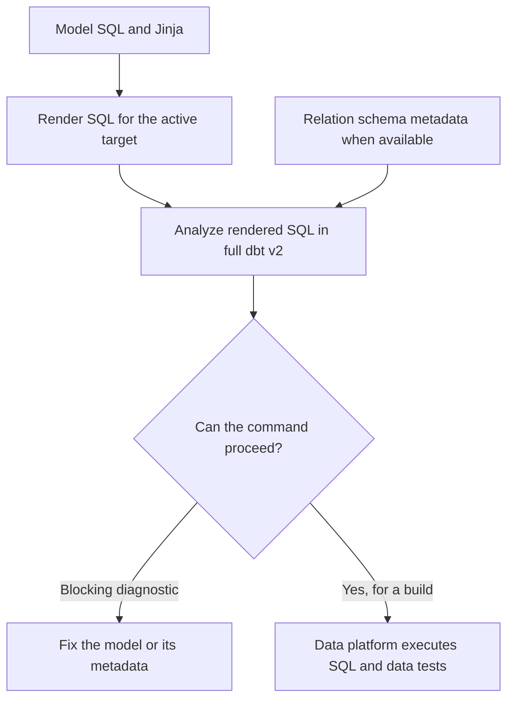

# Fusion, dbt v2 and dbt OSS

To choose tools and read documentation accurately, separate four distinct terms. An **engine** parses, compiles, and schedules a dbt project. A **distribution** packages that engine with a specific license and feature set. An **adapter** connects the engine to a warehouse dialect. The **CLI** is the terminal executable, usually invoked as `dbt`, so the command name alone never tells you which distribution is running.

## Engine distributions compared

| Name in current or older docs | Distribution and architecture | Key capabilities |
| --- | --- | --- |
| **dbt Core v1.x** | Original Python engine (`dbt-core` 1.x) paired with separately installed Python adapters. | Renders Jinja SQL templates without full target-dialect SQL parsing or type checking. |
| **dbt** (formerly **dbt Fusion Engine**) | Full free-to-use Rust-based v2 distribution (`dbt`). | Fast parsing, target-dialect SQL comprehension, static type analysis, and an integrated language server. Some platform integrations require a paid entitlement. |
| **dbt OSS** (formerly **dbt Core v2**) | Apache 2.0 distribution of the same Rust foundation (`dbt-oss`). | Standard project parsing and execution without proprietary features such as full static analysis or the platform language server. |

When planning a v1-to-v2 migration, record your exact version and distribution, verify adapter and package `require-dbt-version` compatibility, check any custom Jinja macros or Python models, and run a representative build against a development schema. Keep separate virtual environments or explicit binary paths when testing multiple distributions on one machine.

## Where SQL analysis fits

Unlike Core v1, full dbt v2 parses rendered SQL in the target dialect before executing queries. With schema metadata, it can resolve column names and types during compilation instead of waiting for a slow warehouse failure.



Control analysis behavior with the `--static-analysis` flag or per-model `static_analysis` config:

- `baseline` (default): checks SQL syntax and local definitions, reports findings as warnings, and skips fetching remote warehouse schemas.
- `strict`: fetches relation schemas when available and fails compilation on unresolved columns or type mismatches.
- `off`: skips SQL comprehension for the invocation or for a specific model that uses dynamic SQL not yet understood by the analyzer (for example, `{{ config(static_analysis='off') }}` at the top of a model).

The data platform remains responsible for runtime permissions and row-level execution.

## Practice

### What you need

Work in an isolated copy of the four [DuckDB starter files](0004-adapters-profiles-and-the-local-shop-lab.md) using full dbt v2. If you have not created `shop_lab` yet, read the steps here and run them right after setting up the starter in lesson 0004.

### Steps

1. Copy `models/stg_orders.sql` to `models/analysis_probe.sql`.
2. In `models/analysis_probe.sql`, misspell `total_cents` as `total_centz`.
3. Seed `raw_orders` first so DuckDB holds the upstream schema metadata needed by strict analysis, then run each compile and preview command one at a time:

```bash
dbt --version
dbt seed --profiles-dir . --select raw_orders
dbt compile --profiles-dir . --select analysis_probe --static-analysis off
dbt compile --profiles-dir . --select analysis_probe --static-analysis baseline
dbt compile --profiles-dir . --select analysis_probe --static-analysis strict
dbt show --profiles-dir . --select analysis_probe --static-analysis off
```

4. Record the dbt version, exit status, and first diagnostic from each command.
5. Delete `models/analysis_probe.sql` when finished so it does not affect later exercises.

**Expected result.** On full dbt 2.0.12 with this fixture, `--static-analysis off` and `baseline` compile, `strict` fails at compile time on the unresolved `total_centz` column, and `dbt show` with analysis `off` fails at execution time with a DuckDB binder error.

## Recall

1. A blog post mentions Fusion, while a teammate's runbook mentions Core v2. Which distributions do those names refer to today?
2. Why can a model pass `--static-analysis strict` and still produce duplicate order rows in production?
3. When should you configure `static_analysis: off` on a single model instead of disabling analysis for the entire project?

??? note "Answer guidance"
    1. Fusion became the full dbt v2 distribution (`dbt`). Core v2 became `dbt OSS` (`dbt-oss`). Core v1 refers to the Python engine (`dbt-core`).
    2. Static analysis verifies column names, SQL syntax, and data types against schemas, not row uniqueness or join cardinality. Use `unique` and `not_null` data tests to enforce the output grain.
    3. Set `static_analysis: off` only on individual models whose dynamic Jinja or dialect features confuse the analyzer, leaving strict or baseline checks active across the rest of the DAG.

[dbt and dbt OSS comparison](https://docs.getdbt.com/blog/comparing-dbt-and-dbt-oss) · [Supported data platforms](https://docs.getdbt.com/docs/supported-data-platforms) · [Static analysis](https://docs.getdbt.com/docs/build/about-static-analysis)

| Previous | Curriculum | Next |
| --- | --- | --- |
| [Previous lesson](0002-dbt-core-v1-and-the-parse-to-run-lifecycle.md) | [All lessons](index.md) | [Next lesson](0004-adapters-profiles-and-the-local-shop-lab.md) |
