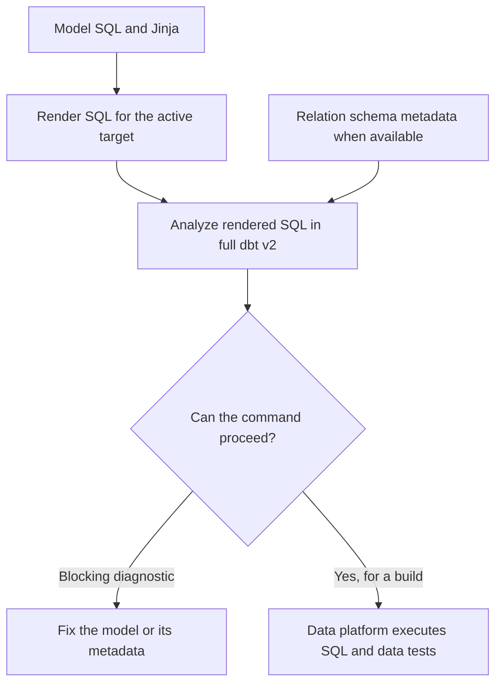

# Fusion, dbt v2 and dbt OSS

An **engine** parses, compiles and schedules your dbt project. A **distribution** packages the engine with a particular set of features and licenses. An **adapter** connects the engine to the data platform. The **CLI** is the command-line interface you invoke, usually as `dbt`. The command name alone tells you little about which installation runs it.

| Name in docs or older guides | What it refers to |
| --- | --- |
| **dbt Core v1.x** | The original Python engine, packaged as `dbt-core` at 1.x, with separately installed Python adapters. |
| **dbt**, formerly **dbt Fusion Engine** | The full, free-to-use v2 distribution, packaged as `dbt`. It includes SQL comprehension and language server features. Some platform features require a paid entitlement. |
| **dbt OSS**, formerly **dbt Core v2** | The Apache 2.0 distribution of the same Rust foundation, packaged as `dbt-oss`. It supports standard project builds. |

For a migration, record the exact version and distribution, then check adapter and package compatibility and build a representative slice against a development target. Use separate installations when comparing distributions that both expose a `dbt` command.

## Where analysis fits

Full dbt v2 can analyze rendered SQL in the target dialect. It can check syntax and, with sufficient schema information, resolve columns and types before running the model's query. The platform still resolves runtime permissions and executes queries against real rows.



In releases with `static_analysis` modes, `baseline` is the default and reports analysis findings as warnings. It skips fetching remote schemas for analysis. `strict` can fetch relation schemas and fail on unresolved columns or types. `off` disables this analysis. Coverage depends on the release, SQL dialect and available metadata. Check the docs for the version you're running.

## Practice

From an isolated copy of [the DuckDB starter](0004-adapters-profiles-and-the-local-shop-lab.md), copy `models/stg_orders.sql` to `models/analysis_probe.sql`. In the copy, change `total_cents` to `total_centz`. Use full dbt v2 and run these commands one at a time:

```bash
dbt seed --profiles-dir . --select raw_orders
dbt compile --profiles-dir . --select analysis_probe --static-analysis off
dbt compile --profiles-dir . --select analysis_probe --static-analysis baseline
dbt compile --profiles-dir . --select analysis_probe --static-analysis strict
dbt show --profiles-dir . --select analysis_probe --static-analysis off
```

Record the version, exit status and first diagnostic for each mode. On full dbt 2.0.12 with this fixture, `off` and `baseline` compiled, `strict` failed on the unresolved column, and `show` with analysis off got a DuckDB binder error when it submitted the query. Remove the probe file afterward.

## Recall

1. A guide says to install Fusion, but an older team runbook says Core v2. Which distribution does each name refer to today?
2. Why can a query pass strict analysis and still produce duplicate orders?

??? note "Answer guidance"
    1. Fusion became the full dbt v2 distribution called dbt. Core v2 became dbt OSS. Core v1 refers to the Python engine.
    2. A column and its type can resolve correctly even when several rows share its value. Check actual rows with a uniqueness test on the published grain.

[dbt and dbt OSS comparison](https://docs.getdbt.com/blog/comparing-dbt-and-dbt-oss) · [Supported data platforms](https://docs.getdbt.com/docs/supported-data-platforms) · [Static analysis](https://docs.getdbt.com/docs/build/about-static-analysis)

| Previous | Curriculum | Next |
| --- | --- | --- |
| [Previous lesson](0002-dbt-core-v1-and-the-parse-to-run-lifecycle.md) | [All lessons](index.md) | [Next lesson](0004-adapters-profiles-and-the-local-shop-lab.md) |
