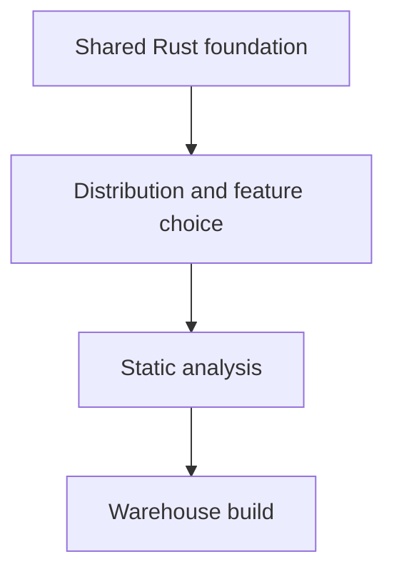

# Fusion, dbt v2 and dbt OSS

The Rust-based dbt v2 engine underlies two distributions. The full distribution is now called **dbt** and was introduced as the **Fusion Engine**. **dbt OSS**, introduced as dbt Core v2, contains the Apache-licensed subset. Check the comparison before assuming identical availability for analysis, adapters, or integrations.

On supported configurations, static analysis can catch errors earlier by understanding rendered SQL and types. It may need relation schemas or cached metadata. The supported analysis mode determines whether diagnostics warn or stop the build, and warehouse execution is still needed to verify actual data, permissions and performance.

## Practice

Compile `stg_orders` after introducing a misspelled input column. Note your distribution, configured analysis mode, and first command that flags the typo. Restore the original query before building.

## Recall

Which validations require actual warehouse rows even when static analysis succeeds?

[Distribution comparison](https://docs.getdbt.com/blog/comparing-dbt-and-dbt-oss) · [Static analysis](https://docs.getdbt.com/docs/build/about-static-analysis)

| Previous | Curriculum | Next |
| --- | --- | --- |
| [← Previous lesson](0002-dbt-core-v1-and-the-parse-to-run-lifecycle.md) | [All lessons](index.md) | [Next lesson →](0004-adapters-profiles-and-the-local-shop-lab.md) |
