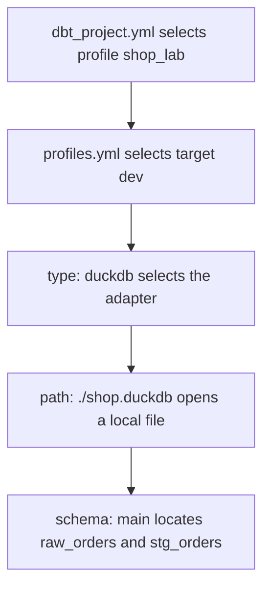

# Adapters, profiles and the local shop lab

The dbt engine plans the DAG and compiles SQL, while an **adapter** connects dbt to a specific data platform. The adapter handles authentication, identifier quoting, dialect differences, and platform-specific materializations such as creating tables or merging incremental batches. In Core v1, adapters install as separate Python packages. In dbt v2, supported adapters ship with the distribution, though some database drivers download separately.

| Adapter (`type` in `profiles.yml`) | Key connection and execution concepts |
| --- | --- |
| `snowflake` (`dbt-snowflake`) | Account, role, warehouse, database, and schema. The role controls permissions and the warehouse supplies compute. |
| `bigquery` (`dbt-bigquery`) | GCP project, dataset, location, and auth method such as OAuth/ADC or service account. |
| `databricks` (`dbt-databricks`) | Host and HTTP path identify compute; catalog and schema locate Unity Catalog relations. |
| `postgres` (`dbt-postgres`) | Host, port, database, schema, and role. Confirm v2 support before migrating a Postgres project. |
| `duckdb` (`dbt-duckdb`) | Embedded analytical database backed by a local file in this course. dbt v2 includes DuckDB support out of the box. |

## How projects bind to profiles



1. `dbt_project.yml` sets `profile: shop_lab` to select a named connection block.
2. `profiles.yml` defines `target: dev` as the default output (overridable via `--target prod`).
3. Each output configures the adapter (`type`), destination namespace (`schema`), and concurrency (`threads`). Increasing `threads` lets dbt run independent branches concurrently while dependent nodes still wait for their parents.
4. dbt locates `profiles.yml` in this precedence order: `--profiles-dir` CLI flag, `DBT_PROFILES_DIR` environment variable, the current project directory, and finally `~/.dbt/profiles.yml` (the standard user location outside Git).

!!! tip "Keep credentials out of Git"
    In shared repositories, store `profiles.yml` in `~/.dbt/` or keep secrets in environment variables using Jinja `{{ env_var('DBT_PASSWORD') }}`. Add `target/`, `dbt_packages/`, `logs/`, `*.duckdb`, and any local `.env` files to `.gitignore` so generated artifacts and credentials never enter version control.

## Practice: Build the shop lab

Install the full dbt v2 CLI using [the official install guide](https://docs.getdbt.com/docs/local/install-dbt). DuckDB runs locally in-process, so this lab needs no cloud account or credentials.

Create a new `shop_lab` directory outside this course repository with this structure:

```text
shop_lab/
├── dbt_project.yml
├── profiles.yml
├── models/
│   └── stg_orders.sql
└── seeds/
    └── raw_orders.csv
```

`dbt_project.yml` (dbt uses `view` as the default materialization when no model override is configured):

```yaml
name: shop_lab
version: '1.0.0'
config-version: 2
profile: shop_lab
model-paths: [models]
seed-paths: [seeds]
test-paths: [tests]
snapshot-paths: [snapshots]
```

`profiles.yml`:

```yaml
shop_lab:
  target: dev
  outputs:
    dev:
      type: duckdb
      path: ./shop.duckdb
      schema: main
      threads: 2
```

`seeds/raw_orders.csv`:

```csv
order_id,customer_id,status,total_cents,updated_at
1,101,paid,1250,2026-01-01 10:00:00
2,101,pending,500,2026-01-02 10:00:00
3,102,paid,1750,2026-01-03 10:00:00
```

`models/stg_orders.sql`:

```sql
select
    order_id,
    customer_id,
    lower(status) as status,
    total_cents,
    cast(updated_at as timestamp) as updated_at
from {{ ref('raw_orders') }}
```

Run the setup checks from inside `shop_lab`:

```bash
dbt --version
dbt debug --profiles-dir .
dbt build --profiles-dir . --select +stg_orders
dbt show --profiles-dir . --select stg_orders
```

**Expected result.** `dbt --version` reports dbt v2 and `dbt debug` reports a passing connection check. `dbt build` loads `raw_orders` into `main.raw_orders` and creates `main.stg_orders` as a view. `dbt show` returns order IDs 1, 2, and 3, with paid orders 1 and 3 totaling 3,000 cents (row order may vary).

Keep `shop_lab` as your main workspace for later lessons. Pass `--profiles-dir .` on commands or run `export DBT_PROFILES_DIR="$PWD"` in your terminal session to omit the flag.

## Recall

1. In `profiles.yml`, which keys pick the database adapter, the local DuckDB file, and the destination namespace?
2. How does dbt search for `profiles.yml`, and how do teams keep warehouse passwords out of Git when `profiles.yml` is committed?
3. What happens if two engineers share a single `shop.duckdb` file or configure `:memory:` as the DuckDB path across separate `dbt seed` and `dbt run` commands?

??? note "Answer guidance"
    1. Under the active output, `type` selects the adapter, `path` points DuckDB to the file on disk, and `schema` sets the default namespace (`main`).
    2. dbt checks `--profiles-dir`, `DBT_PROFILES_DIR`, the current directory, and `~/.dbt/`. Teams keep `profiles.yml` in `~/.dbt/` or reference environment variables with `{{ env_var('...') }}`.
    3. Sharing one DuckDB file causes lock conflicts or overwrites between runs. Using `:memory:` discards all tables as soon as the first invocation exits, so the next command fails with missing relations.

[DuckDB setup](https://docs.getdbt.com/docs/local/connect-data-platform/duckdb-setup) · [Supported data platforms](https://docs.getdbt.com/docs/supported-data-platforms) · [Connection profiles](https://docs.getdbt.com/docs/core/connect-data-platform/profiles.yml)

| Previous | Curriculum | Next |
| --- | --- | --- |
| [Previous lesson](0003-fusion-dbt-v2-and-dbt-oss.md) | [All lessons](index.md) | [Next lesson](0005-dbt-cloud-cli-platform-cli-and-vs-code.md) |
