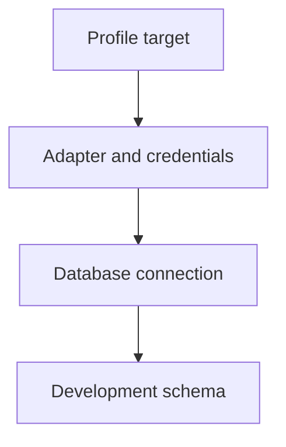

# Adapters, profiles and the local shop lab

Adapters manage connections, quote identifiers, implement materializations, and supply platform-specific macros. Your SQL still has to work in the target dialect. Core v1 installs adapters separately. Supported v2 adapters ship with the distribution, and availability varies.
| Core v1 adapter | Connection and execution concepts |
| --- | --- |
| `dbt-snowflake` | Account, role, warehouse, database and schema. Role grants and warehouse compute are separate concerns. |
| `dbt-bigquery` | Project, dataset, location, service account or OAuth. Inspect partition pruning and bytes processed. |
| `dbt-databricks` | Host, HTTP path, catalog and schema. Check compute access and Delta materialization support. |
| `dbt-postgres` | Host, port, database, schema and role. Consult the v2 adapter matrix before migrating. |
| `dbt-duckdb` | Embedded database file. The v2 DuckDB adapter supports the hands-on lab. |



## Practice

Install the full dbt v2 CLI from the official installer docs. Create a separate `shop_lab` directory, then put these files in it.

`dbt_project.yml`

```yaml
name: shop_lab
version: '1.0.0'
config-version: 2
profile: shop_lab
model-paths: [models]
seed-paths: [seeds]
test-paths: [tests]
snapshot-paths: [snapshots]
```

`profiles.yml`

```yaml
shop_lab:
  target: dev
  outputs:
    dev:
      type: duckdb
      path: ./shop.duckdb
      schema: main
      threads: 2
```

`seeds/raw_orders.csv`

```csv
order_id,customer_id,status,total_cents,updated_at
1,101,paid,1250,2026-01-01 10:00:00
2,101,pending,500,2026-01-02 10:00:00
3,102,paid,1750,2026-01-03 10:00:00
```

`models/stg_orders.sql`

```sql
select
    order_id,
    customer_id,
    lower(status) as status,
    total_cents,
    cast(updated_at as timestamp) as updated_at
from {{ ref('raw_orders') }}
```

```bash
dbt --version
dbt debug --profiles-dir .
dbt build --profiles-dir . --select +stg_orders
dbt show --profiles-dir . --select stg_orders
```

Expect three staged rows. Run later lab commands from this directory and append `--profiles-dir .` to use the local profile. Keep the generated database, build output, and any real credentials out of Git.

## Recall

Which profile field controls the schema written by this run, and how would a separate database file isolate another learner?

[Install dbt v2](https://docs.getdbt.com/docs/local/install-dbt) · [DuckDB setup](https://docs.getdbt.com/docs/local/connect-data-platform/duckdb-setup) · [Adapter matrix](https://docs.getdbt.com/docs/supported-data-platforms)

| Previous | Curriculum | Next |
| --- | --- | --- |
| [← Previous lesson](0003-fusion-dbt-v2-and-dbt-oss.md) | [All lessons](index.md) | [Next lesson →](0005-dbt-cloud-cli-platform-cli-and-vs-code.md) |
