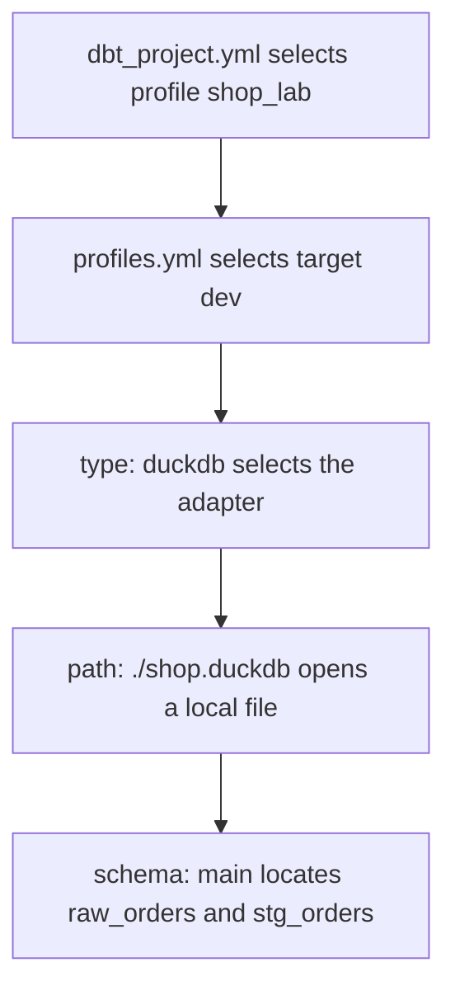

# Adapters, profiles and the local shop lab

The dbt engine works out what to build. An adapter connects it to a particular data platform, handles dialect details such as identifier quoting, and implements platform-specific materializations and macros. The model's SQL still needs to run on that platform. Core v1 adapter plugins are Python packages. In v2, the supported adapters ship with the distribution, though some drivers are fetched separately. Verify adapter and feature support for your exact release.

| Core v1 adapter | Connection and execution concepts |
| --- | --- |
| `dbt-snowflake` | Account, role, warehouse, database and schema. The role governs access and the warehouse provides compute. |
| `dbt-bigquery` | Project, dataset and location, plus authentication such as a service account or OAuth. |
| `dbt-databricks` | Host and HTTP path identify the compute endpoint. Catalog and schema locate relations. |
| `dbt-postgres` | Host, port, database, schema and role. Check v2 support before migrating this project. |
| `dbt-duckdb` | Embedded database, backed by a local file in this course. dbt v2 includes the DuckDB adapter and a driver for the starter. |



The `profile` key in `dbt_project.yml` selects a named profile. Within that profile, `target: dev` chooses the default output and `--target` can choose another. An output holds the connection and default schema. `threads` limits concurrent work on eligible nodes, so dependent nodes still wait for their parents.

## Practice

Install the full dbt v2 CLI. DuckDB runs in process and this file-backed target needs no account or credentials. [Install dbt v2](https://docs.getdbt.com/docs/local/install-dbt)

In a separate `shop_lab` directory outside this course repository, create the four files below, including the `seeds` and `models` directories.

`dbt_project.yml`

```yaml
name: shop_lab
version: '1.0.0'
config-version: 2
profile: shop_lab
model-paths: [models]
seed-paths: [seeds]
test-paths: [tests]
snapshot-paths: [snapshots]
```

`profiles.yml`

```yaml
shop_lab:
  target: dev
  outputs:
    dev:
      type: duckdb
      path: ./shop.duckdb
      schema: main
      threads: 2
```

`seeds/raw_orders.csv`

```csv
order_id,customer_id,status,total_cents,updated_at
1,101,paid,1250,2026-01-01 10:00:00
2,101,pending,500,2026-01-02 10:00:00
3,102,paid,1750,2026-01-03 10:00:00
```

`models/stg_orders.sql`

```sql
select
    order_id,
    customer_id,
    lower(status) as status,
    total_cents,
    cast(updated_at as timestamp) as updated_at
from {{ ref('raw_orders') }}
```

```bash
dbt --version
dbt debug --profiles-dir .
dbt build --profiles-dir . --select +stg_orders
dbt show --profiles-dir . --select stg_orders
```

Check that the CLI reports v2 and that `dbt debug` reports a successful connection. The build should load `raw_orders` and then create the `stg_orders` view in `main`. In the preview, check for order IDs 1, 2 and 3, with paid orders 1 and 3 totaling 3,000 cents. Row order can vary.

Run later lab commands from `shop_lab`. Use `--profiles-dir .` to select the lab profile explicitly. To use the shorter commands in later lessons, run `export DBT_PROFILES_DIR="$PWD"` in your lab shell. Keep the generated database, build output and any real credentials out of Git.

## Recall

1. Which keys choose the adapter, the database file and the schema?
2. What can two learners change to keep their lab data independent? What happens if they use an in-memory database across several commands?

??? note "Answer guidance"
    1. In the selected output, `type` chooses the adapter, `path` points DuckDB at a file, and `schema` sets the default namespace for the relations.
    2. Use separate working directories with separate `shop.duckdb` files, or set a distinct file path in each profile. An in-memory database loses its relations at the end of each invocation.

[DuckDB setup](https://docs.getdbt.com/docs/local/connect-data-platform/duckdb-setup) · [Supported data platforms](https://docs.getdbt.com/docs/supported-data-platforms)

| Previous | Curriculum | Next |
| --- | --- | --- |
| [Previous lesson](0003-fusion-dbt-v2-and-dbt-oss.md) | [All lessons](index.md) | [Next lesson](0005-dbt-cloud-cli-platform-cli-and-vs-code.md) |
