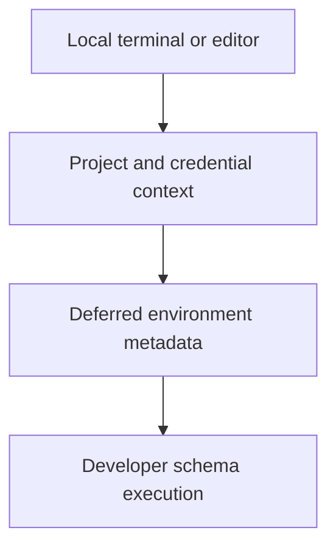

# dbt Cloud CLI, platform CLI and VS Code

The **dbt Cloud CLI**, now called the **dbt platform CLI** in the docs, brings platform project context into terminal-based development. The v1 CLI targets the platform development environment. In the v2 workflow a local engine can use platform metadata and credentials while connecting to the warehouse from your workstation. Confirm where code runs and whose network and credentials it uses before diagnosing access failures.

Link the project context using `dbt_cloud.yml` and the project settings for the installed version. Keep the credential file private. Platform deferral can resolve unbuilt upstream references against a successful staging or production manifest. The VS Code extension adds diagnostics and navigation around local development.

## Practice

With a connected development environment, compile a downstream model and compare the relation names with deferral enabled and disabled. With the DuckDB lab, sketch the same comparison and identify the production artifact you would need.

## Recall

If credentials work in Studio but fail in your local editor, which network and credential paths would you compare?

[Platform deferral](https://docs.getdbt.com/docs/platform/about-defer) · [Local editor setup](https://docs.getdbt.com/docs/configure-dbt-extension)

| Previous | Curriculum | Next |
| --- | --- | --- |
| [← Previous lesson](0004-adapters-profiles-and-the-local-shop-lab.md) | [All lessons](index.md) | [Next lesson →](0006-models-refs-and-project-configuration.md) |
