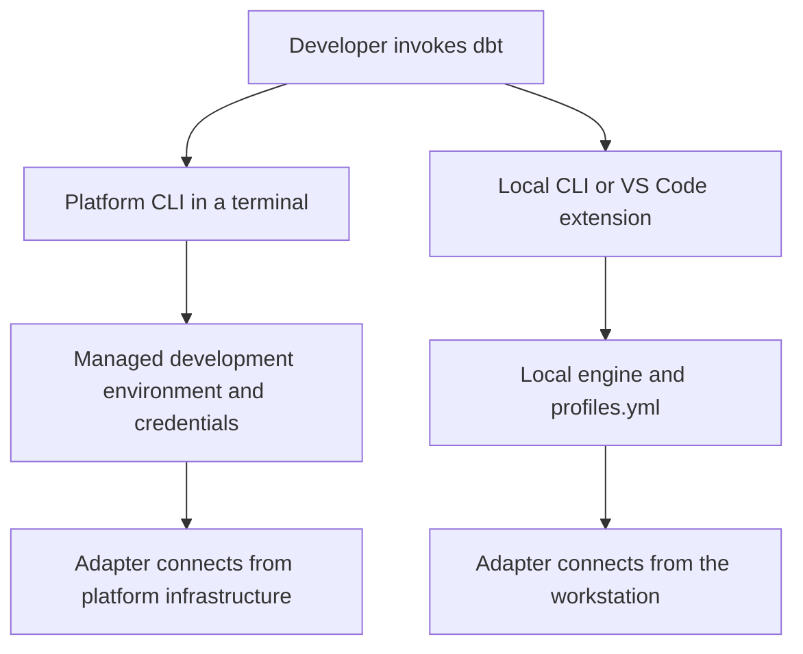

# dbt Cloud CLI, platform CLI and VS Code

You can run dbt from your local workstation, from dbt platform infrastructure, or from an editor that combines local speed with platform context. Each option changes where SQL compiles, which credentials authenticate to the warehouse, and how upstream tables are resolved.

The **dbt platform CLI** (formerly **dbt Cloud CLI**) runs commands from your terminal against dbt platform infrastructure. Your platform session supplies the project context, release track, and warehouse credentials, and automatically streams local edits to your cloud workspace. The **local dbt CLI** runs directly on your machine using `profiles.yml`. The **Official dbt VS Code extension** runs the local dbt v2 engine and language server on your machine, and can also connect to platform metadata for hybrid features like deferral.

| Interface | Where dbt runs | Connection and credentials |
| --- | --- | --- |
| **dbt platform CLI** | dbt platform development infrastructure | Configured in the platform project; automatically defers unselected parents to staging or production metadata. |
| **Local dbt v2 CLI** | Local workstation | Uses `profiles.yml`. Your laptop needs direct network access and credentials for the warehouse (or local DuckDB). |
| **Official dbt VS Code extension** | Local dbt v2 + language server (LSP) | Uses local `profiles.yml` for execution; in hybrid mode, reads `dbt_cloud.yml` for platform metadata, lineage, and deferral. |



## Resolving CLI conflicts and `dbt_cloud.yml`

- **Avoid binary collisions.** Both the platform CLI and local dbt CLI install an executable named `dbt`. Run `command -v dbt` and `dbt --version` in each terminal and VS Code integrated shell to confirm which binary runs. Alias one binary or invoke it by full path if both are installed. In VS Code, verify the extension's engine path setting because editor processes can inherit different `PATH` and environment variables than your shell.
- **Protect `dbt_cloud.yml`.** Managed CLI and hybrid VS Code setups download `dbt_cloud.yml` (typically to `~/.dbt/dbt_cloud.yml`). It stores your personal platform API token and project context, so keep it out of Git. In hybrid VS Code workflows, dbt can populate non-sensitive profile details from platform context while your local adapter still requires valid warehouse credentials and network reachability.

**Trace the connection.** Two developers open the same Git commit. One uses Studio and one uses the local CLI. If only the local connection times out, identify the machine that opens each warehouse connection. Check the workstation's network route before changing the shared model SQL. If both connect but read different parents, compare the compiled relation names instead.

## Practice

**With a platform project.** Pick a downstream model whose parent has already been built in staging or production, while your personal dev schema lacks that parent. Run `dbt environment show` to verify your project context. Run `dbt compile --select <model>` using the platform CLI's default deferral, then run `dbt compile --select <model> --no-defer` and compare the `from` clause in the compiled SQL.

**With DuckDB (local simulation).** Use a fresh disposable copy of the four [starter files](0004-adapters-profiles-and-the-local-shop-lab.md) to preview how deferral works (covered in depth in [lesson 0018](0018-state-comparison-and-deferral.md)). Add a `baseline` output under `outputs` in `profiles.yml`, sharing the same `shop.duckdb` file so `dev` can read `baseline` relations:

```yaml
    baseline:
      type: duckdb
      path: ./shop.duckdb
      schema: baseline
      threads: 2
```

Build the baseline target, archive its manifest outside `target/`, and compare two compiles on `dev`:

```bash
dbt build --profiles-dir . --target baseline --select +stg_orders
mkdir -p baseline-artifacts
cp target/manifest.json baseline-artifacts/
dbt compile --profiles-dir . --select stg_orders
dbt compile --profiles-dir . --select stg_orders --defer --state baseline-artifacts
```

**Expected result.** Open `target/compiled/shop_lab/models/stg_orders.sql` after each compile. The first compile points to `main.raw_orders`. The second points to `baseline.raw_orders` because `raw_orders` is unselected and missing from `main`, so `--defer` resolves it from the saved manifest. Delete the disposable copy when done.

## Recall

1. A model query works in Studio IDE and the platform CLI, but fails to connect from the Official VS Code extension on your laptop. Which differences should you check first?
2. Why might turning on `--defer` still compile a `ref()` to your personal development schema?
3. Both the platform CLI and local dbt v2 are installed on your machine, and VS Code behaves differently from your terminal. How do you diagnose which binary each one invokes?

??? note "Answer guidance"
    1. Compare the target profile, warehouse role, authentication method, and network access (such as VPN or IP allowlists). Studio and the platform CLI connect from dbt cloud infrastructure, whereas local VS Code connects directly from your workstation.
    2. Any resource explicitly included in the current `--select` builds in dev and resolves locally. By default, an existing relation in your dev schema also wins for unselected refs unless you pass `--favor-state`.
    3. Run `command -v dbt` and `dbt --version` in both the terminal and VS Code's shell, and inspect the VS Code dbt extension's configured binary path and environment variables.

[Platform CLI installation](https://docs.getdbt.com/docs/platform/dbt-cli-installation) · [Hybrid development](https://docs.getdbt.com/guides/dbt-platform-local-workflow) · [Local editor setup](https://docs.getdbt.com/docs/configure-dbt-extension) · [Platform deferral](https://docs.getdbt.com/docs/platform/about-defer)

| Previous | Curriculum | Next |
| --- | --- | --- |
| [Previous lesson](0004-adapters-profiles-and-the-local-shop-lab.md) | [All lessons](index.md) | [Next lesson](0006-models-refs-and-project-configuration.md) |
