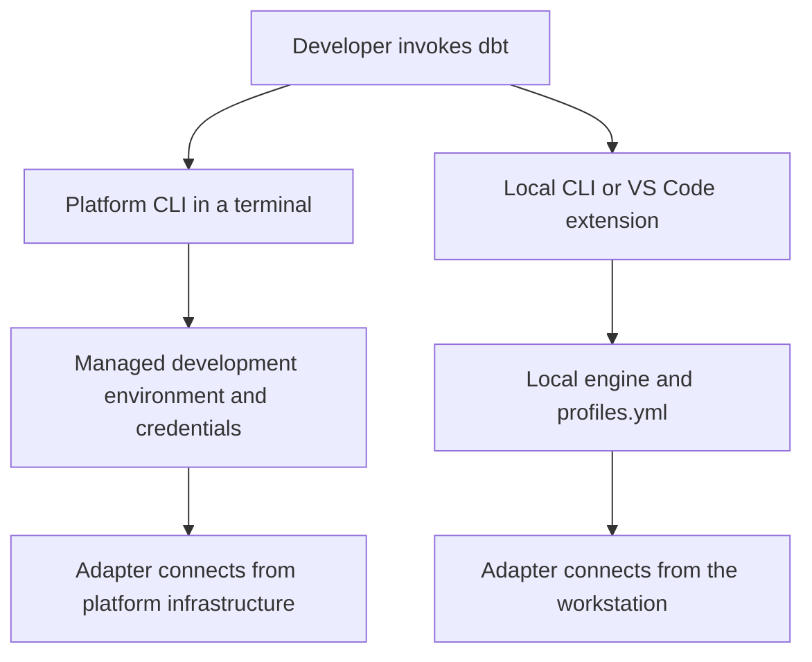

# dbt Cloud CLI, platform CLI and VS Code

The **dbt Cloud CLI**, now called the **dbt platform CLI**, sends terminal commands to the managed development environment. That environment's release track determines the engine that runs them. The **local dbt CLI** runs the installed engine on your machine. You can use local dbt v2 with a self-hosted profile or connect it to platform metadata in a hybrid workflow.

| Interface | Where dbt runs | Connection context |
| --- | --- | --- |
| dbt platform CLI | dbt platform development infrastructure | Your platform session identifies the project and development environment. The platform supplies the warehouse credentials and environment variables. |
| Local dbt v2 CLI | On your machine | `profiles.yml` sets the target. Your machine must be able to reach the warehouse. In the lab the adapter opens a local DuckDB file. |
| Official dbt VS Code extension | Local dbt v2 and its language server | A local profile connects directly to the data platform. In a connected project, the extension can also use platform metadata for features such as deferral. |



Both CLIs can install an executable called `dbt`. Use `command -v dbt` and `dbt --version` in the relevant terminal. If both are installed, give one an alias or invoke it by absolute path. In VS Code, also check the extension's configured engine path and environment variables. An editor process can have different variables from its integrated terminal.

For managed setup, download `dbt_cloud.yml` from your platform account and follow the CLI or extension guide to select the project context. Keep the file private. In the hybrid VS Code workflow, dbt can use that context to populate non-sensitive fields in your local profile. The local adapter still needs a working warehouse login and network route. The language server adds editor features such as diagnostics, navigation and lineage. Availability depends on the engine and analysis mode.

## Practice

**With a platform project**, choose an existing downstream model with a materialized parent that has been built in staging or production, and use a development schema where that parent is absent. Use `dbt environment show` to verify the project context. Compile only the downstream model with the platform CLI's default deferral, then add `--no-defer` and compile again. Compare the upstream relation in the rendered SQL. With deferral, an eligible unselected parent can resolve to the location recorded by a successful staging or production job. The development credentials still need read access to that relation.

**With DuckDB**, reproduce the same relation switch locally using full dbt v2. In a fresh copy of the four [starter files](0004-adapters-profiles-and-the-local-shop-lab.md), add this output under `outputs` beside `dev`, leaving `dev` as the default. The two schemas share one database file so the dev connection can read the baseline relation.

```yaml
    baseline:
      type: duckdb
      path: ./shop.duckdb
      schema: baseline
      threads: 2
```

```bash
dbt build --profiles-dir . --target baseline --select +stg_orders
mkdir -p baseline-artifacts
cp target/manifest.json baseline-artifacts/
dbt compile --profiles-dir . --select stg_orders
dbt compile --profiles-dir . --select stg_orders --defer --state baseline-artifacts
```

The first compile's `from` points to `main.raw_orders`. The second points to `baseline.raw_orders` because the seed is unselected and absent from `main`. Save the baseline manifest outside `target/` so the dev compile can write its own manifest. The saved file supplies the relation location. The database still holds the rows.

## Recall

1. Studio can query a warehouse table, but VS Code on your laptop cannot. Which connection details would you compare?
2. Why might turning on deferral leave a compiled `ref()` pointing to development?

??? note "Answer guidance"
    1. Compare the actual target, warehouse role and authentication method, plus network reachability from the host running dbt. Studio uses platform infrastructure. The local extension uses the workstation's connection and a local profile.
    2. An upstream node selected in the current invocation resolves locally. With default deferral precedence, an existing development relation can also win for an unselected node.

[Platform CLI installation](https://docs.getdbt.com/docs/platform/dbt-cli-installation) · [Hybrid development](https://docs.getdbt.com/guides/dbt-platform-local-workflow) · [Local editor setup](https://docs.getdbt.com/docs/configure-dbt-extension) · [Platform deferral](https://docs.getdbt.com/docs/platform/about-defer)

| Previous | Curriculum | Next |
| --- | --- | --- |
| [Previous lesson](0004-adapters-profiles-and-the-local-shop-lab.md) | [All lessons](index.md) | [Next lesson](0006-models-refs-and-project-configuration.md) |
