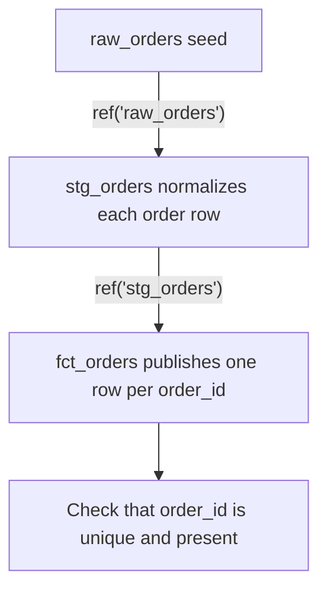

# Models, refs and project configuration

A SQL model is a named `select` that dbt compiles and builds using the model's materialization. In `fct_orders.sql`, `ref('stg_orders')` resolves the upstream relation for the active target and declares a dependency. A build that selects both models can use that edge to run staging first. A leading `+` in `+fct_orders` selects the fact and its ancestors, including the seed. [SQL models](https://docs.getdbt.com/docs/build/sql-models) · [ref](https://docs.getdbt.com/reference/dbt-jinja-functions/ref) · [Graph operators](https://docs.getdbt.com/reference/node-selection/graph-operators)

**Grain** is what one row represents. Here both `stg_orders` and `fct_orders` have one row per `order_id`. Staging standardizes input names, types and values while preserving the input grain. The lab's staging model lowercases `status` and casts `updated_at` to a timestamp. Intermediate models can prepare joins or aggregations. Marts publish business-facing facts and dimensions at an explicit grain. If an order joins to three line items, summing the order total after the join counts it three times. Aggregate line items to one row per order first when the output must retain order grain. [Staging conventions](https://docs.getdbt.com/best-practices/how-we-structure/2-staging)



## Practice

Start in the DuckDB `shop_lab` from [lesson 0004](0004-adapters-profiles-and-the-local-shop-lab.md). Add this model default to `dbt_project.yml`, merging into `models:` if it already exists. Under `shop_lab`, you can set more specific defaults for subfolders. A model's properties YAML `config:` overrides project defaults, and an in-file `config()` takes precedence for `materialized`. Use resource properties such as `description` and `columns` to document the model. [Config precedence](https://docs.getdbt.com/reference/define-configs)

```yaml
models:
  shop_lab:
    +materialized: view
```

Save this as `models/fct_orders.sql`.

```sql
{{ config(materialized='table') }}

select order_id, customer_id, status, total_cents, updated_at
from {{ ref('stg_orders') }}
```

Save this as `models/fct_orders.yml`. Extend this entry when adding fact properties in later lessons.

```yaml
models:
  - name: fct_orders
    description: Current order facts, one row per order_id. Totals are in cents.
    columns:
      - name: order_id
        data_tests: [unique, not_null]
```

```bash
dbt build --profiles-dir . --select +fct_orders
dbt show --profiles-dir . --inline "select count(*) as rows, count(distinct order_id) as orders from {{ ref('fct_orders') }}"
```

Expect both key tests to pass and both counts to be **3**. The build log should identify `stg_orders` as a view and `fct_orders` as a table. The inline preview selects from the built fact relation. [dbt show](https://docs.getdbt.com/reference/commands/show)

## Recall

1. What does `ref('stg_orders')` give dbt that a hardcoded table name doesn't?
2. Why is `customer_id` unsuitable as the uniqueness test for this fact?

??? note "Answer guidance"
    1. dbt can resolve the relation for the current environment and track the dependency for selection, execution order and lineage.
    2. The grain is one row per order, and customer 101 has two orders. Test `order_id` for both uniqueness and presence.

| Previous | Curriculum | Next |
| --- | --- | --- |
| [← Previous lesson](0005-dbt-cloud-cli-platform-cli-and-vs-code.md) | [All lessons](index.md) | [Next lesson →](0007-sources-and-freshness.md) |
