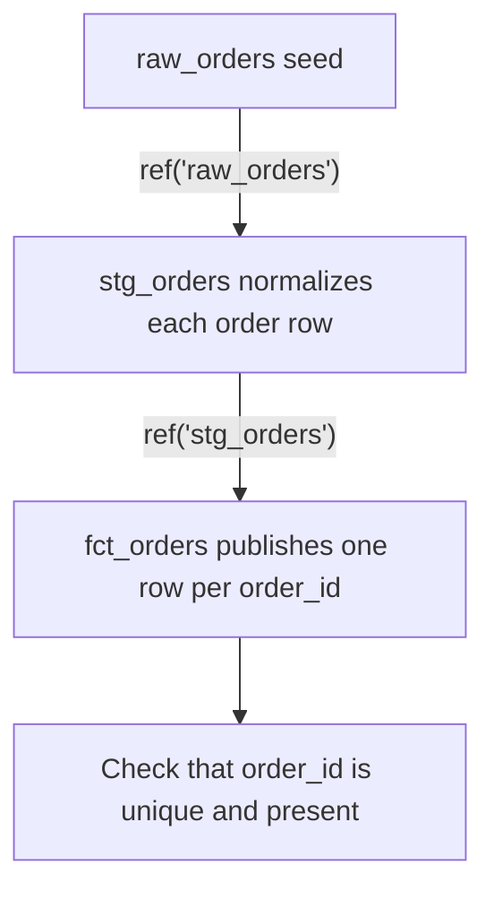

# Models, refs and project configuration

A SQL model is a `select` query stored under `models/`. When dbt compiles the file, `{{ ref('stg_orders') }}` resolves the upstream table or view name for the active target and adds a dependency edge to the DAG. Passing `+fct_orders` to `dbt build` walks those edges upstream and loads `raw_orders` and `stg_orders` before building `fct_orders`. [SQL models](https://docs.getdbt.com/docs/build/sql-models) · [ref](https://docs.getdbt.com/reference/dbt-jinja-functions/ref)

## Model layers and grain

Teams organize models into three layers so cleaning logic happens once and business grains stay clear:

- **Staging (`stg_<source>__<entity>`)** selects 1:1 from a single source or raw seed, renames columns, casts types, and normalizes values (`lower(status)`) without joining or aggregating.
- **Intermediate (`int_<entity>_<verb>`)** prepares reusable joins, filters, or pre-aggregations needed before building final marts.
- **Marts (`fct_<entity>`, `dim_<entity>`)** publishes business-facing facts and dimensions at a declared **grain** (what one row represents).

Here both `stg_orders` and `fct_orders` have one row per `order_id`. If an order has three line items and you join items before aggregating them, summing `total_cents` counts that order three times. Always aggregate child records to the parent grain first. [Staging conventions](https://docs.getdbt.com/best-practices/how-we-structure/2-staging)



On supported platforms (Snowflake, BigQuery, Databricks, and DuckDB in Core v1), dbt also supports Python models (`.py` files defining `def model(dbt, session):`) for ML scoring or complex procedural transforms that are awkward in SQL. Prefer SQL models whenever SQL expresses the logic cleanly.

## Configuration precedence and custom schemas

dbt merges model configuration from least specific to most specific:

1. **Project defaults in `dbt_project.yml`.** Set defaults for the whole project or specific subdirectories (such as `staging:` or `marts:`). Prefix config keys with `+` (for example `+materialized: view`) so dbt tells configuration properties apart from folder names.
2. **Properties YAML `config:` block** overrides project defaults for one model in `models/fct_orders.yml`.
3. **In-file `{{ config(...) }}`** overrides both YAML layers directly inside the `.sql` model file. [Config precedence](https://docs.getdbt.com/reference/define-configs)

If you set `+schema: marts`, dbt appends that suffix to your target schema (`main_marts` in dev) by default. Teams customize the `generate_schema_name` macro when production jobs should write directly to `marts` without the target prefix.

## Practice

### What you need

Start in the `shop_lab` directory from [lesson 0004](0004-adapters-profiles-and-the-local-shop-lab.md).

### Steps

1. Add a project default to `dbt_project.yml` (merge under `models:` if that section already exists):

```yaml
models:
  shop_lab:
    +materialized: view
```

2. Create `models/fct_orders.sql`. Its in-file config overrides the project's `view` default:

```sql
{{ config(materialized='table') }}

select order_id, customer_id, status, total_cents, updated_at
from {{ ref('stg_orders') }}
```

3. Create `models/fct_orders.yml` to document the grain and enforce primary-key tests. Keep extending this file in later lessons:

```yaml
models:
  - name: fct_orders
    description: Current order facts, one row per order_id. Totals are in cents.
    columns:
      - name: order_id
        data_tests: [unique, not_null]
```

4. Build the DAG and inspect the row and distinct key counts:

```bash
dbt build --profiles-dir . --select +fct_orders
dbt show --profiles-dir . --inline "select count(*) as rows, count(distinct order_id) as orders from {{ ref('fct_orders') }}"
```

**Expected result.** The build output lists `stg_orders` as a `view` and `fct_orders` as a `table`. Both `unique` and `not_null` tests pass, and `dbt show` returns **3** for both `rows` and `orders`. [dbt show](https://docs.getdbt.com/reference/commands/show)

## Recall

1. What does `ref('stg_orders')` give dbt that a hardcoded table name does not?
2. Why is `customer_id` unsuitable for the `unique` test on `fct_orders`?
3. Why do keys under `models:` in `dbt_project.yml` start with `+`, and which wins if `dbt_project.yml` sets `+materialized: view` while `fct_orders.sql` sets `materialized='table'`?

??? note "Answer guidance"
    1. `ref()` resolves the relation in the active environment and records the dependency edge for DAG ordering, `+` graph selection, and impact analysis.
    2. The grain of `fct_orders` is one row per order, and customer 101 placed two orders. Test `order_id` for both uniqueness and presence.
    3. The `+` prefix tells dbt that the key is a configuration setting rather than a subdirectory name under `models/`. In-file `{{ config(...) }}` has highest precedence, so `fct_orders` builds as a table.

| Previous | Curriculum | Next |
| --- | --- | --- |
| [Previous lesson](0005-dbt-cloud-cli-platform-cli-and-vs-code.md) | [All lessons](index.md) | [Next lesson](0007-sources-and-freshness.md) |
