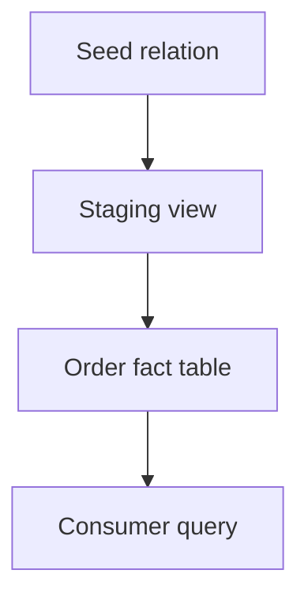

# Models, refs and project configuration

`ref()` resolves the relation for the current target and adds a graph edge. Staging normalizes types and names close to the upstream grain. Intermediate models handle reusable joins or transformations. Marts publish stable, business-facing facts and dimensions. Declare a model's grain before joining, since a one-to-many join can multiply facts.

Use YAML descriptions and project-level defaults for teams and folders. Per-model config is useful for decisions such as materializing a fact as a table. Some adapters also support Python models with distinct runtime and materialization constraints.



## Practice

Save this as `models/fct_orders.sql`.

```sql
{{ config(materialized='table') }}

select order_id, customer_id, status, total_cents, updated_at
from {{ ref('stg_orders') }}
```

Run `dbt build --select +fct_orders`. Predict the row count and grain, then compare the result of `dbt show --select fct_orders`.

## Recall

What two behaviors would you lose if you replaced the ref with a literal schema and table?

[SQL models](https://docs.getdbt.com/docs/build/sql-models)

| Previous | Curriculum | Next |
| --- | --- | --- |
| [← Previous lesson](0005-dbt-cloud-cli-platform-cli-and-vs-code.md) | [All lessons](index.md) | [Next lesson →](0007-sources-and-freshness.md) |
