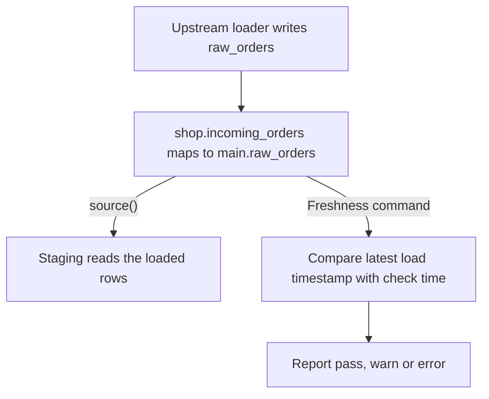

# Sources and freshness

Declare a **source** for a relation owned by an upstream system. A call to `source('shop', 'incoming_orders')` resolves the configured relation and records a lineage edge. The YAML gives dbt a logical source and table name plus the physical database and schema as needed. Use `identifier` when the physical table name differs from the logical one. The ingestion system is responsible for creating and loading the relation. [Sources](https://docs.getdbt.com/docs/build/sources) · [source](https://docs.getdbt.com/reference/dbt-jinja-functions/source)

With `loaded_at_field`, dbt compares the latest timestamp in the source to the check time and applies `warn_after` and `error_after`. Choose thresholds against the agreed delivery cadence. Prefer a reliable ingestion timestamp when measuring delivery. An order date measures when the order happened, and a backfill of old orders can arrive today. Some adapters can use warehouse metadata for freshness. A recent maximum can coexist with missing partitions or invalid rows, so schedule both freshness checks and data tests. Decide which freshness status should alert the ingestion owner and which should block a dependent build. [Freshness config](https://docs.getdbt.com/reference/resource-configs/freshness)



## Practice

In the [DuckDB shop lab](0004-adapters-profiles-and-the-local-shop-lab.md), use the seed as a stand-in for a loaded source. Keep the existing `stg_orders` on `ref('raw_orders')` so standard lab builds still load the fixture.

Add `models/sources.yml`. The fixture has no ingestion timestamp, so this exercise measures the age of its fixed `updated_at` values.

```yaml
sources:
  - name: shop
    schema: main
    tables:
      - name: incoming_orders
        identifier: raw_orders
        config:
          loaded_at_field: "cast(updated_at as timestamp)"
          freshness:
            warn_after: {count: 6, period: hour}
            error_after: {count: 1, period: day}
        columns:
          - name: order_id
            data_tests: [not_null]
```

Add a scratch model at `models/stg_incoming_orders.sql` to exercise the source reference.

```sql
select order_id, lower(status) as status
from {{ source('shop', 'incoming_orders') }}
```

```bash
dbt seed --profiles-dir . --select raw_orders
dbt show --profiles-dir . --select stg_incoming_orders
dbt test --profiles-dir . --select source:shop.incoming_orders
dbt source freshness --profiles-dir . --select source:shop.incoming_orders
```

Expect **three preview rows** and a passing `not_null` test. The maximum fixture timestamp is **2026-01-03 10:00:00**. Expect a freshness error when the check is more than a day after that timestamp. Inspect the output and `target/sources.json` for the timestamp and status. dbt v2 treats the timezone-free fixture values as UTC.

After the exercise, remove the scratch SQL file and the temporary `columns:` block. Keep the source mapping for future freshness checks. The seed and source share a physical table in this lab, but dbt tracks them as separate resources, so run the seed before checking the source.

!!! note "Version"
    The exercise uses the source-specific command. dbt v2 also has `dbt freshness` for models and sources. Older Core releases may require `freshness` and `loaded_at_field` directly on the source or table, outside `config:`. Consult the docs for your release. [Source freshness command](https://docs.getdbt.com/reference/commands/source) · [dbt freshness command](https://docs.getdbt.com/reference/commands/freshness)

## Recall

1. What changes in YAML if ingestion renames `raw_orders` but the logical name stays the same?
2. A freshness check passes and a daily partition is missing. What would catch the missing data?

??? note "Answer guidance"
    1. Update `identifier`. The model still calls `source('shop', 'incoming_orders')`.
    2. Check for expected partitions or reconcile counts against the loader. A maximum load timestamp only shows how recent the newest observed row is.

| Previous | Curriculum | Next |
| --- | --- | --- |
| [← Previous lesson](0006-models-refs-and-project-configuration.md) | [All lessons](index.md) | [Next lesson →](0008-seeds-and-lookup-data.md) |
