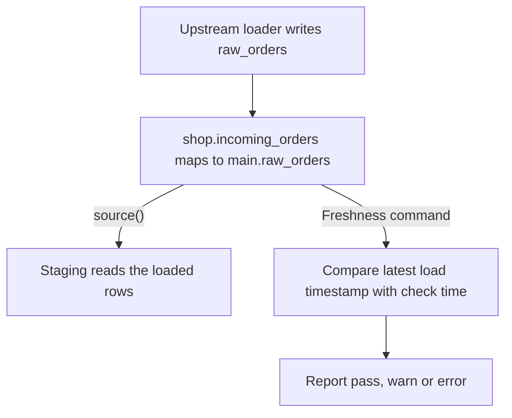

# Sources and freshness

Your dbt project does not load raw data from operational databases or SaaS tools. An upstream ingestion pipeline creates and populates those tables, and you declare them in YAML as **sources**. Calling `{{ source('shop', 'incoming_orders') }}` in a staging model resolves the physical location and records the source node at the root of your DAG. [Sources](https://docs.getdbt.com/docs/build/sources) · [source](https://docs.getdbt.com/reference/dbt-jinja-functions/source)

## Declaring upstream sources

Source YAML separates the logical name your models call (`shop.incoming_orders`) from physical warehouse naming (`database`, `schema`, and `identifier`):

- Use `identifier` when the physical warehouse table name differs from the logical table name you want in dbt.
- Attach `data_tests` (such as `not_null` or `unique`) directly to source columns to verify raw keys before staging reads them.
- Reference each source table in a single staging model so renaming and type casting stay in one place.

## Measuring source freshness



When you configure `loaded_at_field` and `freshness`, dbt compares the newest timestamp in the table against the current check time and evaluates `warn_after` and `error_after` thresholds: [Freshness config](https://docs.getdbt.com/reference/resource-configs/freshness)

- **Pick an ingestion timestamp, not a business date.** An `order_date` shows when a customer ordered, whereas an ingestion timestamp (`_loaded_at`) shows when the loader last committed rows. A backfill of old orders can arrive today while `order_date` looks stale.
- **Filter large tables.** On partitioned tables, add a `filter:` expression (for example `updated_at >= current_date - 2`) inside freshness config so dbt avoids full-table scans when finding `max(loaded_at_field)`. Some adapters can also inspect warehouse metadata via `loaded_at_query` or catalog metadata.
- **Pair freshness with data completeness tests.** A single newly arrived row satisfies `max(loaded_at_field)` even if an earlier daily partition dropped.
- **Decide alert vs block policies.** Use `warn_after` to notify the ingestion owner and `error_after` to halt downstream publication when stale inputs would mislead consumers.

## Practice

### What you need

Use [the DuckDB shop lab](0004-adapters-profiles-and-the-local-shop-lab.md). The `raw_orders` seed stands in for a loaded source table. Keep `models/stg_orders.sql` pointing at `ref('raw_orders')` so regular lab builds still load the seed.

### Steps

1. Create `models/sources.yml`. Because the starter seed lacks an ingestion timestamp column, this exercise measures the age of its fixed `updated_at` values:

```yaml
sources:
  - name: shop
    schema: main
    tables:
      - name: incoming_orders
        identifier: raw_orders
        config:
          loaded_at_field: "cast(updated_at as timestamp)"
          freshness:
            warn_after: {count: 6, period: hour}
            error_after: {count: 1, period: day}
        columns:
          - name: order_id
            data_tests: [not_null]
```

2. Create a temporary staging file `models/stg_incoming_orders.sql`:

```sql
select order_id, lower(status) as status
from {{ source('shop', 'incoming_orders') }}
```

3. Load the underlying seed table first, then test and inspect freshness:

```bash
dbt seed --profiles-dir . --select raw_orders
dbt show --profiles-dir . --select stg_incoming_orders
dbt test --profiles-dir . --select source:shop.incoming_orders
dbt source freshness --profiles-dir . --select source:shop.incoming_orders
```

**Expected result.** `dbt show` returns three rows, and `dbt test` passes `not_null`. Because the newest fixture timestamp is **2026-01-03 10:00:00** (treated as UTC in dbt v2), `dbt source freshness` reports an `error` when run more than a day after that date. Open `target/sources.json` to inspect `max_loaded_at`, `snapshotted_at`, and `status`.

4. **Cleanup.** Remove `models/stg_incoming_orders.sql` and the temporary `columns:` block from `models/sources.yml`. Keep the source mapping in `models/sources.yml` for later freshness exercises.

!!! note "Version differences"
    The practice uses `dbt source freshness`. dbt v2 also provides `dbt freshness` for checking models as well as sources. Older Core v1 releases expect `freshness` and `loaded_at_field` directly on the source or table rather than nested under `config:`. [Source freshness command](https://docs.getdbt.com/reference/commands/source) · [dbt freshness command](https://docs.getdbt.com/reference/commands/freshness)

## Recall

1. What changes in `sources.yml` if the ingestion team renames the physical table from `raw_orders` to `orders_v2` while your models still expect `source('shop', 'incoming_orders')`?
2. A source freshness check returns `pass`, yet yesterday's orders are missing. How can that happen, and what catches it?
3. Why should `loaded_at_field` reference an ingestion timestamp rather than the order creation timestamp, and how can you avoid scanning an entire multi-terabyte table?

??? note "Answer guidance"
    1. Change `identifier: raw_orders` to `identifier: orders_v2`. All downstream `source('shop', 'incoming_orders')` calls keep working unchanged.
    2. `max(loaded_at_field)` only confirms that at least one recent row arrived. Earlier batches or partitions can still be missing. Add partition completeness checks or row-count reconciliations against the source system.
    3. An ingestion timestamp measures when rows actually reached the warehouse, regardless of historical event dates. Add a `filter` in the freshness config to restrict the scan to recent partitions.

| Previous | Curriculum | Next |
| --- | --- | --- |
| [Previous lesson](0006-models-refs-and-project-configuration.md) | [All lessons](index.md) | [Next lesson](0008-seeds-and-lookup-data.md) |
