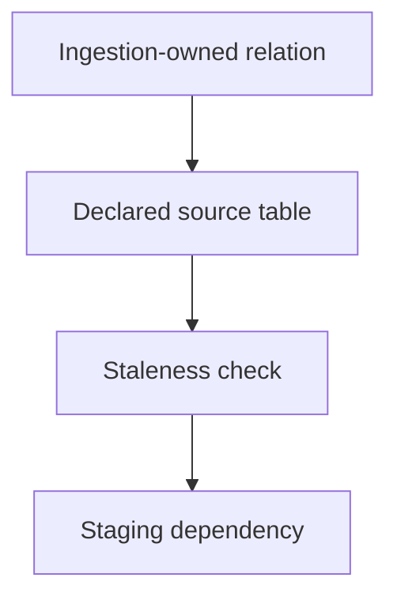

# Sources and freshness

A source maps a logical name to an externally owned relation. It allows dbt to document upstream dependencies and attach tests, ownership metadata, and freshness settings. `identifier` maps a logical table name to its physical name. Freshness checks use an observed load time field or supported metadata and evaluate it against warning and error thresholds.

Use an ingestion timestamp where possible. An event timestamp measures a different thing and can make a late backfill look stale. Run source freshness explicitly and decide how the scheduler should handle each threshold.



## Practice

Create `models/sources.yml` with the following local mapping. The seed stands in for a loaded source in this exercise. Keep the lab staging model on `ref('raw_orders')` so the standard lab builds still include the seed.

```yaml
sources:
  - name: shop
    schema: main
    tables:
      - name: incoming_orders
        identifier: raw_orders
        config:
          loaded_at_field: "cast(updated_at as timestamp)"
          freshness:
            warn_after: {count: 6, period: hour}
            error_after: {count: 1, period: day}
```

After seeding, run `dbt source freshness --select source:shop.incoming_orders`. The fixed fixture timestamps should trip the threshold outside the fixture window. Compare that result with a successful `not_null` test on an order ID.

## Recall

How would you detect a source that arrived on time but contained invalid rows?

[Sources](https://docs.getdbt.com/docs/build/sources)

| Previous | Curriculum | Next |
| --- | --- | --- |
| [← Previous lesson](0006-models-refs-and-project-configuration.md) | [All lessons](index.md) | [Next lesson →](0008-seeds-and-lookup-data.md) |
