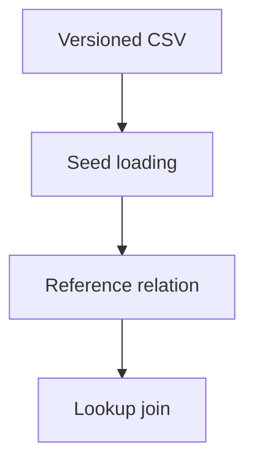

# Seeds and lookup data

Seeds load repository CSVs as database tables. They work well for small reviewable lookup values and stable test fixtures. Document the update owner and use tests on keys and allowed domains. Set `column_types` when inference would change identifiers such as postal codes with leading zeros.

When a seed's column shape changes, check whether the adapter requires a full refresh to recreate the relation. Review downstream changes before refreshing anything shared. Use ingestion and access controls suitable for large or sensitive datasets.

## Practice

Create `seeds/order_statuses.csv` with columns `status,is_reportable` and rows `paid,true` and `pending,false`. Run `dbt seed --select order_statuses`. Write a select joining it to `fct_orders` using refs. Verify that the two paid orders are reportable and that a new unexpected status is detectable with a relationship test.

## Recall

What can happen to a fact table if the lookup seed has duplicate keys?

[Seeds](https://docs.getdbt.com/docs/build/seeds)

| Previous | Curriculum | Next |
| --- | --- | --- |
| [← Previous lesson](0007-sources-and-freshness.md) | [All lessons](index.md) | [Next lesson →](0009-views-tables-ephemeral-models-and-adapter-choices.md) |
