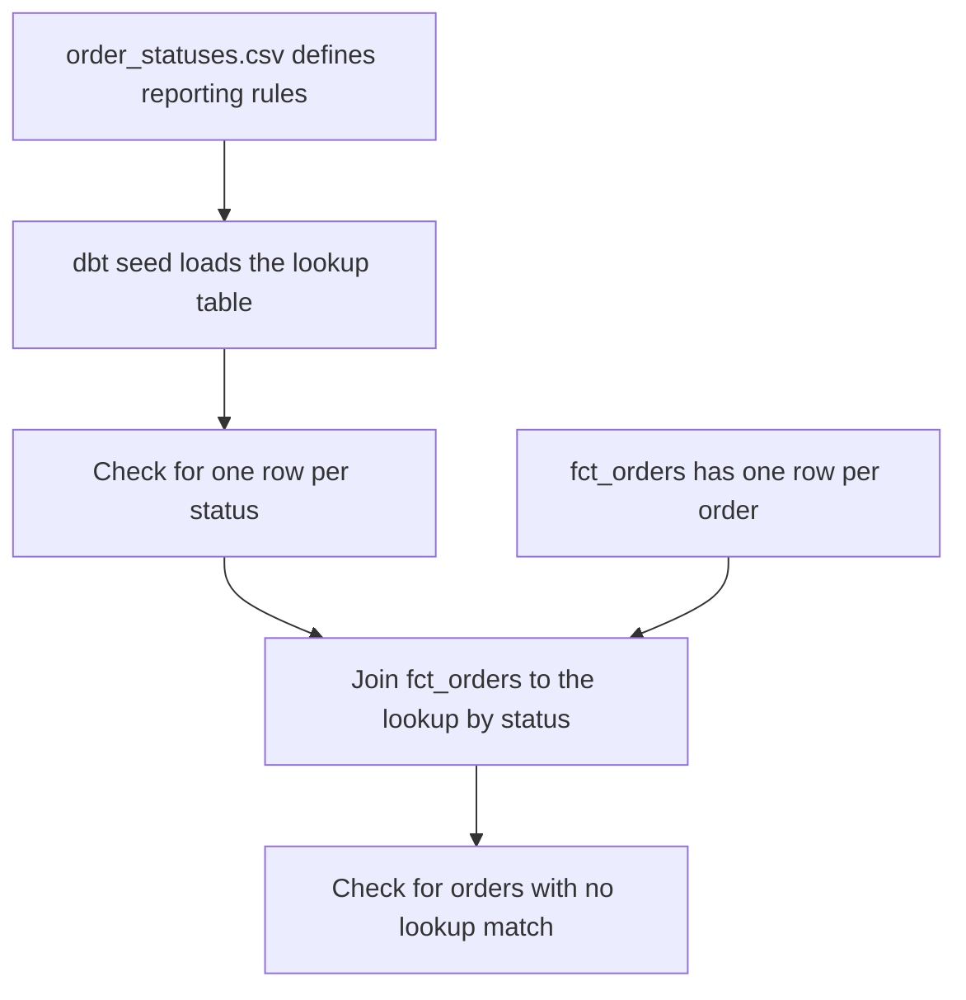

# Seeds and lookup data

A **seed** is a CSV file placed in `seeds/` (or your configured `seed-paths`). Running `dbt seed` loads it into a database table, and downstream models reference it with `{{ ref('order_statuses') }}`. Seeds keep small, version-controlled lookup mappings and test fixtures inside Git so a pull request reviews both the lookup edit and its effect on models. [Seeds](https://docs.getdbt.com/docs/build/seeds)

## When seeds fit and how they behave

- **Keep seeds small.** dbt compiles seeds into SQL `INSERT` statements (or adapter batches), so large CSVs bloat Git history, slow parsing, and hit query limits. As a rule of thumb, use seeds for static lookup tables under a few thousand rows and roughly 1 MB. Route operational tables, PII, and frequently changing feeds through your ELT ingestion loader and `source()`.
- **Pin types explicitly.** dbt infers seed column types from sample values. Set `column_types` with target SQL types whenever formatting matters, such as `varchar` for ZIP codes with leading zeros or `boolean` for flags. You can also configure `delimiter`, `quote_columns`, and `+schema` in YAML.
- **Recreate on schema edits.** A normal `dbt seed` truncates and reloads rows. When you add, rename, or retype a CSV column, run `dbt seed --full-refresh --select order_statuses` to drop and recreate the table with the new schema. [column_types](https://docs.getdbt.com/reference/resource-configs/column_types)



Before joining a fact table to a lookup seed, test two assumptions: the lookup key must be `unique` and `not_null` (so the join cannot multiply fact rows), and every fact key should map to a lookup row (checked with a `relationships` generic test or a singular left-join query).

## Practice

### What you need

Work in [shop_lab](0004-adapters-profiles-and-the-local-shop-lab.md) with [`fct_orders`](0006-models-refs-and-project-configuration.md) and the original three rows in `seeds/raw_orders.csv`.

### Steps

1. Create `seeds/order_statuses.csv`:

```csv
status,is_reportable
paid,true
pending,false
```

2. Create `seeds/order_statuses.yml` with explicit types and key tests:

```yaml
seeds:
  - name: order_statuses
    description: Reporting eligibility by order status, maintained with the shop models.
    config:
      column_types:
        status: varchar
        is_reportable: boolean
    columns:
      - name: status
        data_tests: [unique, not_null]
      - name: is_reportable
        data_tests: [not_null]
```

3. Build both the fact and the lookup seed, then preview a left join:

```bash
dbt build --profiles-dir . --select +fct_orders order_statuses
dbt show --profiles-dir . --inline "
select o.order_id, o.status, s.is_reportable
from {{ ref('fct_orders') }} as o
left join {{ ref('order_statuses') }} as s on o.status = s.status
order by o.order_id"
```

**Expected result.** All lookup tests pass, and the join returns **3 rows**: orders **1** and **3** have `is_reportable = true`, and order **2** has `false`.

4. Add a temporary singular test in `tests/order_status_has_lookup.sql` to catch unmapped statuses (the equivalent declarative YAML test is `relationships` with `to: ref('order_statuses')` and `field: status` under `arguments:`):

```sql
select o.order_id, o.status
from {{ ref('fct_orders') }} as o
left join {{ ref('order_statuses') }} as s on o.status = s.status
where s.status is null
```

5. Run `dbt test --profiles-dir . --select order_status_has_lookup` and confirm it passes.
6. Temporarily delete `pending,false` from `seeds/order_statuses.csv`, run `dbt seed --profiles-dir . --select order_statuses`, and rerun the test. Confirm it reports **1 failing row** (order 2).
7. **Cleanup.** Restore `pending,false` in `seeds/order_statuses.csv`, run `dbt seed --profiles-dir . --select order_statuses`, verify `order_status_has_lookup` passes again, and delete `tests/order_status_has_lookup.sql`. Keep `order_statuses.csv` and `order_statuses.yml` in `shop_lab` for later lessons. [Data tests](https://docs.getdbt.com/reference/resource-properties/data-tests)

## Recall

1. What happens to `fct_orders` revenue totals if `order_statuses.csv` accidentally contains two rows for `paid`?
2. Why check lookup coverage (`relationships` or left-join test) after already testing `order_statuses.status` for uniqueness?
3. When you add a `display_label` column to `order_statuses.csv`, why might a plain `dbt seed` fail until you add `--full-refresh`?

??? note "Answer guidance"
    1. Every `paid` order matches both seed rows during the join, doubling paid order counts and inflating revenue sums.
    2. Uniqueness only limits matches to at most one row. A coverage check proves that every observed order status exists in the lookup so new upstream statuses are caught instead of returning null or dropping in an inner join.
    3. A standard `dbt seed` truncates and inserts into the existing table schema, which lacks the new column. Passing `--full-refresh` drops and recreates the seed table with the updated CSV columns.

| Previous | Curriculum | Next |
| --- | --- | --- |
| [Previous lesson](0007-sources-and-freshness.md) | [All lessons](index.md) | [Next lesson](0009-views-tables-ephemeral-models-and-adapter-choices.md) |
