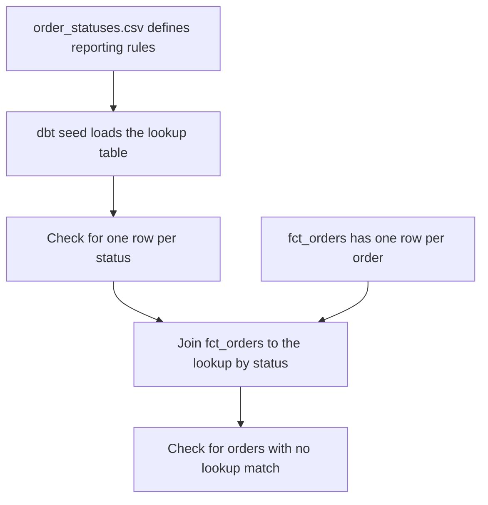

# Seeds and lookup data

A **seed** is a CSV in a configured `seed-paths` directory. `dbt seed` loads it into a table, and models use `ref()` with the CSV basename. Seeds suit small, version-controlled lookup data and fixtures. A pull request can review both the lookup change and its impact on a model. Use the upstream ingestion path for data that is large, sensitive or frequently updated. [Seeds](https://docs.getdbt.com/docs/build/seeds)

dbt can infer seed column types. Set `column_types` using target-specific SQL types when the representation matters. For example, use `varchar` in DuckDB for a postal code with leading zeros. A regular reseed replaces the data. When a header or column type changes, a scoped `dbt seed --full-refresh --select order_statuses` recreates this seed table. Check adapter behavior and dependent relations before changing its shape in a shared schema. [column_types](https://docs.getdbt.com/reference/resource-configs/column_types)



## Practice

Use the [DuckDB shop lab](0004-adapters-profiles-and-the-local-shop-lab.md) with [`fct_orders`](0006-models-refs-and-project-configuration.md). Leave `raw_orders.csv` as supplied. If the fact is missing, create `models/fct_orders.sql` with `{{ config(materialized='table') }}` above `select order_id, customer_id, status, total_cents, updated_at from {{ ref('stg_orders') }}`.

Create `seeds/order_statuses.csv`.

```csv
status,is_reportable
paid,true
pending,false
```

Add `seeds/order_statuses.yml`.

```yaml
seeds:
  - name: order_statuses
    description: Reporting eligibility by order status, maintained with the shop models.
    config:
      column_types:
        status: varchar
        is_reportable: boolean
    columns:
      - name: status
        data_tests: [unique, not_null]
      - name: is_reportable
        data_tests: [not_null]
```

```bash
dbt build --profiles-dir . --select +fct_orders order_statuses
dbt show --profiles-dir . --inline "
select o.order_id, o.status, s.is_reportable
from {{ ref('fct_orders') }} as o
left join {{ ref('order_statuses') }} as s on o.status = s.status
order by o.order_id"
```

Expect the lookup tests to pass and the join to return **three rows**. Orders **1 and 3** are reportable, and order **2** is false. A left join keeps unmapped orders visible with a null flag. Detect them with this SQL data test in `tests/order_status_has_lookup.sql`.

```sql
select o.order_id, o.status
from {{ ref('fct_orders') }} as o
left join {{ ref('order_statuses') }} as s on o.status = s.status
where s.status is null
```

Run `dbt test --profiles-dir . --select order_status_has_lookup` and expect a pass. Temporarily remove `pending,false` from the lookup, reseed with `dbt seed --profiles-dir . --select order_statuses`, and rerun the test. Expect **one failing row**, order 2. Restore the CSV, reseed, verify the test passes, then remove the exercise test file. The built-in `relationships` test can also check lookup coverage for non-null keys. [Data tests](https://docs.getdbt.com/reference/resource-properties/data-tests)

## Recall

1. What happens to the fact's grain if the seed contains two rows for `paid`?
2. Why check coverage after testing the seed key for uniqueness?

??? note "Answer guidance"
    1. Each paid order appears twice after the join, so sums and counts can inflate.
    2. Uniqueness caps the match count at one. Coverage verifies there is a match for every order status.

| Previous | Curriculum | Next |
| --- | --- | --- |
| [← Previous lesson](0007-sources-and-freshness.md) | [All lessons](index.md) | [Next lesson →](0009-views-tables-ephemeral-models-and-adapter-choices.md) |
