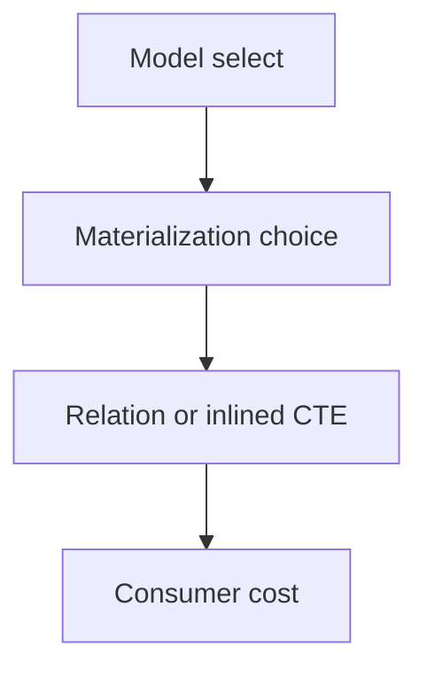

# Views, tables, ephemeral models and adapter choices

A materialization decides how dbt turns a model into something downstream SQL can reference. A view stores a query definition and evaluates it when read. A table stores computed results and needs rebuilding or refreshing. An ephemeral model compiles into a CTE in downstream queries and has no standalone relation to query. Materialized views and other specialized types depend on adapter support and refresh semantics.

Each choice affects freshness, read latency, write cost, and debuggability. Reused expensive joins are a good place to evaluate tables. Treat custom materializations as deployment code because they own database writes and cleanup.

## Practice

In the sandbox, run the fact as a table, then switch it to a view and build again. Compare the relation type and warehouse work. Try an ephemeral helper used by the fact and locate the inlined CTE in compiled SQL.

## Recall

Why can an ephemeral model make multiple downstream queries more expensive?

[Materializations](https://docs.getdbt.com/docs/build/materializations)

| Previous | Curriculum | Next |
| --- | --- | --- |
| [← Previous lesson](0008-seeds-and-lookup-data.md) | [All lessons](index.md) | [Next lesson →](0010-incremental-models-late-data-and-backfills.md) |
