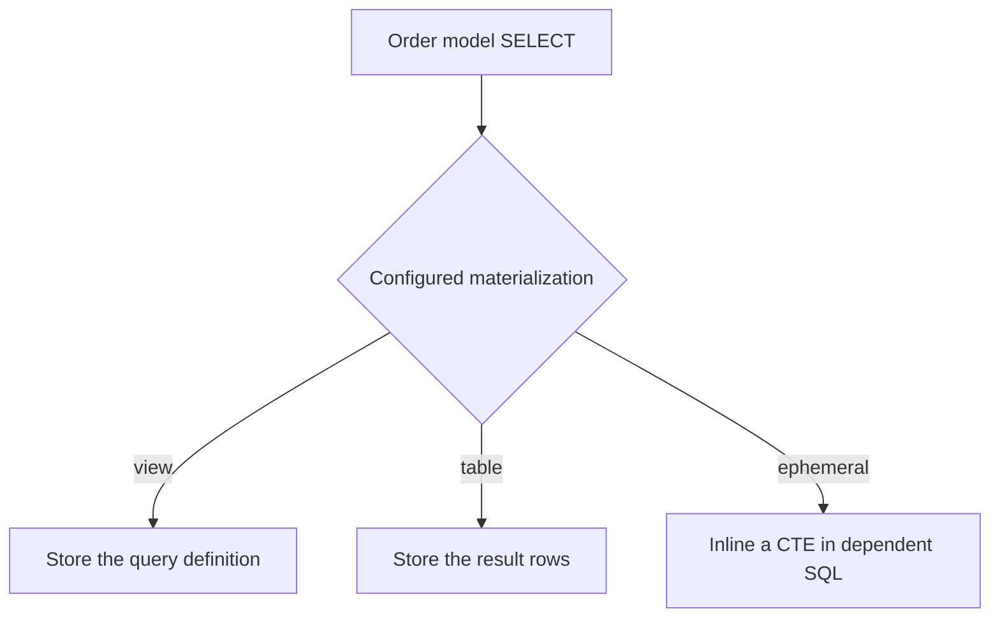

# Views, tables, ephemeral models and adapter choices

A **materialization** tells dbt how to expose a model's query. Start with the expected read pattern and freshness requirement. [Materializations](https://docs.getdbt.com/docs/build/materializations)

| Choice | What dbt builds | When to use it |
| --- | --- | --- |
| `view` | A stored query definition. Reads evaluate it against the upstream relations. | A lightweight staging projection whose consumers should see upstream changes as soon as those relations change. |
| `table` | Stored query results rebuilt by dbt when the model runs. | A frequently queried fact or an expensive join whose build can absorb the compute cost. Data reflects the last successful build. |
| `ephemeral` | A CTE in the compiled SQL of each dependent model. | A small helper used by a few models. Its logic can run in multiple dependent queries, and warehouse users cannot query it as a standalone relation. |

A materialized view can persist results and refresh them through warehouse mechanisms. Availability, refresh rules and supported configuration changes depend on the adapter and engine version. Check those before relying on any refresh guarantee. Compare representative reads and build costs on your target warehouse before changing a shared model. [Materializations](https://docs.getdbt.com/docs/build/materializations) · [Supported data platforms](https://docs.getdbt.com/docs/supported-data-platforms)



## Practice

In the [DuckDB shop lab](0004-adapters-profiles-and-the-local-shop-lab.md), use [`fct_orders`](0006-models-refs-and-project-configuration.md) with its `table` config. If the fact is missing, create `models/fct_orders.sql` with `{{ config(materialized='table') }}` above `select order_id, customer_id, status, total_cents, updated_at from {{ ref('stg_orders') }}`. Build it and check DuckDB's catalog.

```bash
dbt build --profiles-dir . --select +fct_orders
dbt show --profiles-dir . --inline "
select table_type from information_schema.tables
where table_schema = 'main' and table_name = 'fct_orders'"
```

Expect **BASE TABLE**. Change only the fact's config to `materialized='view'`, then repeat both commands. Expect **VIEW** and the same three orders in the fact. The catalog reports how the data is exposed. A small fixture is useful for checking behavior, and representative queries are needed to compare performance.

Restore `materialized='table'`. Create `models/int_orders_for_fact.sql` as a temporary helper.

```sql
{{ config(materialized='ephemeral') }}

select order_id, customer_id, status, total_cents, updated_at
from {{ ref('stg_orders') }}
```

In the fact, change the input to `{{ ref('int_orders_for_fact') }}`. Compile, then build.

```bash
dbt compile --profiles-dir . --select fct_orders
dbt build --profiles-dir . --select +fct_orders
dbt show --profiles-dir . --inline "
select count(*) as helper_relations from information_schema.tables
where table_schema = 'main' and table_name = 'int_orders_for_fact'"
```

Inspect `target/compiled/shop_lab/models/fct_orders.sql` for the inlined helper CTE containing the select from staging. Expect **0** helper relations and the same fact grain. Restore the fact's reference to `stg_orders`, remove the helper file, and rebuild the table.

## Recall

1. A dashboard must reflect upstream changes between dbt runs. What trade-off comes with a view?
2. Where do you inspect a helper's SQL if it's materialized as ephemeral?

??? note "Answer guidance"
    1. A view can read the current upstream data. Queries pay the cost of evaluating its logic, and freshness still depends on the upstream relations.
    2. Inspect the dependent model's compiled SQL for the inlined CTE.

| Previous | Curriculum | Next |
| --- | --- | --- |
| [Previous lesson](0008-seeds-and-lookup-data.md) | [All lessons](index.md) | [Next lesson](0010-incremental-models-late-data-and-backfills.md) |
