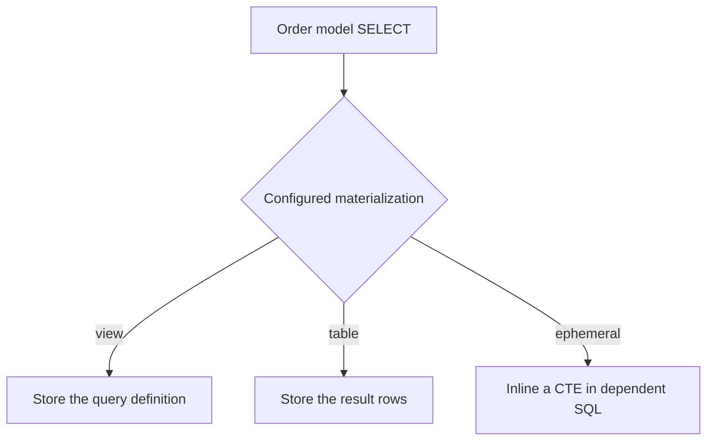

# Views, tables, ephemeral models and adapter choices

A **materialization** determines how dbt persists or exposes a model's SQL in the warehouse. Choose each model's materialization by balancing read latency, build cost, storage, data freshness, and how downstream consumers inspect it. [Materializations](https://docs.getdbt.com/docs/build/materializations)

## Comparing core materializations

| Materialization | What dbt builds | Query speed and storage | When to use it |
| --- | --- | --- | --- |
| **`view`** (default) | Stored query definition (`CREATE VIEW`). | Zero storage; computes on read so downstream queries stay slow if logic is heavy. | Lightweight staging projections where consumers should read fresh upstream tables without extra storage. |
| **`table`** | Physical table rebuilt from scratch on every run (`CREATE TABLE`). | Fast reads; pays storage and full rebuild compute on every run. | Frequently queried marts, expensive joins, or dashboards that need predictable read speed. |
| **`ephemeral`** | Inlined as a CTE inside each downstream consumer's compiled SQL. | No warehouse relation created; duplicated compute if many models reference it. | Small intermediate helpers referenced by one or two models when you want no warehouse clutter. |
| **`incremental`** | Physical table updated in batches after initial load (covered in [lesson 0010](0010-incremental-models-late-data-and-backfills.md)). | Fast reads and lower build cost on large event tables; adds backfill complexity. | Large append or update tables where rebuilding all history every run is too slow or costly. |
| **`materialized_view`** | Warehouse-managed persisted query (`CREATE MATERIALIZED VIEW`). | Fast reads with storage; refresh schedule and SQL restrictions depend on the adapter. | Supported adapters where warehouse auto-refresh fits better than scheduled `table` rebuilds. |



Two practical rules avoid surprises:

- **Ephemeral models are invisible to SQL clients.** Because dbt builds no table or view for an ephemeral model, BI tools cannot query it directly, deeply chained ephemerals generate huge nested CTEs, and data tests on an ephemeral model inject its CTE into the test query.
- **Verify adapter support for materialized views.** Refresh triggers and allowed SQL operators (`joins`, `window functions`, `on_configuration_change`) differ across Snowflake, BigQuery, Postgres, and DuckDB. Test representative read queries and build times on your target warehouse before switching a shared model. [Supported data platforms](https://docs.getdbt.com/docs/supported-data-platforms)

**Follow a status edit.** Suppose ingestion changes order 2 to paid after the fact was built. With a view over the staging view, the next uncached query sees the new status. With a table, the next query sees the stored pending row until the fact rebuilds. An ephemeral helper inside that table's build SQL inherits the same wait for a rebuild.

## Practice

### What you need

Work in [shop_lab](0004-adapters-profiles-and-the-local-shop-lab.md) with [`fct_orders`](0006-models-refs-and-project-configuration.md) configured as `materialized='table'`.

### Steps

1. Build `fct_orders` as a table and query DuckDB's catalog:

```bash
dbt build --profiles-dir . --select +fct_orders
dbt show --profiles-dir . --inline "
select table_type from information_schema.tables
where table_schema = 'main' and table_name = 'fct_orders'"
```

**Expected result.** `table_type` is **BASE TABLE**.

2. Temporarily change `models/fct_orders.sql` to `{{ config(materialized='view') }}` and repeat both commands. Confirm `table_type` switches to **VIEW** while returning the same three orders.
3. Restore `{{ config(materialized='table') }}` in `models/fct_orders.sql`, then create a temporary helper `models/int_orders_for_fact.sql`:

```sql
{{ config(materialized='ephemeral') }}

select order_id, customer_id, status, total_cents, updated_at
from {{ ref('stg_orders') }}
```

4. Point `models/fct_orders.sql` at `from {{ ref('int_orders_for_fact') }}`, compile, build, and check DuckDB's catalog:

```bash
dbt compile --profiles-dir . --select fct_orders
dbt build --profiles-dir . --select +fct_orders
dbt show --profiles-dir . --inline "
select count(*) as helper_relations from information_schema.tables
where table_schema = 'main' and table_name = 'int_orders_for_fact'"
```

**Expected result.** `target/compiled/shop_lab/models/fct_orders.sql` embeds `int_orders_for_fact` inside a `with __dbt__cte__int_orders_for_fact as (...)` CTE, `helper_relations` is **0**, and `fct_orders` retains its 3-row grain.

5. **Cleanup.** Point `models/fct_orders.sql` back to `{{ ref('stg_orders') }}`, delete `models/int_orders_for_fact.sql`, and run `dbt build --profiles-dir . --select +fct_orders` so `fct_orders` stays a clean `table` in `shop_lab`.

## Recall

1. A dashboard needs to see newly loaded upstream data immediately without waiting for `fct_orders` to rebuild. What trade-off comes with switching `fct_orders` to a `view`?
2. Where do you inspect the rendered SQL of an `ephemeral` helper model, and why can BI tools not select from it directly?
3. When does switching from `table` to `ephemeral` make total warehouse query cost *higher* instead of lower?

??? note "Answer guidance"
    1. A view reads current upstream relations on every query, removing table storage and dbt build lag, but every BI dashboard load pays the compute cost of re-evaluating the joins and filters.
    2. Inspect the compiled SQL of a downstream model that calls `ref()` on the helper under `target/compiled/`. No relation is materialized in the database, so external SQL clients have no table or view to query.
    3. If five downstream marts all `ref()` an expensive ephemeral helper, its joins and aggregations execute five separate times across downstream builds instead of once in a persisted table.

| Previous | Curriculum | Next |
| --- | --- | --- |
| [Previous lesson](0008-seeds-and-lookup-data.md) | [All lessons](index.md) | [Next lesson](0010-incremental-models-late-data-and-backfills.md) |
