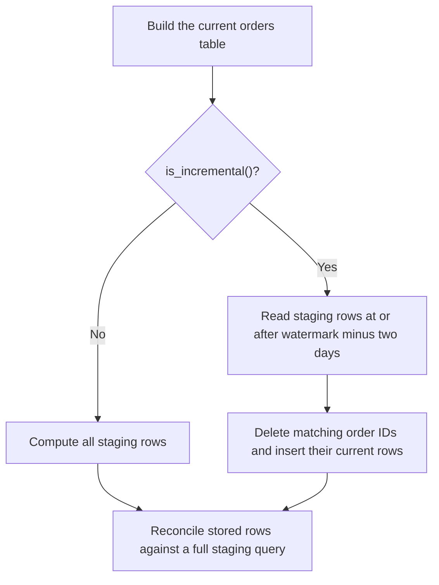

# Incremental models, late data and backfills

Rebuilding a multi-billion-row event table from scratch every hour wastes compute and time. An **incremental model** persists a physical table and processes only new or recently updated rows on routine runs. On the first run or when you pass `--full-refresh`, dbt drops or replaces the table using the full query. [Incremental models](https://docs.getdbt.com/docs/build/incremental-models)

## How `is_incremental()` works

`is_incremental()` evaluates to `true` only when all four conditions hold:

1. The model is configured with `materialized='incremental'`.
2. The target relation already exists in the warehouse as a table (not a view).
3. `--full-refresh` was **not** passed (and `full_refresh: false` is not overridden).
4. The query is running during execution (during parse/full-refresh compile without existing table, it renders the full branch).

Write SQL so both the full branch and the `` branch emit the exact same columns and types.



## Choosing an incremental strategy

Separate **which rows the `SELECT` reads** (the watermark and lookback filter) from **how dbt writes them to the target table** (`incremental_strategy`): [Incremental strategies](https://docs.getdbt.com/docs/build/incremental-strategy)

| Strategy | How dbt writes rows | Best fit and caveats |
| --- | --- | --- |
| **`append`** | Inserts all selected rows without checking for existing keys. | Immutable append-only logs. Replaying an overlapping lookback duplicates rows. |
| **`delete+insert`** | Deletes target rows matching `unique_key` in the batch, then inserts the batch. | Updates by `unique_key` on warehouses without native `MERGE` or when batch key sets are moderate. |
| **`merge`** | Executes a SQL `MERGE` matching on `unique_key` (single column or composite list `['order_id', 'line_id']`). | Upserts by key on Snowflake, BigQuery, Databricks, Postgres 15+. Add `incremental_predicates` to prune target partitions during `MERGE`. |
| **`insert_overwrite`** | Replaces whole partitions touched by the batch (for example on BigQuery or Spark). | Partitioned tables where each batch supplies **complete** data for every touched partition. |
| **`microbatch`** | Splits event-time ranges into independent fixed batches (`event_time`, `batch_size`, `lookback`). | Event-time models in dbt v1.9+ / v2. Lets you backfill specific time windows cleanly with `--event-time-start` and `--event-time-end`. |

Test incoming `unique_key` values before writing, or deduplicate multiple versions in staging with a deterministic `row_number()` tie-breaker. An `update` outside the lookback window never enters the `SELECT` batch, so `unique_key` never touches that stale row. Note that Core v1's separate `dbt-duckdb` adapter documents its own strategy requirements (`delete+insert` works cleanly across DuckDB runs). [dbt-duckdb strategies](https://github.com/duckdb/dbt-duckdb#incremental-strategy-configuration)

## Handling schema changes (`on_schema_change`)

When you add or drop a column in an existing incremental model's `SELECT`, a routine incremental run does not rebuild the table DDL unless you configure `on_schema_change`:

- `ignore` (default): keeps the old target columns and silently ignores newly added columns until a `--full-refresh` (or fails if a mapped column disappears).
- `fail`: aborts the run immediately when source and target schemas diverge so silent drift cannot hide.
- `append_new_columns`: adds new columns to the target table (old rows remain `NULL` until backfilled).
- `sync_all_columns`: adds new columns, removes dropped columns, and updates altered data types where the adapter allows.

## Late data, deletes, and backfills

- **Lookback sizing and null/future timestamps.** Size the lookback (for example `- interval '2 days'`) from observed ingestion delays. A single future-dated bad row pushes `max(updated_at)` forward and skips valid changes, and a `null` `updated_at` fails `updated_at >= updated_at`, so test `updated_at` with `not_null`.
- **Hard deletes.** An ordinary incremental batch only sees rows present in staging, so hard-deleted source keys remain in the target unless you process a deletion feed (`is_deleted` flag) or rebuild from complete upstream history.
- **Safe recovery.** Replay affected keys or partitions first, then rebuild downstream tables and reconcile row counts and metric totals against staging. See the [incremental recovery playbook](../debugging/incremental-recovery.md).

## Practice

### What you need

Start from [shop_lab](0004-adapters-profiles-and-the-local-shop-lab.md) with the original three rows in `seeds/raw_orders.csv`.

### Steps

1. Create `models/fct_orders_incremental.sql`. Here `{{ this }}` refers to the already-built `fct_orders_incremental` table, and `coalesce` ensures an empty target admits every row with a non-null `updated_at`:

```sql
{{ config(materialized='incremental', unique_key='order_id', incremental_strategy='delete+insert') }}

select order_id, customer_id, status, total_cents, updated_at
from {{ ref('stg_orders') }}

where updated_at >= coalesce(
    (select max(updated_at) from {{ this }}) - interval '2 days',
    updated_at
)

```

2. Create or extend `models/stg_orders.yml` so upstream key or timestamp defects halt the incremental build before writing:

```yaml
models:
  - name: stg_orders
    columns:
      - name: order_id
        data_tests: [unique, not_null]
      - name: updated_at
        data_tests: [not_null]
```

3. Build the baseline table with `--full-refresh` and inspect its rows (reuse the `dbt show` query after each step):

```bash
dbt build --profiles-dir . --full-refresh --select +fct_orders_incremental
dbt show --profiles-dir . --inline "
select order_id, status, total_cents, updated_at
from {{ ref('fct_orders_incremental') }}
order by order_id"
```

4. **Baseline check.** Confirm 3 rows exist (order 1 is `1250` cents, order 2 is `pending`, newest target timestamp is `2026-01-03 10:00:00`, so the lookback cutoff is `2026-01-01 10:00:00`).
5. **Replay an update inside the lookback.** In `seeds/raw_orders.csv`, change order 2's status to `paid` (keeping `2026-01-02 10:00:00`). Run `dbt build --profiles-dir . --select +fct_orders_incremental` **twice**. Confirm order 2 becomes `paid` and all 3 order IDs appear once after both runs (idempotent `delete+insert`).
6. **Miss and recover an older correction.** Change order 1 in `seeds/raw_orders.csv` to `1500` cents with timestamp `2025-12-31 10:00:00` (older than the 2-day cutoff). Run the ordinary build `dbt build --profiles-dir . --select +fct_orders_incremental`. The build passes while order 1 remains `1250` cents in the incremental table! Verify the mismatch with this reconciliation diff:

```bash
dbt show --profiles-dir . --inline "
with expected as (
    select order_id, customer_id, status, total_cents, updated_at
    from {{ ref('stg_orders') }}
),
actual as (
    select order_id, customer_id, status, total_cents, updated_at
    from {{ ref('fct_orders_incremental') }}
)
select 'missing' as difference, * from (select * from expected except all select * from actual)
union all
select 'extra' as difference, * from (select * from actual except all select * from expected)"
```

Confirm the diff returns order 1 in both `missing` (`1500`) and `extra` (`1250`). Now run `dbt build --profiles-dir . --full-refresh --select +fct_orders_incremental` and rerun the diff to see **0 differences**.

7. **Cleanup.** Restore the original three rows in `seeds/raw_orders.csv` (`1,101,paid,1250,2026-01-01 10:00:00` and `2,101,pending,500,2026-01-02 10:00:00`) and rerun `dbt build --profiles-dir . --full-refresh --select +fct_orders_incremental` so later lessons start from clean baseline data.

## Recall

1. Why can `unique_key='order_id'` fail to update a corrected order from last month?
2. What happens if you switch `incremental_strategy` to `append` while keeping the 2-day lookback filter?
3. You add a `currency` column to an incremental model whose `on_schema_change` is unset. What happens on the next incremental run, and how do `append_new_columns` and `--full-refresh` differ?

??? note "Answer guidance"
    1. `unique_key` only replaces keys returned by the model's `SELECT` query. Because last month's timestamp falls before the lookback cutoff, the query never reads that row.
    2. `append` inserts every row selected by the 2-day lookback again without deleting existing matches, creating duplicate `order_id` rows on every run.
    3. Under the default `ignore`, dbt keeps the existing table columns and silently omits `currency` from incremental inserts. Setting `append_new_columns` alters the table to add `currency` for new/updated batches (leaving historical rows `NULL`), whereas `--full-refresh` rebuilds and populates `currency` for all history.

| Previous | Curriculum | Next |
| --- | --- | --- |
| [Previous lesson](0009-views-tables-ephemeral-models-and-adapter-choices.md) | [All lessons](index.md) | [Next lesson](0011-snapshots-and-slowly-changing-dimensions.md) |
