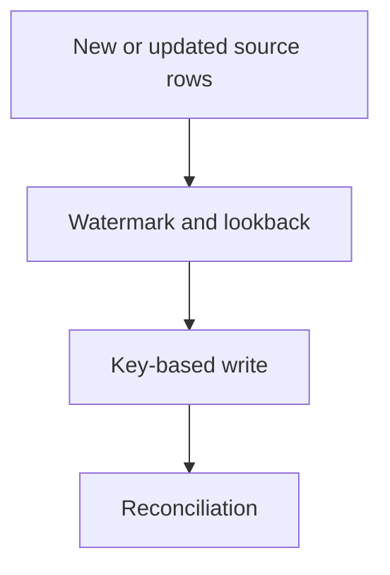

# Incremental models, late data and backfills

An incremental model builds the full query on its first run and can filter eligible rows on later runs with `is_incremental()`. A unique key can match incoming records to existing rows when supported by the chosen strategy. The config does not assert uniqueness. Test and deduplicate incoming keys. Append, merge, delete-and-insert, partition overwrite, and microbatch support vary by adapter.

Plan for late arrivals, equal timestamps, deletes, and changed business logic. A bounded lookback with key-based writes handles updates within that bound. Older corrections need an explicit backfill or rebuild; source deletes need deliberate handling.



## Practice

Create `models/fct_orders_incremental.sql` in the lab with this example. The interval expression is for DuckDB.

```sql
{{ config(materialized='incremental', unique_key='order_id', incremental_strategy='delete+insert') }}

select order_id, customer_id, status, total_cents, updated_at
from {{ ref('stg_orders') }}

where updated_at >= (
    select coalesce(max(updated_at), cast('1900-01-01' as timestamp))
    from {{ this }}
) - interval '2 days'

```

Build it, edit an existing seed row's status and timestamp, and rerun the seed and downstream build. Compare order counts and the changed status to a full-table recomputation.

## Recall

Why can a successful incremental run silently miss a correction outside the lookback?

[Incremental models](https://docs.getdbt.com/docs/build/incremental-models) · [Incremental strategies](https://docs.getdbt.com/docs/build/incremental-strategy)

| Previous | Curriculum | Next |
| --- | --- | --- |
| [← Previous lesson](0009-views-tables-ephemeral-models-and-adapter-choices.md) | [All lessons](index.md) | [Next lesson →](0011-snapshots-and-slowly-changing-dimensions.md) |
