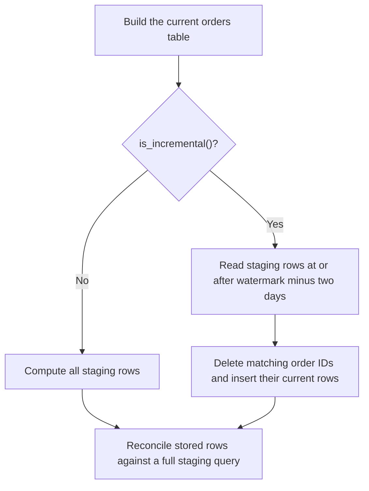

# Incremental models, late data and backfills

An incremental model stores a table. On the first build and on a full refresh, dbt evaluates the full model query. `is_incremental()` is true when the model is configured as incremental, its target already exists as a table, and the run is proceeding without a full refresh. Write SQL that works in both modes. [Incremental models](https://docs.getdbt.com/docs/build/incremental-models)

**Separate row selection from writes.** A watermark such as `max(updated_at)` from the target helps decide which input to reprocess. An inclusive cutoff and a lookback replay rows with tied timestamps and capture some late changes. Then a key-based strategy such as `delete+insert` replaces target rows whose keys occur in that batch. `unique_key` configures matching. Test incoming keys for uniqueness and presence, or deduplicate multiple versions using a deterministic tie-breaker before writing. [Incremental strategies](https://docs.getdbt.com/docs/build/incremental-strategy)

Append suits immutable rows when retries cannot duplicate them. Merge or delete-and-insert can apply updates by key. Partition overwrite replaces selected partitions, so supply complete data for those partitions. Check the strategy against your engine and adapter version. The lab uses DuckDB interval syntax with `delete+insert`. The separately installed Core v1 `dbt-duckdb` adapter documents its own strategy requirements. [dbt-duckdb strategies](https://github.com/duckdb/dbt-duckdb#incremental-strategy-configuration)



## Practice

Start with the original fixture in the [DuckDB shop lab](0004-adapters-profiles-and-the-local-shop-lab.md). Add `models/fct_orders_incremental.sql`.

```sql
{{ config(materialized='incremental', unique_key='order_id', incremental_strategy='delete+insert') }}

select order_id, customer_id, status, total_cents, updated_at
from {{ ref('stg_orders') }}

where updated_at >= coalesce(
    (select max(updated_at) from {{ this }}) - interval '2 days',
    updated_at
)

```

Here `this` is the target relation. If it is empty, the comparison admits all rows with a timestamp. Add these tests to `models/stg_orders.yml`, or merge the columns into the existing `stg_orders` entry. With the upstream selection, a staging test failure can stop the dependent build before it writes.

```yaml
models:
  - name: stg_orders
    columns:
      - name: order_id
        data_tests: [unique, not_null]
      - name: updated_at
        data_tests: [not_null]
```

Reset the incremental table and query its stored rows. Use the same preview after each change.

```bash
dbt build --profiles-dir . --full-refresh --select +fct_orders_incremental
dbt show --profiles-dir . --inline "
select order_id, status, total_cents, updated_at
from {{ ref('fct_orders_incremental') }}
order by order_id"
```

1. **Baseline.** Expect three orders, with order 1 at 1,250 cents and order 2 pending. The newest target timestamp is January 3 at 10:00, so the cutoff is January 1 at 10:00.
2. **Replay an update.** Temporarily change order 2 to `paid` in `seeds/raw_orders.csv` and keep its January 2 timestamp. Run `dbt build --profiles-dir . --select +fct_orders_incremental` twice. Expect order 2 to be paid and all three order IDs to appear once after each run.
3. **Miss and recover an older correction.** Change order 1 to 1,500 cents with timestamp `2025-12-31 10:00:00`. Run the ordinary build again. It can succeed while order 1 stays at 1,250 cents in the target. Compare with staging using the query below. Expect one row in each direction, both for order 1. Rerun the full-refresh command and expect **zero differences** and three stored rows.

```bash
dbt show --profiles-dir . --inline "
with expected as (
    select order_id, customer_id, status, total_cents, updated_at
    from {{ ref('stg_orders') }}
),
actual as (
    select order_id, customer_id, status, total_cents, updated_at
    from {{ ref('fct_orders_incremental') }}
)
select 'missing' as difference, * from (select * from expected except all select * from actual)
union all
select 'extra' as difference, * from (select * from actual except all select * from expected)"
```

Restore the original seed and rerun the full-refresh command so later exercises start from the baseline.

!!! tip "Plan recovery before release"
    Size the lookback from observed delivery delays. Monitor null or future timestamps and reconcile row-level changes, since a future timestamp can move the cutoff past valid changes. An absent source key never enters this batch, so handle hard deletes with a deletion feed or a rebuild from complete data. For a large fact, identify affected keys or partitions and replay their current results. Rebuild when a logic change affects all historical rows and the source can reproduce them. Schema changes handled by `on_schema_change` can still require a backfill to populate new columns in old rows. Refresh dependent tables after recovery. Verify parity and rerun the same input to check repeatability. [Incremental recovery playbook](../debugging/incremental-recovery.md)

## Recall

1. Why can `unique_key` fail to fix an old correction?
2. What would an append strategy do if this model replayed two days of already loaded rows?

??? note "Answer guidance"
    1. Matching only applies to rows selected by the model query. A correction outside the cutoff supplies no key to replace.
    2. The replay would insert those rows again, duplicating order IDs. A key-based strategy can replace them when the batch has one row per key.

| Previous | Curriculum | Next |
| --- | --- | --- |
| [← Previous lesson](0009-views-tables-ephemeral-models-and-adapter-choices.md) | [All lessons](index.md) | [Next lesson →](0011-snapshots-and-slowly-changing-dimensions.md) |
