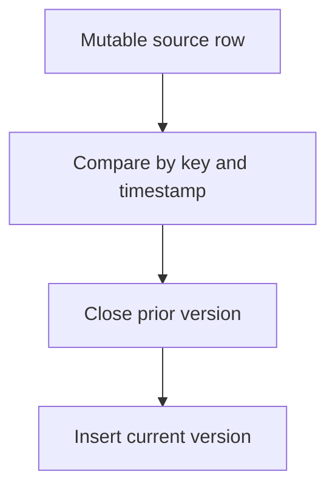

# Snapshots and slowly changing dimensions

Snapshots implement SCD Type 2 history by tracking successive states of a row. A stable unique key identifies the business entity. The timestamp strategy uses a trustworthy update column. The check strategy compares chosen columns when timestamps are unavailable. `dbt_valid_from` and `dbt_valid_to` describe the interval for each observed version.

Snapshots can miss intermediate changes between runs. Choose a frequency based on the business need and decide whether to ignore deletions, invalidate the current version, or record a deletion version where supported. A later snapshot cannot reconstruct states that were never captured.



## Practice

Add `snapshots/order_history.yml` after staging is available.

```yaml
snapshots:
  - name: order_history
    relation: ref('stg_orders')
    config:
      strategy: timestamp
      unique_key: order_id
      updated_at: updated_at
```

Run `dbt snapshot --select order_history`, update the fixture's status and timestamp for one order, and reseed. Run the snapshot again. Verify that the changed order has two versions and exactly one current row.

## Recall

Why might an order change twice while the snapshot records only one change?

[Snapshots](https://docs.getdbt.com/docs/build/snapshots)

| Previous | Curriculum | Next |
| --- | --- | --- |
| [← Previous lesson](0010-incremental-models-late-data-and-backfills.md) | [All lessons](index.md) | [Next lesson →](0012-generic-and-singular-data-tests.md) |
