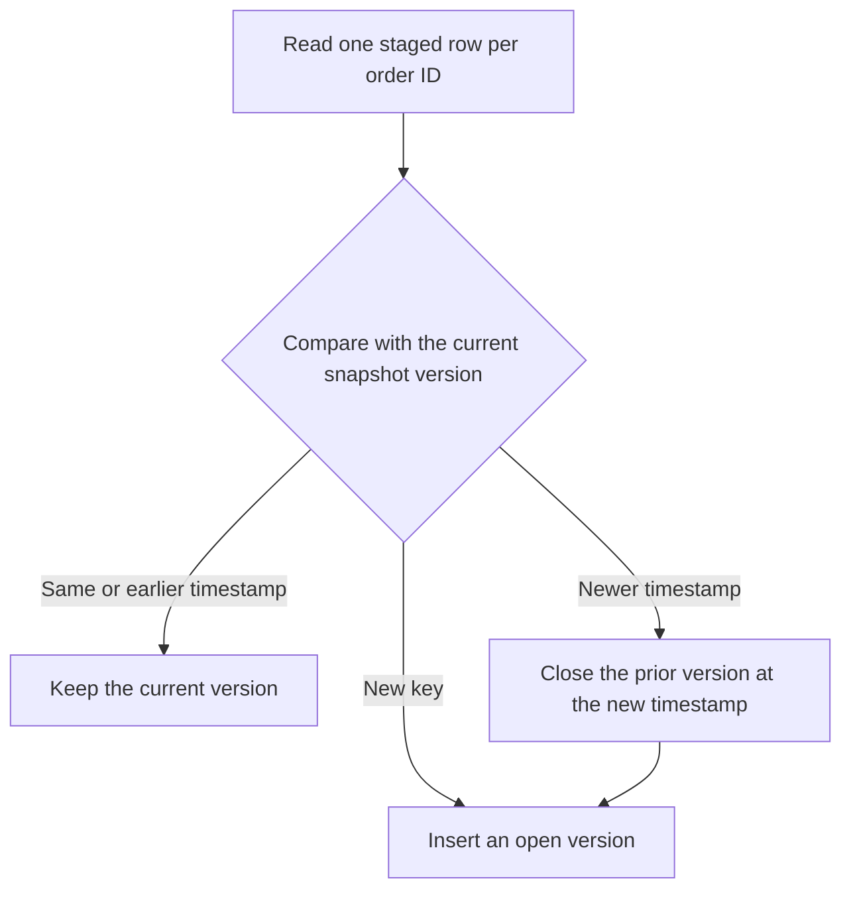

# Snapshots and slowly changing dimensions

A snapshot preserves observed versions of a mutable record as a slowly changing dimension (SCD Type 2). Its grain is one row per observed version of a business key. dbt uses `unique_key` to match versions. Test that the input has one non-null row per key before capturing it.

- **Timestamp** uses an `updated_at` that advances whenever the source row changes. An edit with the same timestamp is invisible to this strategy.
- **Check** compares the columns listed in `check_cols`. Without a configured `updated_at`, it records the snapshot run time for observed changes.

The first run captures the rows it sees. On later runs, an observed change closes the prior version and inserts a new one. Treat validity as the half-open interval `[dbt_valid_from, dbt_valid_to)`. For an as-of lookup, use `dbt_valid_from <= as_of` and `(as_of < dbt_valid_to or dbt_valid_to is null)`. The open end is `NULL` by default. Adjust the predicate if you configure a sentinel with `dbt_valid_to_current`.



The default delete policy leaves the last version open when its source row disappears. Where the adapter supports `hard_deletes`, `invalidate` closes it and `new_record` also writes a deletion version. Choose snapshot frequency based on how much history consumers need. A snapshot cannot recover an intermediate state that disappeared between runs. [Snapshots](https://docs.getdbt.com/docs/build/snapshots) · [Delete policy and adapter support](https://docs.getdbt.com/reference/resource-configs/hard-deletes)

## Practice

Use a copy of the [DuckDB lab](0004-adapters-profiles-and-the-local-shop-lab.md) with the original seed and a fresh database so the exercise starts with empty history. Save this as `snapshots/order_history.yml`. YAML snapshots are supported in dbt v2 and Core v1.9 or later. Older Core versions use a SQL snapshot block.

```yaml
snapshots:
  - name: order_history
    relation: ref('stg_orders')
    config:
      strategy: timestamp
      unique_key: order_id
      updated_at: updated_at
```

1. From `shop_lab`, build the input and take the first snapshot.

    ```bash
    dbt build --profiles-dir . --select +stg_orders
    dbt snapshot --profiles-dir . --select order_history
    ```

2. In `seeds/raw_orders.csv`, change order 2 from `pending` to `paid` and set its timestamp to `2026-01-04 10:00:00`. Repeat both commands above, then inspect the stored history.

    ```bash
    dbt show --profiles-dir . --inline "
      select status, dbt_valid_from, dbt_valid_to
      from {{ ref('order_history') }}
      where order_id = 2
      order by dbt_valid_from
    "
    ```

3. Expect two versions. The `pending` row starts on January 2 and ends on January 4 at 10:00. The `paid` row starts at that same boundary and has a null end. Run the snapshot once more with the same input and confirm the query still returns two rows.

## Recall

1. An order's status moves from `pending` to `paid` to `refunded` between runs. Which state can dbt miss?
2. Which version applies at the exact timestamp where the pending version closes?

??? success "Answer guidance"

    1. The `paid` version may never be observed. Use a change log or CDC if every transition must be recoverable.
    2. The newly opened version applies. The old interval excludes its end and the new interval includes its start.

| Previous | Curriculum | Next |
| --- | --- | --- |
| [Previous lesson](0010-incremental-models-late-data-and-backfills.md) | [All lessons](index.md) | [Next lesson](0012-generic-and-singular-data-tests.md) |
