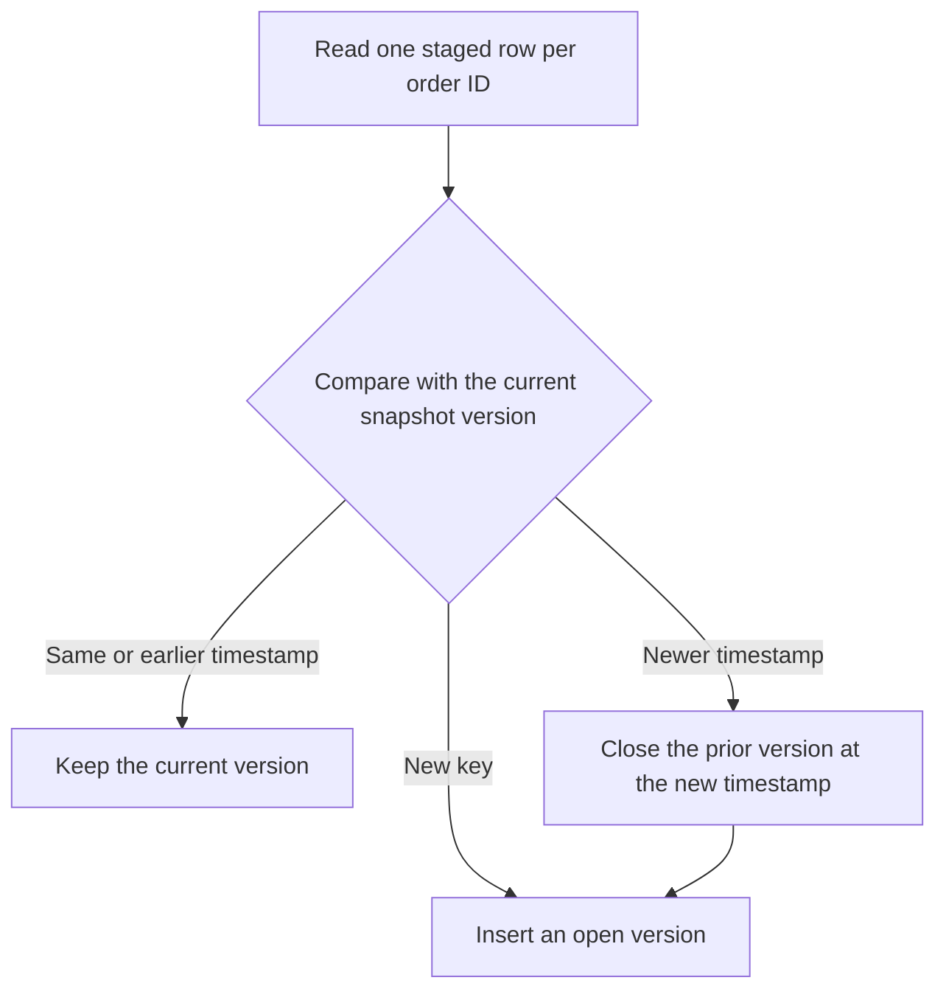

# Snapshots and slowly changing dimensions

Mutable source tables overwrite old values in place. If an order moves from `pending` to `paid`, querying the latest table hides when the change happened. A **snapshot** preserves observed row versions over time as a slowly changing dimension (SCD Type 2) at a grain of one row per observed version of `unique_key`.

Test the input relation so `unique_key` has one non-null row per key before running `dbt snapshot`.

## Strategies and snapshot metadata

| Strategy | How dbt detects changes | Caveats |
| --- | --- | --- |
| **`timestamp`** | Compares a configured `updated_at` column with `dbt_updated_at` in the snapshot table. | Fast and cheap. Any edit whose `updated_at` does not advance (or is backdated) is ignored. |
| **`check`** | Compares columns listed in `check_cols` (or `check_cols: all`) row by row. | Catches edits without a reliable `updated_at`. Without `updated_at`, dbt records the snapshot run time as the boundary. |



dbt adds metadata columns (renamable via `snapshot_meta_column_names`) to every snapshot table:

- `dbt_scd_id`: unique surrogate key generated for each historical version row.
- `dbt_updated_at`: source `updated_at` (or snapshot timestamp) recorded when the version was captured.
- `dbt_valid_from`: inclusive start boundary for this version.
- `dbt_valid_to`: exclusive end boundary (`NULL` for the current open row unless overridden with `dbt_valid_to_current`).

Treat validity as the half-open interval `[dbt_valid_from, dbt_valid_to)`. Query an as-of state with `dbt_valid_from <= as_of and (as_of < dbt_valid_to or dbt_valid_to is null)`.

For order 2, draw the two observed versions on a timeline. The pending version ends at January 4 at 10:00 and the paid version starts then. A report for 09:59 selects pending. A report for 10:00 selects paid. Using an inclusive end such as `BETWEEN` would match both versions at 10:00.

## Deletes and preserving history

- **Deletes (`hard_deletes`).** By default (`ignore`), dbt leaves the latest version open when a source key disappears. On supported adapters, `hard_deletes: invalidate` sets `dbt_valid_to`, and `new_record` also inserts a deleted version with `dbt_is_deleted`.
- **Cadence and durability.** Snapshots only observe states present when `dbt snapshot` runs, so intermediate transitions between runs are lost unless captured by a change feed. Never drop or rebuild a snapshot table carelessly because past source states cannot be recovered from current-state tables. [Snapshots](https://docs.getdbt.com/docs/build/snapshots) · [Delete policy and adapter support](https://docs.getdbt.com/reference/resource-configs/hard-deletes)

## Practice

### What you need

Use a fresh copy of [shop_lab](0004-adapters-profiles-and-the-local-shop-lab.md) with the original `seeds/raw_orders.csv` and a clean DuckDB file so the exercise starts with empty snapshot history.

### Steps

1. Save `snapshots/order_history.yml`. YAML snapshots work in dbt v2 and Core v1.9+; earlier Core releases put `...` inside `snapshots/order_history.sql`.

```yaml
snapshots:
  - name: order_history
    relation: ref('stg_orders')
    config:
      strategy: timestamp
      unique_key: order_id
      updated_at: updated_at
```

2. Build staging and take the initial snapshot:

```bash
dbt build --profiles-dir . --select +stg_orders
dbt snapshot --profiles-dir . --select order_history
```

3. Simulate an order update: in `seeds/raw_orders.csv`, change order 2 from `pending` to `paid` and advance its timestamp to `2026-01-04 10:00:00`. Repeat both commands above, then inspect order 2's history:

```bash
dbt show --profiles-dir . --inline "
  select status, dbt_valid_from, dbt_valid_to
  from {{ ref('order_history') }}
  where order_id = 2
  order by dbt_valid_from
"
```

**Expected result.** Order 2 returns **2 versions**: `pending` with `dbt_valid_from = 2026-01-02 10:00:00` and `dbt_valid_to = 2026-01-04 10:00:00`, followed by `paid` starting at `2026-01-04 10:00:00` with `dbt_valid_to = null`. Run `dbt snapshot --profiles-dir . --select order_history` once more with unchanged inputs and confirm the row count stays 2.

4. **Cleanup.** If you plan to reuse this directory, restore order 2 in `seeds/raw_orders.csv` to `2,101,pending,500,2026-01-02 10:00:00` and remove `order_history` from DuckDB if you want a clean slate before lesson 0039.

## Recall

1. Between snapshot runs, an order transitions from `pending` to `paid` to `refunded`. Which state does dbt miss, and what architecture captures every intermediate change?
2. Which version of order 2 matches an as-of query at the exact timestamp `2026-01-04 10:00:00`?
3. A source correction fixes order 1's amount while keeping `updated_at` unchanged. Why does the `timestamp` strategy miss it, and which strategy catches it?

??? note "Answer guidance"
    1. dbt never observes the intermediate `paid` state because `dbt snapshot` only reads current values at run time. Use an event log or CDC stream if every transition must be preserved.
    2. The new `paid` version matches because intervals are half-open (`[dbt_valid_from, dbt_valid_to)`): `2026-01-04 10:00:00` equals the new row's `dbt_valid_from` and is excluded by `< dbt_valid_to` on the closed row.
    3. The `timestamp` strategy skips rows whose `updated_at` has not increased. Use `strategy: check` with `check_cols` listing `total_cents` (or `check_cols: all`) when source edits do not always advance `updated_at`.

| Previous | Curriculum | Next |
| --- | --- | --- |
| [Previous lesson](0010-incremental-models-late-data-and-backfills.md) | [All lessons](index.md) | [Next lesson](0012-generic-and-singular-data-tests.md) |
