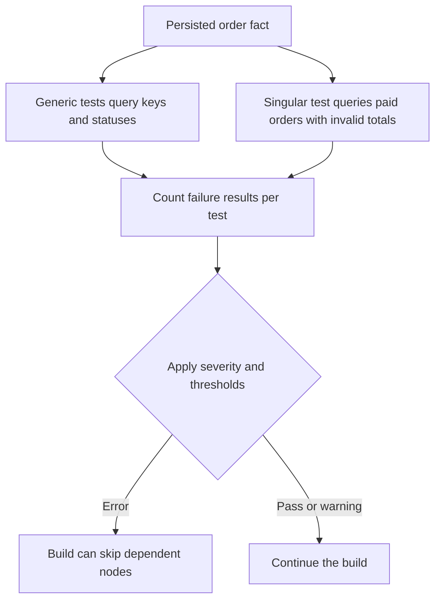

# Generic and singular data tests

A data test queries persisted data for violations. Under the default failure thresholds, zero results pass and any result fails. A result may represent a group of bad records, such as an order ID shared by several rows.

| Built-in generic test | Assertion |
| --- | --- |
| `unique` | Each non-null value appears once. |
| `not_null` | Each row has a value. Pair it with `unique` for an order key. |
| `accepted_values` | Each non-null value belongs to a declared set. Pair it with `not_null` for required statuses. |
| `relationships` | Each non-null child key appears in a parent column. Test the parent's uniqueness separately when a join expects one parent row. |

A generic test is a parameterized `` SQL block, attached to resources or columns in YAML. A singular test is one named SQL query in `tests/`, useful when a rule depends on several columns. References inside either form let dbt find the parents the test reads.



For data tests, `dbt test` checks relations already in the target. `dbt build` runs selected resources and tests in dependency order, and a test error can skip downstream nodes. Use `severity`, `error_if`, and `warn_if` when the rule needs a threshold other than the default. With `store_failures`, dbt can persist diagnostic rows for inspection, so choose which columns to return and who can read them. [Data tests](https://docs.getdbt.com/docs/build/data-tests) · [Severity](https://docs.getdbt.com/reference/resource-configs/severity) · [Build](https://docs.getdbt.com/reference/commands/build)

## Practice

Use the original [shop seed](0004-adapters-profiles-and-the-local-shop-lab.md) and the [order fact](0006-models-refs-and-project-configuration.md). Create or extend the properties for `fct_orders` in `models/fct_orders.yml`.

```yaml
models:
  - name: fct_orders
    columns:
      - name: order_id
        data_tests: [unique, not_null]
      - name: status
        data_tests:
          - not_null
          - accepted_values:
              arguments:
                values: [paid, pending]
```

dbt v2 requires the `arguments` block for generic test inputs. It is available on Core v1.10.5 and later. Older Core releases put `values` directly under `accepted_values`.

Save this as `tests/paid_orders_have_positive_total.sql`. The explicit null check catches missing totals, which a numeric comparison alone would skip.

```sql
select order_id, total_cents
from {{ ref('fct_orders') }}
where status = 'paid'
  and (total_cents is null or total_cents <= 0)
```

1. Run `dbt build --profiles-dir . --select +fct_orders` from `shop_lab`. Expect the four generic assertions and the singular test to pass on the original fixture.
2. In your local seed CSV, change order 1's total from `1250` to `0` and repeat the build. Expect the generic tests to pass and `paid_orders_have_positive_total` to report one violation. To inspect it, run `dbt show --profiles-dir . --select paid_orders_have_positive_total` and look for order 1.
3. Restore `1250` and repeat the build. The singular test should pass again.

## Recall

1. Why does an order ID need both `unique` and `not_null`?
2. The CSV contains a bad total but the materialized fact is still valid. What happens if you run only `dbt test`?

??? success "Answer guidance"

    1. `unique` detects duplicates among non-null values. `not_null` catches missing identifiers.
    2. The test queries the existing fact and may pass. Load the edited seed and rebuild the fact to check the new rows.

| Previous | Curriculum | Next |
| --- | --- | --- |
| [Previous lesson](0011-snapshots-and-slowly-changing-dimensions.md) | [All lessons](index.md) | [Next lesson](0013-unit-tests-and-edge-cases.md) |
