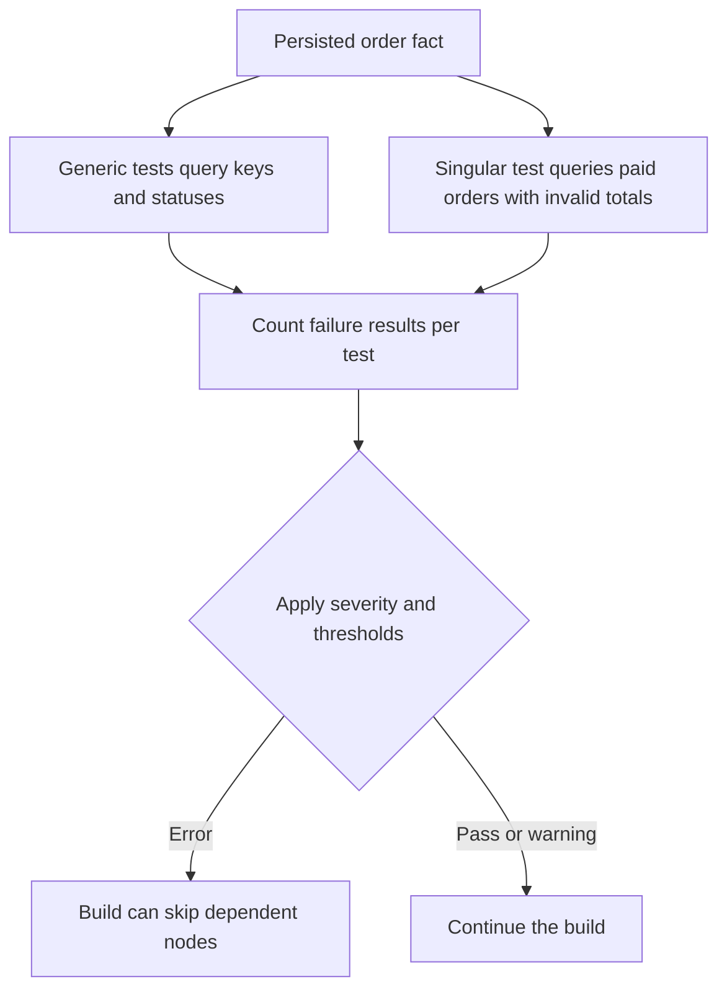

# Generic and singular data tests

A **data test** compiles to a SQL query against built relations in the warehouse and asserts that zero invalid rows exist. Under default thresholds, 0 returned rows passes and 1 or more returned rows fails. Note that a single returned row can summarize multiple offending records (for example, one duplicated `order_id` grouped across 50 rows). [Data tests](https://docs.getdbt.com/docs/build/data-tests)

## Built-in generic tests, custom generic tests, and singular tests

| Test kind | Where it lives | Best for |
| --- | --- | --- |
| **Built-in generic** (`unique`, `not_null`, `accepted_values`, `relationships`) | Configured in `models/*.yml` on columns or models. | Standard key uniqueness, nullability, enum, and foreign-key rules. |
| **Custom generic** (``) | Saved in `tests/generic/*.sql` (or `macros/`). | Reusable parameterized rules applied across many models in YAML. |
| **Singular** (`select ...`) | Saved as a standalone `.sql` query in `tests/`. | One-off cross-column or cross-table business invariants. |

Built-in generic rules to pair carefully:

- **`unique` + `not_null`.** `unique` ignores `NULL` values, so a primary key needs both tests.
- **`accepted_values` + `not_null`.** `accepted_values` skips `NULL` unless paired with `not_null`. Pass `quote: false` when testing integers or booleans (such as `[1, 2, 3]`) so dbt does not quote them as strings.
- **`relationships`** verifies every non-null child key appears in a parent column. Test the parent key's uniqueness separately.

For reusable rules, define a custom generic test under `tests/generic/positive_value.sql`:

```sql

select {{ column_name }}
from {{ model }}
where {{ column_name }} is null or {{ column_name }} <= 0

```

Attach `- positive_value` under any column's `data_tests:` in YAML, or write a singular query under `tests/` when logic spans multiple columns (like checking `status = 'paid'` alongside `total_cents`).

## Running tests and configuring thresholds



`dbt test` runs data tests against tables already in the warehouse. `dbt build` runs models and their tests in DAG order, halting downstream builds when an upstream test errors.

Configure test behavior with these resource configs:

- **`severity: warn` vs `error`.** Alert without blocking downstream models for advisory checks.
- **`warn_if` and `error_if`.** Override the zero-row failure bar (for example `warn_if: "> 5"`, `error_if: "> 20"`).
- **`where`.** Restrict the test scan to recent partitions or relevant rows (for example `where: "status = 'paid'"`).
- **`store_failures: true` and `limit:`.** Save failing rows into an audit schema (`--store-failures`) for debugging, capping rows if sensitive or huge. [Severity](https://docs.getdbt.com/reference/resource-configs/severity) · [Build](https://docs.getdbt.com/reference/commands/build)

## Practice

### What you need

Work in [shop_lab](0004-adapters-profiles-and-the-local-shop-lab.md) with the original three-row seed and [`fct_orders`](0006-models-refs-and-project-configuration.md).

### Steps

1. Merge these column tests into `models/fct_orders.yml` (keeping your model `description` from lesson 0006):

```yaml
models:
  - name: fct_orders
    description: Current order facts, one row per order_id. Totals are in cents.
    columns:
      - name: order_id
        data_tests: [unique, not_null]
      - name: status
        data_tests:
          - not_null
          - accepted_values:
              arguments:
                values: [paid, pending]
```

!!! note "YAML syntax across versions"
    dbt v2 and Core v1.10.5+ place generic test inputs under `arguments:`. Earlier Core v1 releases put `values:` directly under `accepted_values:`.

2. Save this singular data test as `tests/paid_orders_have_positive_total.sql`. The explicit `is null` check catches missing totals that `<= 0` alone would skip:

```sql
select order_id, total_cents
from {{ ref('fct_orders') }}
where status = 'paid'
  and (total_cents is null or total_cents <= 0)
```

3. Run `dbt build --profiles-dir . --select +fct_orders` and confirm all 4 generic tests and 1 singular test pass.
4. Temporarily edit order 1's `total_cents` from `1250` to `0` in `seeds/raw_orders.csv` and rerun `dbt build --profiles-dir . --select +fct_orders`.
5. Confirm the generic tests pass while `paid_orders_have_positive_total` fails with 1 violation. Inspect the failing row directly:

```bash
dbt show --profiles-dir . --select paid_orders_have_positive_total
```

6. **Restore.** Change order 1 back to `1250` in `seeds/raw_orders.csv` and rerun `dbt build --profiles-dir . --select +fct_orders` to confirm all 5 tests pass. Keep `tests/paid_orders_have_positive_total.sql` for later lessons.

## Recall

1. Why does a primary key such as `order_id` require both `unique` and `not_null`?
2. You edit `raw_orders.csv` to introduce a zero-cent paid order, then run `dbt test` without running `dbt build` or `dbt seed` first. Why does the test pass?
3. When would you write a custom generic test (``) instead of a singular SQL file in `tests/`, and how do you avoid hardcoding string quotes in `accepted_values` for integer codes `[1, 2, 3]`?

??? note "Answer guidance"
    1. `unique` only flags duplicated non-null values and ignores `NULL` rows. `not_null` ensures no key is missing.
    2. `dbt test` queries the already-built `fct_orders` table in DuckDB, which still holds old valid rows until you reseed and rebuild the model.
    3. Use a custom generic test when the same assertion applies across multiple columns or models via YAML parameters. Add `quote: false` inside `accepted_values` so dbt generates `in (1, 2, 3)` instead of `in ('1', '2', '3')`.

| Previous | Curriculum | Next |
| --- | --- | --- |
| [Previous lesson](0011-snapshots-and-slowly-changing-dimensions.md) | [All lessons](index.md) | [Next lesson](0013-unit-tests-and-edge-cases.md) |
