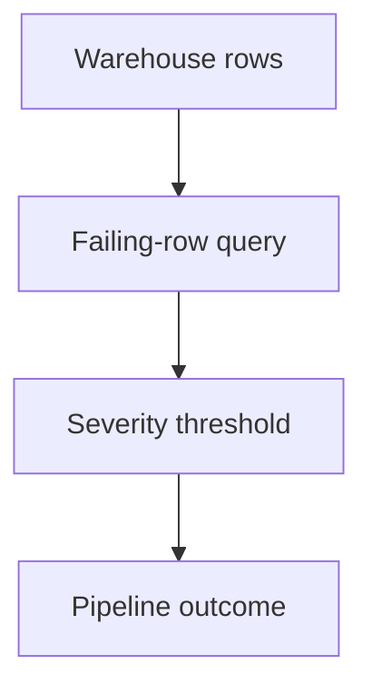

# Generic and singular data tests

A dbt data test returns rows or groups that violate an assertion. The built-in generic tests are `unique`, `not_null`, `accepted_values`, and `relationships`. Unique and relationship tests should be paired with `not_null` when the input key is required. Singular tests are individual SQL queries, useful for domain rules that need multiple columns or relations.

Tests can warn, error, and store failures depending on config. Review who can access stored failure rows before enabling persistence. An error can block downstream builds depending on the graph and selection.



## Practice

Create `models/fct_orders.yml`.

```yaml
models:
  - name: fct_orders
    columns:
      - name: order_id
        data_tests: [unique, not_null]
      - name: status
        data_tests:
          - accepted_values:
              arguments:
                values: [paid, pending]
```

Save a singular test in `tests/paid_orders_have_positive_total.sql`.

```sql
select order_id, total_cents
from {{ ref('fct_orders') }}
where status = 'paid' and (total_cents is null or total_cents <= 0)
```

Change a paid amount to zero, run `dbt build --select +fct_orders`, and check which test fails. Restore and rebuild.

## Recall

What does zero returned rows mean for a data test?

[Data tests](https://docs.getdbt.com/docs/build/data-tests)

| Previous | Curriculum | Next |
| --- | --- | --- |
| [← Previous lesson](0011-snapshots-and-slowly-changing-dimensions.md) | [All lessons](index.md) | [Next lesson →](0013-unit-tests-and-edge-cases.md) |
