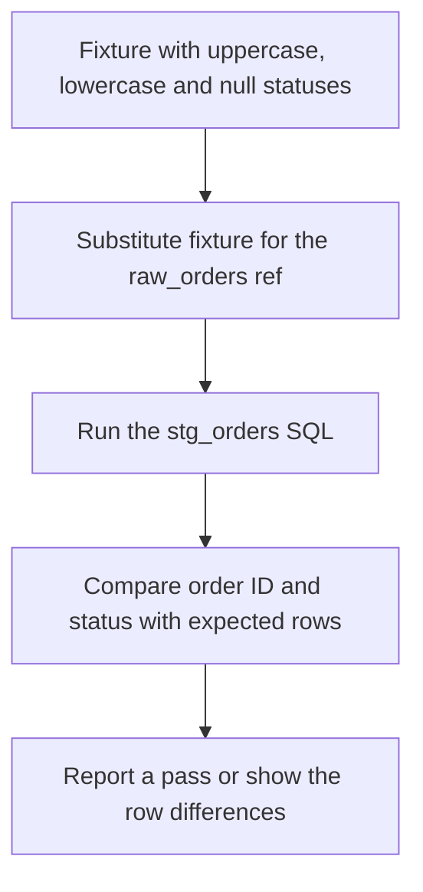

# Unit tests and edge cases

A unit test runs a SQL model against small, fixed inputs and compares its output with expected rows. Use it to pin down transformations such as case normalization, date boundaries, and conditional logic. Use data tests to catch duplicates, nulls, and other violations in actual relations.

Define unit tests in YAML under a model path. Under `given`, supply a fixture for each `ref()` or `source()` the model reads. With inline dictionary rows, dbt can use the input relation's schema to type fixture columns. Under `expect`, include the output columns that demonstrate the rule. dbt compares the projected rows with that expectation.



Native unit tests are available in Core v1.8+ and dbt v2. Check adapter and model restrictions before adding one. For example, dbt's documented support excludes recursive SQL and materialized views. To unit test incremental branches, override `is_incremental` in separate tests. Supply a `this` fixture if the incremental branch reads the existing table. Expected rows represent the query output offered to the incremental write. Verify the final persisted merge with a build and a data check. [Unit tests](https://docs.getdbt.com/docs/build/unit-tests) · [Unit test overrides](https://docs.getdbt.com/reference/resource-properties/unit-test-overrides)

## Practice

Use `raw_orders` and `stg_orders` from the [DuckDB lab](0004-adapters-profiles-and-the-local-shop-lab.md). Save `models/stg_orders_unit_tests.yml`. The test gives `stg_orders` three synthetic rows, including a null status absent in the lab seed.

```yaml
unit_tests:
  - name: order_status_normalizes_case
    model: stg_orders
    given:
      - input: ref('raw_orders')
        rows:
          - {order_id: 9, customer_id: 99, status: PAID, total_cents: 100, updated_at: '2026-01-01 10:00:00'}
          - {order_id: 10, customer_id: 99, status: pending, total_cents: 200, updated_at: '2026-01-01 10:00:00'}
          - {order_id: 11, customer_id: 99, status: null, total_cents: 300, updated_at: '2026-01-01 10:00:00'}
    expect:
      rows:
        - {order_id: 9, status: paid}
        - {order_id: 10, status: pending}
        - {order_id: 11, status: null}
```

1. From `shop_lab`, load the seed relation for type information and select the test by name.

    ```bash
    dbt seed --profiles-dir . --select raw_orders
    dbt test --profiles-dir . --select order_status_normalizes_case
    ```

2. Temporarily replace `lower(status) as status` with `status` in `models/stg_orders.sql`. Repeat the test command and confirm the comparison reports `PAID` where it expected `paid` for order 9.
3. Restore `lower(status) as status` and confirm the test passes again. The actual seed rows can stay as they are throughout the exercise.

## Recall

1. Which test would catch an unexpected duplicate order ID in tomorrow's production load?
2. What should an incremental unit test expect when the model selects two changed orders from a fact with a million existing rows?

??? success "Answer guidance"

    1. A `unique` data test on the persisted order ID. A fixed unit fixture checks transformations on the rows you supply.
    2. Expect the two rows the model query hands to the write strategy. Use a build followed by a query or data test to verify the final table.

| Previous | Curriculum | Next |
| --- | --- | --- |
| [Previous lesson](0012-generic-and-singular-data-tests.md) | [All lessons](index.md) | [Next lesson](0014-macros-jinja-and-dispatch.md) |
