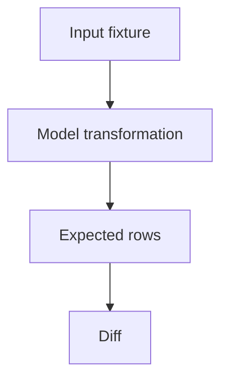

# Unit tests and edge cases

Unit tests compare a SQL model's output with expected rows using small fixed inputs. They verify transformation logic, including edge conditions that may be absent from today's warehouse data. Data tests inspect actual persisted rows. Keep both when the business risk calls for both.

Declare each upstream input the model reads. For incremental models, test the incremental and full branches separately where supported, including a fixture for the existing relation when the model reads `this`. Review restrictions for adapters and materializations.



## Practice

Add this unit test to a YAML file under `models/`.

```yaml
unit_tests:
  - name: order_status_normalizes_case
    model: stg_orders
    given:
      - input: ref('raw_orders')
        rows:
          - {order_id: 9, customer_id: 99, status: PAID, total_cents: 100, updated_at: '2026-01-01 10:00:00'}
    expect:
      rows:
        - {order_id: 9, status: paid}
```

Seed the input relation first so datatype inference can use its schema. Run `dbt test --select stg_orders,test_type:unit`. Remove the lowercasing, confirm the test fails, then restore the model.

## Recall

Which kind of test would reveal an upstream duplicate that appears only in production?

[Unit tests](https://docs.getdbt.com/docs/build/unit-tests)

| Previous | Curriculum | Next |
| --- | --- | --- |
| [← Previous lesson](0012-generic-and-singular-data-tests.md) | [All lessons](index.md) | [Next lesson →](0014-macros-jinja-and-dispatch.md) |
