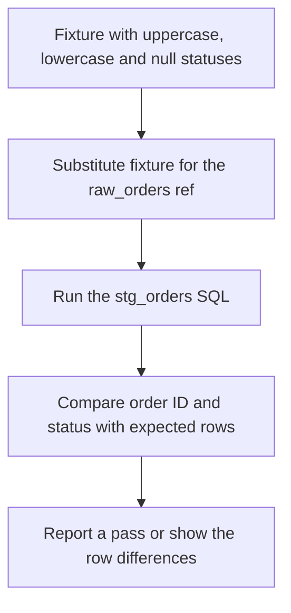

# Unit tests and edge cases

Data tests validate live warehouse rows after a model runs, whereas **unit tests** verify your SQL transformation logic before building tables in production. A unit test feeds small synthetic fixture inputs into a model's `ref()` and `source()` dependencies and compares the output rows against expected results. Use unit tests to pin down edge cases such as case normalization, date boundaries, null handling, and conditional aggregations.

## Fixture formats and incremental overrides

Native unit tests are supported in Core v1.8+ and dbt v2 (with documented limits excluding recursive SQL and materialized views). [Unit tests](https://docs.getdbt.com/docs/build/unit-tests)



Configure `given` and `expect` in YAML under `unit_tests:`:

- **Fixture formats.** `dict` (inline YAML objects, the default) infers column types from existing upstream warehouse relations, so those upstream tables must exist (or specify `format: sql` / `format: csv` when inputs contain complex expressions or aren't materialized yet).
- **Projected expectations.** Under `expect.rows`, include only the columns relevant to the rule you are verifying.
- **Overriding `is_incremental()`, `vars`, and `env_vars`.** Test incremental branches by setting `overrides` in YAML and providing a `this` fixture for existing target rows. [Unit test overrides](https://docs.getdbt.com/reference/resource-properties/unit-test-overrides)

```yaml
unit_tests:
  - name: fct_orders_incremental_lookback
    model: fct_orders_incremental
    overrides:
      macros:
        is_incremental: true
    given:
      - input: ref('stg_orders')
        rows:
          - {order_id: 2, customer_id: 101, status: paid, total_cents: 500, updated_at: '2026-01-02 10:00:00'}
      - input: this
        rows:
          - {order_id: 3, customer_id: 102, status: paid, total_cents: 1750, updated_at: '2026-01-03 10:00:00'}
    expect:
      rows:
        - {order_id: 2, status: paid}
```

Unit tests run under `dbt test` and `dbt build`. Select them explicitly with `--select test_type:unit` (or `--exclude test_type:unit` to run data tests alone).

## Practice

### What you need

Use `raw_orders` and `stg_orders` in [shop_lab](0004-adapters-profiles-and-the-local-shop-lab.md). The unit test introduces synthetic uppercase and `null` statuses absent from the starter CSV.

### Steps

1. Save `models/stg_orders_unit_tests.yml`:

```yaml
unit_tests:
  - name: order_status_normalizes_case
    model: stg_orders
    given:
      - input: ref('raw_orders')
        rows:
          - {order_id: 9, customer_id: 99, status: PAID, total_cents: 100, updated_at: '2026-01-01 10:00:00'}
          - {order_id: 10, customer_id: 99, status: pending, total_cents: 200, updated_at: '2026-01-01 10:00:00'}
          - {order_id: 11, customer_id: 99, status: null, total_cents: 300, updated_at: '2026-01-01 10:00:00'}
    expect:
      rows:
        - {order_id: 9, status: paid}
        - {order_id: 10, status: pending}
        - {order_id: 11, status: null}
```

2. Load `raw_orders` so dbt can read its column types for the `dict` fixture, then run the unit test:

```bash
dbt seed --profiles-dir . --select raw_orders
dbt test --profiles-dir . --select order_status_normalizes_case
```

3. Temporarily change `lower(status) as status` to `status` in `models/stg_orders.sql` and rerun `dbt test --profiles-dir . --select order_status_normalizes_case`. Notice the failure diff shows `PAID` where `paid` was expected for order 9, even though `seeds/raw_orders.csv` stayed untouched.
4. **Restore.** Revert `models/stg_orders.sql` back to `lower(status) as status` and verify `dbt test --profiles-dir . --select stg_orders,test_type:unit` passes. Keep `models/stg_orders_unit_tests.yml` for lesson 0039.

## Recall

1. Which test catches an unexpected duplicate `order_id` in tomorrow's production load, a unit test or a data test?
2. What should an incremental unit test put in `expect.rows` when the model selects two changed orders out of a million existing target rows?
3. Why did the practice command run `dbt seed --select raw_orders` before running the unit test, and which fixture format avoids needing an existing upstream table?

??? note "Answer guidance"
    1. A `unique` data test on the built relation catches live data defects. Unit tests only exercise fixed synthetic inputs against your SQL logic.
    2. Put only the two rows emitted by the model's `SELECT` query, not the existing million rows in `this`. Verify the final merged table separately using `dbt build` and data checks.
    3. Inline `dict` rows infer column types from the materialized input table (`raw_orders`). Using `format: sql` supplies explicit SQL expressions and types in `given` without needing a pre-built upstream relation.

| Previous | Curriculum | Next |
| --- | --- | --- |
| [Previous lesson](0012-generic-and-singular-data-tests.md) | [All lessons](index.md) | [Next lesson](0014-macros-jinja-and-dispatch.md) |
