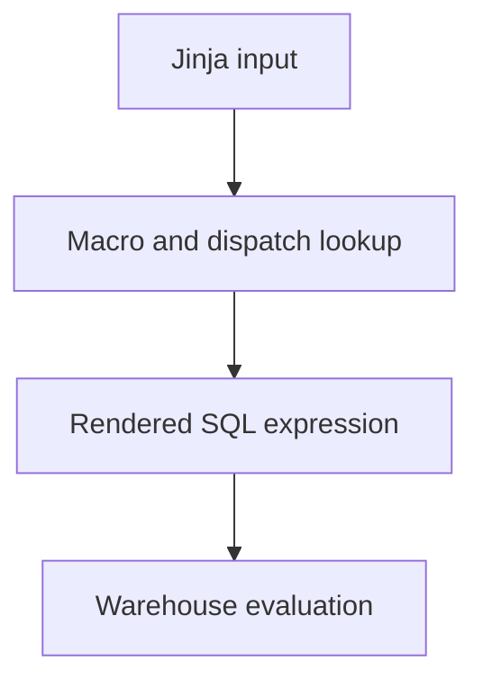

# Macros, Jinja and dispatch

Jinja renders project SQL using variables, loops and conditional logic. A macro can return a reusable SQL expression. `adapter.dispatch()` can select a platform-specific implementation when a common macro interface needs different dialects. Keep business logic legible in the compiled output.

Use `execute` guards for macros that access query results during compilation or execution. Parsing still needs to discover dependencies. A ref hidden inside an execution-only branch can require an explicit dependency declaration.



## Practice

Create `macros/cents_to_dollars.sql`.

```sql

    (cast({{ expression }} as decimal(18, 2)) / 100)

```

Call `{{ cents_to_dollars('total_cents') }} as total_dollars` in a select on the lab fact. Compile it, inspect the rendered expression, and check values for odd cents, nulls and negative amounts before using it in a metric.

## Recall

Why can a macro that renders correctly still fail when executed in a different dialect?

[Jinja and macros](https://docs.getdbt.com/docs/build/jinja-macros) · [Dispatch](https://docs.getdbt.com/reference/dbt-jinja-functions/dispatch)

| Previous | Curriculum | Next |
| --- | --- | --- |
| [← Previous lesson](0013-unit-tests-and-edge-cases.md) | [All lessons](index.md) | [Next lesson →](0015-analyses-hooks-and-user-defined-functions.md) |
