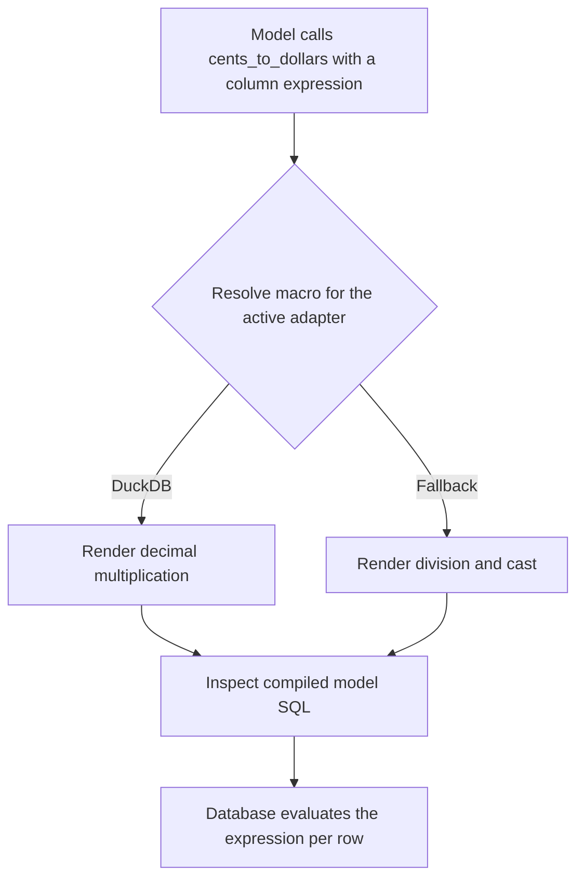

# Macros, Jinja and dispatch

dbt renders Jinja before sending SQL to the database. Use `{{ ... }}` to emit an expression and `` for statements such as `set`, `if`, and `for`. A macro under `macros/` can render a reusable SQL fragment. Passing `'total_cents'` gives the macro the text of a column expression. The database evaluates that expression for each row.

`adapter.dispatch()` gives callers a single macro name. dbt looks for an implementation such as `duckdb__cents_to_dollars` for the active adapter and falls back to `default__cents_to_dollars` when no more specific candidate is found. Package namespaces and project dispatch configuration can affect the search order. Prefer an existing cross-database dbt macro when it covers the same operation. [Dispatch](https://docs.getdbt.com/reference/dbt-jinja-functions/dispatch) · [Cross-database macros](https://docs.getdbt.com/reference/dbt-jinja-functions/cross-database-macros)



During parsing, `execute` is false. Guard access to `run_query` results with `if execute`, and keep dependencies visible to the parser. If a `ref()` only appears in an execution-only branch, declare it in a SQL comment such as `-- depends_on: {{ ref('fct_orders') }}`. Compilation can still run queries while rendering, so keep warehouse writes out of model expression macros. Check adapter behavior with both compiled SQL and actual query results. [Jinja and macros](https://docs.getdbt.com/docs/build/jinja-macros) · [execute](https://docs.getdbt.com/reference/dbt-jinja-functions/execute) · [run_query](https://docs.getdbt.com/reference/dbt-jinja-functions/run_query)

## Practice

Use the [DuckDB lab](0004-adapters-profiles-and-the-local-shop-lab.md) and the [order fact](0006-models-refs-and-project-configuration.md). Add `macros/cents_to_dollars.sql`. The DuckDB branch uses decimal multiplication because DuckDB's decimal division produces a floating-point result. The example accepts integer cents that fit the result's precision. Verify the fallback on each adapter before relying on it for currency. [DuckDB numeric types](https://duckdb.org/docs/stable/sql/data_types/numeric.html)

```sql

    {{ return(adapter.dispatch('cents_to_dollars')(expression)) }}



    cast(({{ expression }}) * 0.01 as decimal(18, 2))



    cast(cast(({{ expression }}) as decimal(18, 0)) / 100 as decimal(18, 2))

```

Add `models/order_amounts.sql`.

```sql
select order_id, {{ cents_to_dollars('total_cents') }} as total_dollars
from {{ ref('fct_orders') }}
order by order_id
```

From `shop_lab`, build the input, compile, and preview.

```bash
dbt build --profiles-dir . --select +fct_orders
dbt compile --profiles-dir . --select order_amounts
dbt show --profiles-dir . --select order_amounts
dbt show --profiles-dir . --inline "
  select total_cents, {{ cents_to_dollars('total_cents') }} as total_dollars
  from (values (101), (-101), (null)) as sample(total_cents)
"
```

In `target/compiled/shop_lab/models/order_amounts.sql`, find the multiplication by `0.01`. Expect `12.50`, `5.00`, and `17.50` for orders 1, 2, and 3. The CLI may omit trailing zeros. The inline preview should map `101` to `1.01`, `-101` to `-1.01`, and null to null.

## Recall

1. Why does the macro receive `'total_cents'` in quotes while the compiled SQL reads `total_cents` without string quotes?
2. How would you check that dispatch selected the DuckDB implementation?

??? success "Answer guidance"

    1. It is a Jinja string containing SQL text. The macro inserts that text as a column reference, which DuckDB evaluates per row.
    2. Compile the model and inspect the expression. The DuckDB branch multiplies by `0.01`. Run a value check to verify the conversion.

| Previous | Curriculum | Next |
| --- | --- | --- |
| [Previous lesson](0013-unit-tests-and-edge-cases.md) | [All lessons](index.md) | [Next lesson](0015-analyses-hooks-and-user-defined-functions.md) |
