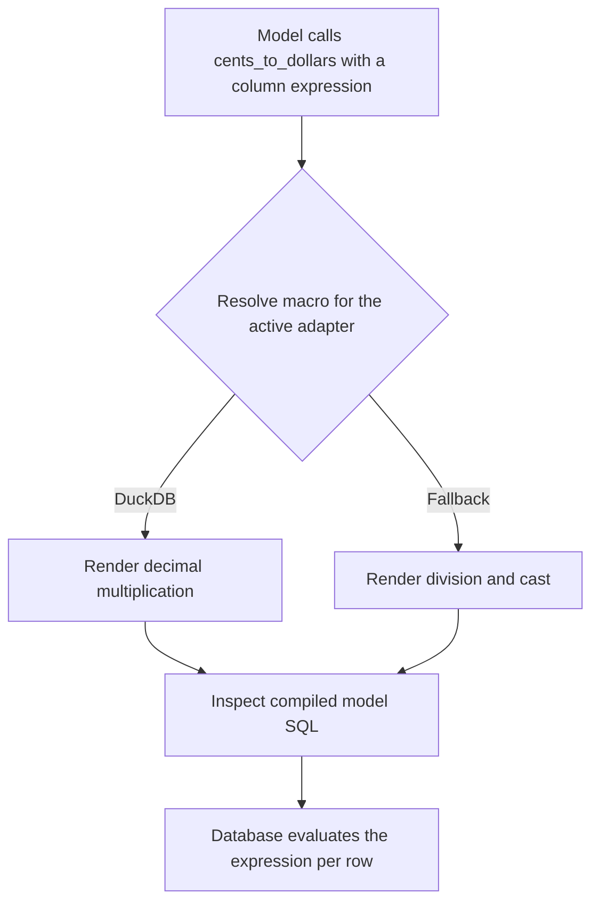

# Macros, Jinja and dispatch

dbt evaluates Jinja templates before sending rendered SQL to the warehouse. Repeating expressions like currency conversions, status pivots, or adapter-specific type casts across dozens of models creates drift; macros extract those fragments into reusable functions under `macros/`.

## Jinja delimiters and whitespace control

dbt uses three Jinja tags inside SQL and macro files:

- **`{{ ... }}` (expressions)** evaluates a value or macro call and inserts the resulting text into SQL (for example `{{ cents_to_dollars('total_cents') }}`).
- **`` (statements)** controls logic with `set`, `if`, and `for` without printing directly. Adding hyphens (``) strips surrounding newlines and spaces so compiled SQL stays readable.
- **`{# ... #}` (Jinja comments).** Ignored completely during Jinja rendering. Never rely on SQL `--` comments to disable a `{{ ref('...') }}` call, because dbt still parses and builds dependencies inside `--` comments!

`for` loops with `loop.last` let you generate repetitive SQL columns safely:

```sql

select

    sum(case when status = '{{ status }}' then total_cents else 0 end) as {{ status }}_cents,

from {{ ref('fct_orders') }}
```

## Cross-database macros and `adapter.dispatch()`



`adapter.dispatch('cents_to_dollars')` lets a model call one macro name while dbt picks the matching warehouse implementation: `<adapter>__cents_to_dollars` (such as `duckdb__cents_to_dollars`) if defined, falling back to `default__cents_to_dollars`. Package namespaces and `dispatch` `search_order` in `dbt_project.yml` control override priority. Check dbt's built-in cross-database macros (`dbt.datediff`, `dbt.dateadd`, `dbt.safe_cast`) before writing custom dispatch blocks. [Dispatch](https://docs.getdbt.com/reference/dbt-jinja-functions/dispatch) · [Cross-database macros](https://docs.getdbt.com/reference/dbt-jinja-functions/cross-database-macros)

During the parse phase, `execute` is `false`. Always wrap `run_query()` result access inside `` so parsing does not crash on empty results, and add a `-- depends_on: {{ ref('fct_orders') }}` SQL comment if a `ref()` only executes conditionally inside an `if execute` block. Keep warehouse writes out of model expression macros. [Jinja and macros](https://docs.getdbt.com/docs/build/jinja-macros) · [execute](https://docs.getdbt.com/reference/dbt-jinja-functions/execute) · [run_query](https://docs.getdbt.com/reference/dbt-jinja-functions/run_query)

**Read the template in two passes.** First substitute the macro argument: Jinja receives the string `total_cents` and emits that identifier into a SQL expression. Then evaluate one row: for order 1, DuckDB reads 1,250 from that column and the expression returns 12.50. Inspect compiled SQL for the first pass and preview rows for the second.

## Practice

### What you need

Work in [shop_lab](0004-adapters-profiles-and-the-local-shop-lab.md) with [`fct_orders`](0006-models-refs-and-project-configuration.md).

### Steps

1. Save `macros/cents_to_dollars.sql`. DuckDB divides decimals into floats, so the DuckDB branch multiplies by `0.01` to preserve exact decimal math (verify precision on each target adapter before using in production finance models). [DuckDB numeric types](https://duckdb.org/docs/stable/sql/data_types/numeric.html)

```sql

    {{ return(adapter.dispatch('cents_to_dollars')(expression)) }}



    cast(({{ expression }}) * 0.01 as decimal(18, 2))



    cast(cast(({{ expression }}) as decimal(18, 0)) / 100 as decimal(18, 2))

```

2. Create `models/order_amounts.sql`. Notice `'total_cents'` passes the column name as a Jinja string:

```sql
select order_id, {{ cents_to_dollars('total_cents') }} as total_dollars
from {{ ref('fct_orders') }}
order by order_id
```

3. Build `fct_orders`, compile `order_amounts`, preview the model, and test edge values inline:

```bash
dbt build --profiles-dir . --select +fct_orders
dbt compile --profiles-dir . --select order_amounts
dbt show --profiles-dir . --select order_amounts
dbt show --profiles-dir . --inline "
  select total_cents, {{ cents_to_dollars('total_cents') }} as total_dollars
  from (values (101), (-101), (null)) as sample(total_cents)
"
```

**Expected result.** Open `target/compiled/shop_lab/models/order_amounts.sql` and verify it rendered `* 0.01` (from `duckdb__cents_to_dollars`) around `total_cents` without quotes. `order_amounts` shows `12.50`, `5.00`, and `17.50` (trailing zeros may be omitted), and the inline check maps `101 -> 1.01`, `-101 -> -1.01`, and `null -> null`.

## Recall

1. Why does the model pass `'total_cents'` in quotes to the macro while the compiled SQL prints `total_cents` unquoted?
2. How do you confirm that `adapter.dispatch()` selected the DuckDB branch rather than `default__`?
3. You comment out a slow model dependency using `-- from {{ ref('heavy_model') }}`. Why does `dbt ls --select +my_model` still include `heavy_model`, and how do you stop dbt from registering that edge?

??? note "Answer guidance"
    1. `'total_cents'` is a Jinja string literal containing SQL text. The macro interpolates that string directly into the SQL `SELECT` expression evaluated by DuckDB for each row.
    2. Run `dbt compile` and inspect `target/compiled/` to confirm the compiled SQL multiplies by `0.01` instead of dividing by `100`, then verify values with `dbt show`.
    3. dbt evaluates Jinja inside SQL `--` comments, so `ref()` still registers a DAG edge. Wrap commented Jinja blocks in `{# ... #}` instead.

| Previous | Curriculum | Next |
| --- | --- | --- |
| [Previous lesson](0013-unit-tests-and-edge-cases.md) | [All lessons](index.md) | [Next lesson](0015-analyses-hooks-and-user-defined-functions.md) |
