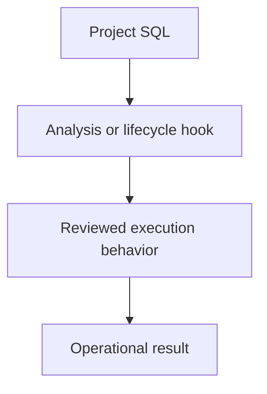

# Analyses, hooks and user-defined functions

Analyses compile reusable queries from `analyses/` without materializing them as models. Hooks execute SQL at configured lifecycle points. Operations invoke macros explicitly with `dbt run-operation`. Adapter behavior determines transaction boundaries. Keep write hooks idempotent when job retries are possible.

On supported versions and adapters, dbt also supports warehouse user-defined functions as project resources. Jinja macros render SQL before execution and a warehouse function executes inside a query. Use the appropriate function reference syntax for your version.

## Practice

Write `analyses/monthly_paid_orders.sql` with a monthly aggregate using `ref('fct_orders')`. Compile it and run the compiled select manually in the sandbox. Propose a hook for grants and explain when declarative `grants` config would be easier to maintain.

## Recall

Which of these resources changes database state when compiled alone?

[Analyses](https://docs.getdbt.com/docs/build/analyses) · [Hooks and operations](https://docs.getdbt.com/docs/build/hooks-operations) · [UDFs](https://docs.getdbt.com/docs/build/udfs)

| Previous | Curriculum | Next |
| --- | --- | --- |
| [← Previous lesson](0014-macros-jinja-and-dispatch.md) | [All lessons](index.md) | [Next lesson →](0016-selectors-graph-operators-and-named-selections.md) |
