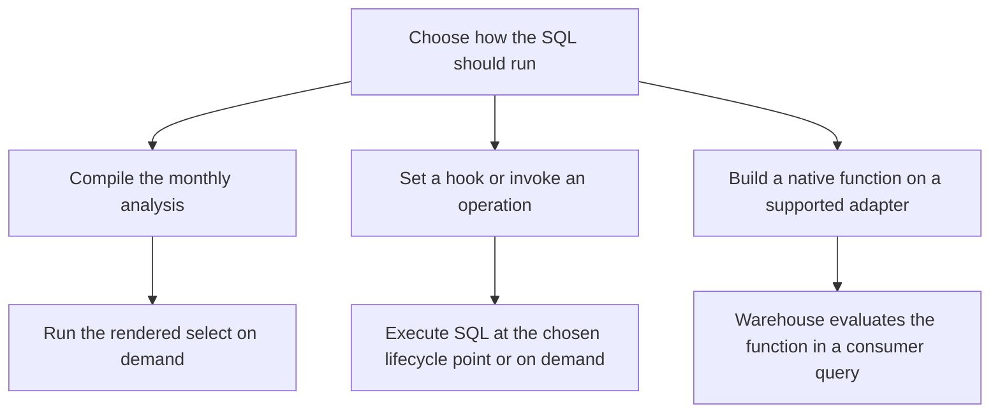

# Analyses, hooks and user-defined functions

Not every SQL asset belongs in `models/`. dbt provides separate primitives when you need an ad-hoc query that shouldn't materialize a table (`analyses/`), lifecycle or operational SQL (`hooks`, `run-operation`, `grants`), or reusable database functions (`functions/`).



## Analyses

An **analysis** is a `.sql` query under `analyses/`. It can call `{{ ref(...) }}` and Jinja so dbt tracks its upstream dependencies and resolves target relation names, while `dbt compile` renders the SQL into `target/compiled/` without creating any table or view. Run the compiled SQL manually or preview it with `dbt show`. [Analyses](https://docs.getdbt.com/docs/build/analyses)

## Hooks, operations, and grants

- **Model hooks (`pre_hook` and `post_hook`).** Run SQL immediately before or after a model materializes (with `{{ this }}` bound to that model's relation). Use declarative **`grants:`** (`grants: {select: ['bi_reader']}`) instead of writing manual `GRANT` post-hooks wherever your adapter supports grants natively. [Grants configuration](https://docs.getdbt.com/reference/resource-configs/grants)
- **Run hooks (`on-run-start` and `on-run-end`).** Configured in `dbt_project.yml` to run around commands. `on-run-end` receives `results` and `schemas` context for auditing or cleanup, though parse or connection errors skip it. Verify adapter transaction boundaries and make hook SQL idempotent. [Hooks and operations](https://docs.getdbt.com/docs/build/hooks-operations) · [Hook transactions](https://docs.getdbt.com/reference/resource-configs/pre-hook-post-hook)
- **Operations (`dbt run-operation`)** invokes any macro on demand outside a model build. Operations must execute SQL explicitly via `run_query()`.

## User-defined functions (UDFs)

On supported adapters in dbt v2 and Core v1.11+ (DuckDB is currently outside the supported list), you can manage warehouse UDFs natively under `functions/`:

- Put the function body in `functions/is_reportable_status.sql` and declare its `arguments` and `returns` data types in `functions/is_reportable_status.yml`:

```yaml
# Example schema for a supported warehouse (not executed on DuckDB)
functions:
  - name: is_reportable_status
    arguments:
      - name: status
        data_type: string
    returns:
      data_type: boolean
```

- Call `{{ function('is_reportable_status') }}(status)` inside downstream models so dbt records the dependency and builds the UDF before callers. [UDFs and adapter support](https://docs.getdbt.com/docs/build/udfs)

## Practice

### What you need

Use the original [DuckDB lab seed](0004-adapters-profiles-and-the-local-shop-lab.md) and [`fct_orders`](0006-models-refs-and-project-configuration.md).

### Steps

1. Create `analyses/monthly_paid_orders.sql` (using `updated_at` as a stand-in for a payment timestamp in this fixture):

```sql
select
    cast(date_trunc('month', updated_at) as date) as update_month,
    count(*) as paid_orders,
    sum(total_cents) as paid_total_cents
from {{ ref('fct_orders') }}
where status = 'paid'
group by 1
order by 1
```

2. Create a read-only operation macro in `macros/count_paid_orders.sql`:

```sql

    
        select count(*) from {{ ref('fct_orders') }} where status = 'paid'
    
    
    {{ log('Paid orders: ' ~ result.columns[0].values()[0], info=true) }}

```

3. Build `fct_orders`, compile and preview the analysis, and run the macro operation:

```bash
dbt build --profiles-dir . --select +fct_orders
dbt compile --profiles-dir . --select monthly_paid_orders
dbt show --profiles-dir . --select monthly_paid_orders
dbt run-operation --profiles-dir . count_paid_orders
```

**Expected result.** `target/compiled/shop_lab/analyses/monthly_paid_orders.sql` contains the resolved table name, `dbt show` returns **1 row** (`2026-01-01`, `2` paid orders, `3000` paid cents), and `dbt run-operation` logs `Paid orders: 2`.

4. **Inspect a hook.** Temporarily update `models/fct_orders.sql` to `{{ config(materialized='table', post_hook='analyze {{ this }}') }}`. Run `dbt --debug run --profiles-dir . --select fct_orders` and locate `analyze` followed by the qualified table name in the debug log right after table creation. **Restore** `models/fct_orders.sql` back to `{{ config(materialized='table') }}`. [DuckDB ANALYZE](https://duckdb.org/docs/stable/sql/statements/analyze.html)
5. **Design a UDF on paper.** Write the SQL body and YAML signature for `is_reportable_status` (`string` in, `boolean` out; `'paid' -> true`, `'pending'` and `null -> false`), write the model call `{{ function('is_reportable_status') }}(status)`, and verify which object dbt builds first.

For the UDF exercise, a possible SQL body is `coalesce(status = 'paid', false)`. Check it against each input in step 5. Without `coalesce`, a null status produces a null result. With the wrapper, the function returns a boolean for all three cases.

## Recall

1. Where does dbt write compiled analysis SQL, and how can you inspect its output rows without materializing a table?
2. Match the right mechanism to each need: granting `SELECT` privileges on every fact build, running a manual diagnostic query, and sharing a status predicate with external BI SQL queries on the same warehouse.
3. Why should `post_hook` and `on-run-end` SQL be written so it is safe to run twice, and when can `on-run-end` fail to execute at all?

??? note "Answer guidance"
    1. Compiled SQL lives under `target/compiled/` (inside `analyses/`). Run `dbt show --select monthly_paid_orders` or execute the compiled query directly against the target database.
    2. Use declarative `grants` on the model config for relation privileges (falling back to a `post_hook` only for unsupported privileges), `dbt run-operation` for the manual diagnostic, and a native warehouse UDF via `functions/` for shared BI SQL (built before callers).
    3. Retries or re-runs re-execute hooks, so non-idempotent inserts duplicate audit logs. `on-run-end` is skipped if dbt exits during parsing, profile connection failure, or an abrupt process kill.

| Previous | Curriculum | Next |
| --- | --- | --- |
| [Previous lesson](0014-macros-jinja-and-dispatch.md) | [All lessons](index.md) | [Next lesson](0016-selectors-graph-operators-and-named-selections.md) |
