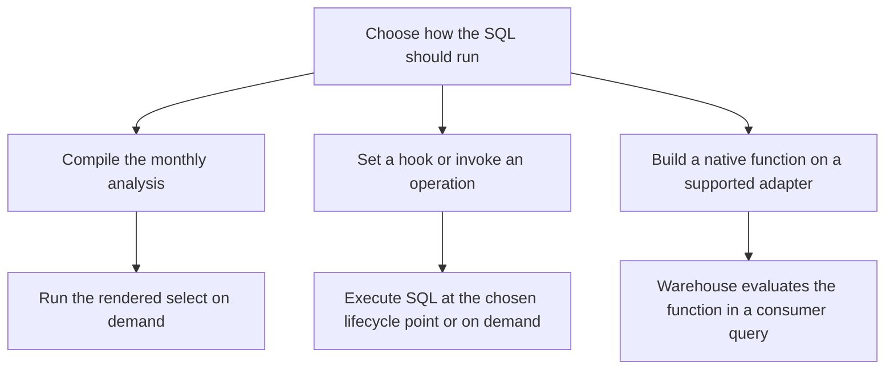

# Analyses, hooks and user-defined functions

An **analysis** is a versioned query under `analyses/`. It can use `ref()` and Jinja, so dbt can resolve its relations and track its dependencies. `dbt compile` writes the rendered query to `target/compiled/` without creating an analysis relation. Run the SQL explicitly to get results.

A **hook** executes SQL at a defined point. Resource `pre_hook` and `post_hook` run around the resource build. Project `on-run-start` and `on-run-end` hooks run around supported commands. Check the adapter's transaction behavior and make writes safe to repeat. Use `dbt run-operation` for a macro you want to invoke explicitly. An operation macro must execute its SQL, for example with `run_query`. [Analyses](https://docs.getdbt.com/docs/build/analyses) · [Hooks and operations](https://docs.getdbt.com/docs/build/hooks-operations) · [Hook transactions](https://docs.getdbt.com/reference/resource-configs/pre-hook-post-hook)

A **user-defined function (UDF)** is a callable database object. On a supported adapter, put the function body in `functions/` and define its argument and return types in an accompanying YAML file. A model call such as `{{ function('is_reportable_status') }}(status)` resolves the database function name and adds a dependency. Include the function in the build selection so dbt can deploy it before callers. The warehouse evaluates the call when the query runs. dbt's native function resource is available on supported adapters in dbt v2 and Core v1.11+. DuckDB is outside the documented adapter list for this resource. [UDFs and adapter support](https://docs.getdbt.com/docs/build/udfs)



## Practice

Use the original [DuckDB lab seed](0004-adapters-profiles-and-the-local-shop-lab.md) and the [order fact](0006-models-refs-and-project-configuration.md). Create `analyses/monthly_paid_orders.sql`. Group by the month of the order's last update for this exercise. A production revenue report would need the payment event timestamp.

```sql
select
    cast(date_trunc('month', updated_at) as date) as update_month,
    count(*) as paid_orders,
    sum(total_cents) as paid_total_cents
from {{ ref('fct_orders') }}
where status = 'paid'
group by 1
order by 1
```

Create `macros/count_paid_orders.sql` for an explicit, read-only operation.

```sql

    
        select count(*) from {{ ref('fct_orders') }} where status = 'paid'
    
    
    {{ log('Paid orders: ' ~ result.columns[0].values()[0], info=true) }}

```

From `shop_lab`, run these commands.

```bash
dbt build --profiles-dir . --select +fct_orders
dbt compile --profiles-dir . --select monthly_paid_orders
dbt show --profiles-dir . --select monthly_paid_orders
dbt run-operation --profiles-dir . count_paid_orders
```

Find the resolved fact relation in `target/compiled/shop_lab/analyses/monthly_paid_orders.sql`. The preview should show one row for `2026-01-01` with 2 paid orders and 3000 cents. The operation should log `Paid orders: 2`.

To see a hook execute, add `post_hook="analyze {{ this }}"` to the existing `config()` in `models/fct_orders.sql`. Run `dbt --debug run --profiles-dir . --select fct_orders` and look for `analyze` followed by the qualified fact name after the table is built. Restore the original config. [DuckDB ANALYZE](https://duckdb.org/docs/stable/sql/statements/analyze.html)

On paper, sketch a native `is_reportable_status` UDF with a string argument and Boolean return for a supported warehouse. Define `paid` as true and both `pending` and null as false. Write the model's `function()` call and identify which object dbt must build first.

## Recall

1. Where is the monthly query after compilation, and what command can you use to get its rows?
2. Which mechanism fits each task: grant read access on every fact build, run a manual diagnostic, and share a status rule with a BI tool that sends SQL to the same warehouse?

??? success "Answer guidance"

    1. The rendered SQL lives under `target/compiled/`. Use `dbt show --select monthly_paid_orders` or execute the compiled select against the target.
    2. Use declarative `grants` for supported relation privileges, with a post-hook available for custom SQL after the build. Use `dbt run-operation` for the diagnostic and a warehouse UDF for the BI rule. The function must exist before a consuming query can call it. [Grants configuration](https://docs.getdbt.com/reference/resource-configs/grants)

| Previous | Curriculum | Next |
| --- | --- | --- |
| [Previous lesson](0014-macros-jinja-and-dispatch.md) | [All lessons](index.md) | [Next lesson](0016-selectors-graph-operators-and-named-selections.md) |
